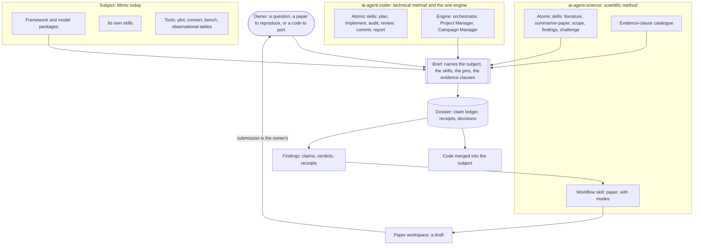
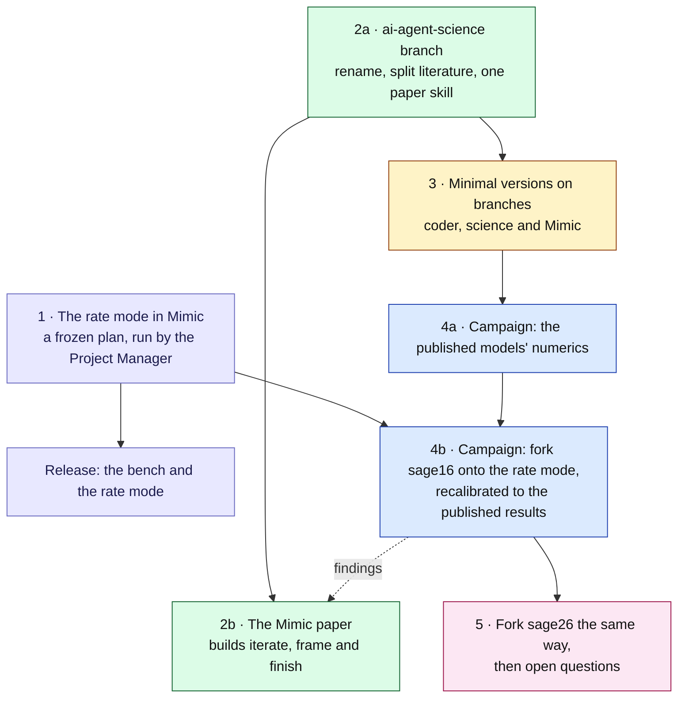

# Agentic Science Architecture

**Status:** Direction, adopted by the owner as the working direction on 2026-11-12 (revision 2). It is a direction and not a frozen plan: each stage below is chosen for what it teaches, and it may supersede every other plan in `docs/dev/` depending on how the shakedowns go. Nothing in any repository has been restructured yet.

**Scope:** The architecture for campaign-style autonomous model building and scientific exploration across three repositories (Mimic, ai-agent-coder, and sci-paper, to become ai-agent-science): what each home owns, which tools exist and where they live, what a science campaign run is, and the ordered road from today to the first shakedowns. It reaches beyond Mimic and lives here because Mimic is the first subject and `docs/dev/` is where its owner plans; it moves when a second subject exists.

**Design guides:** ai-agent-coder's `docs/VISION.md` for the toolkits and the engine. Mimic's [`docs/VISION.md`](../VISION.md) and [`docs/STYLE-GUIDE.md`](../STYLE-GUIDE.md) bound what may live in Mimic. This document revises the direction of [`MIMIC-SCIENCE-CAMPAIGNS-MAP.md`](MIMIC-SCIENCE-CAMPAIGNS-MAP.md) and wins where the two differ; the map stays until the consolidation in [stage 3](#the-road).

---

## Summary

**Two toolkits hold method, and a subject is what they work on.** ai-agent-coder holds technical method and the one orchestration engine. ai-agent-science holds scientific method: literature, scoping, findings, challenge and paper writing. Mimic is the subject, and another model framework can stand in its place. A binding (a person at the keyboard, a paper workspace, or a campaign brief) picks the parts a piece of work needs.

Six points define the direction:

1. **Mimic is a subject, not a third toolkit.** It describes only itself.
2. **There is one engine.** Campaign mode (Mode C) in ai-agent-coder runs every campaign. There is no science manager.
3. **Dependencies run one way.** The engine names no domain, the science toolkit names no subject, and only a brief names all the parts.
4. **The standard of evidence is a set of clauses in the brief.** The owner writes them for each question. Nothing is called a floor unless code enforces it.
5. **The Campaign Manager stands in the author's seat.** Where a science skill says the author decides or verifies, in a campaign that is the Campaign Manager, acting under the brief. A child session writes, the Campaign Manager judges, and anything that leaves the machine stays the owner's.
6. **Build a minimal version, run a shakedown, apply the lessons, repeat.** Each repository takes a branch that looks like the intended shape, and shakedowns find the gaps and the friction until the problems drop into the noise.
7. **The published models are the proving ground.** `sage16` and `sage26` stay as published. Each is forked onto the coupled rate formulation (the first fork has the working name `sage16rate`) and recalibrated to reproduce the published results. The forks are not new models for publication: they exist to develop the tools and the workflow, and for the owner's scientific curiosity. The first fork is the first science campaign, as the SAGE26 import was the first real test of campaign mode.

**What is next:** a frozen implementation plan for the coupled rate formulation's processing mode, run by the Project Manager in Mimic ([stage 1](#the-road)).

### Terms

| Term | Meaning |
|---|---|
| Subject | The code a piece of work is done on. Mimic today. |
| Engine | The orchestrator, Project Manager and Campaign Manager in ai-agent-coder. |
| Brief | The owner-approved contract a campaign runs against, frozen by its digest. |
| Dossier | A campaign's working record, a git repository of its own: brief, work, evidence, decisions, receipts. |
| Node | One unit of campaign work: a change, a measurement (evidence), or a read-only task. |
| Receipt | The record a measurement leaves: product commit, instrument version, configuration, command, outcome, artefact hashes. |
| Binding | What ties general skills to one piece of work: the keyboard, a paper workspace, or a brief. |
| Evidence clause | A rule in a brief stating what a claim must rest on. Chosen by the owner for the question. |
| Claim ledger | The dossier's list of claims, each with its declared test and its verdict. |
| Verdict | The outcome of a question: supported, refuted, or unresolved with reasons. |
| Shakedown | A campaign run to find gaps and friction in the machinery. |
| Seam | The boundary between the general part of a tool and the part specific to one subject. |

---

## The Architecture

### The homes

| Home | Kind | Owns | Never holds |
|---|---|---|---|
| **ai-agent-coder** | Method | The atomic technical skills (plan, implement, audit, review, commit, report); the engine; the mechanical floor; the brief, dossier and receipt formats | Any domain: no science, no subject |
| **ai-agent-science** (sci-paper today) | Method | The science skills; the catalogue of evidence clauses; the literature notebook format | Any subject; any orchestration |
| **Mimic** | Subject | The framework and model packages; its own skills (facts about itself); its tools `plot/`, `convert/` and `bench/`; its observational tables | Campaign state; literature; general method |
| **Campaign dossiers** | Records | One repository per campaign under `campaigns/`, outside every product | Method; anything a later campaign should not read |
| **Paper workspaces** | Records | One repository per paper: the manuscript and its memory | — |

The records are not a third kind of toolkit. They hold state and no method, and nothing depends on them.

### The dependency rule

Mimic's first principle is a physics-agnostic core that never names a physics module. The same rule applies one level up.

- **ai-agent-coder names no domain.** The engine reads a brief and runs nodes. It owns the general idea that a target can be a question with a verdict, because that serves any investigation.
- **ai-agent-science names no subject.** It may read and write the engine's files (a brief, a receipt), because they are plain files.
- **A subject describes only itself.** Mimic's skills hold Mimic facts. A search of `.agents/skills/` finds no reference to another repository today.
- **Only a binding names all the parts.** A brief lists the subject, the skills its nodes load, the pinned inputs and the standard of done.

Nothing in Mimic's `docs/VISION.md` needs to change. Literature, campaign rules and general instruments stay out of Mimic for the same reason physics stays out of the core.

### The shape

### The tools, and where each lives

| Tool | Job | Home | State |
|---|---|---|---|
| Atomic technical skills | Plan, implement, audit, review, commit, report | ai-agent-coder | Built |
| Project Manager (Mode B) | Supervise one frozen plan under the mechanical floor | ai-agent-coder | Built |
| Campaign Manager (Mode C) | Plan and run many nodes against a brief; judge; merge | ai-agent-coder | Built and proven on the SAGE26 import (merged to its `main` on 2026-11-08) |
| `literature` | Search, follow citations, mine values with their exact source | ai-agent-science | Exists as `paper-lit`, built on NASA ADS and tied to a paper workspace; to be split from that binding |
| `summarise-paper` | Structured summary of one paper | ai-agent-science | Exists in the owner's home skills, with a near-copy in two summary applications; to be one |
| `paper` | One workflow skill with modes: start, draft, voice, iterate, frame, finish | ai-agent-science | Start, draft and voice exist as separate skills; iterate, frame and finish are unbuilt |
| `scope` | Turn a question or a paper into a draft brief | ai-agent-science | New; thin at first |
| `findings` | Write claims, verdicts and receipts as the notes a paper starts from | ai-agent-science | New; thin at first |
| `challenge` | An independent attempt to refute a headline claim from the artefacts | ai-agent-science | New; a task-node prompt at first |
| Evidence-clause catalogue | The known failures of agent-run science, each with the clause that guards against it | ai-agent-science | New; seeded from the failure table of the campaigns map |
| Mimic and its packages | Run specified physics deterministically, with provenance | Mimic | Built |
| `mimic-*` skills | Facts about Mimic, loaded by any agent working on it | Mimic | Built, sixteen |
| The bench | Turn parameters into observables with provenance; host the methods that use them | Mimic, `bench/mimic-bench/` | Built; its home is reviewed in stage 3 |
| Observational tables | One source per observation, read by the figures and the bench | Mimic | Missing: the figures hold literals and the bench holds a copy |
| The published models | `sage16` and `sage26`, housed as published: the references the first campaigns are judged against | Mimic, `models/` | Built |

### What works today

| Configuration | Bound by | Use | Works today |
|---|---|---|---|
| ai-agent-coder alone | Keyboard or brief | Any software project | Yes |
| ai-agent-science alone | Keyboard or paper workspace | A literature question; a summary; writing a paper | Partly: literature assumes a paper workspace |
| Mimic alone | Keyboard | Running and extending a model | Yes |
| Coder and Mimic | Brief | A software campaign on Mimic (the SAGE26 import) | Yes |
| Science and Mimic | Keyboard, then paper workspace | An experiment, then the paper about it | Partly |
| Coder and science | Brief | A science campaign on a code that is not Mimic | Never exercised |
| All three | Brief | A science campaign on Mimic | The goal |

---

## A Science Campaign Run

A science campaign is an ordinary Mode C campaign whose targets are questions. One brief gives one dossier and one integration branch on the subject, and the run ends with a verdict on every question, the receipts behind each verdict, any code the questions needed, and a retrospective. The engine's contract (`skills/project-manager/references/campaign-mode.md` in ai-agent-coder) is unchanged except where [What the engine gains](#what-the-engine-gains) says so.

### The brief

The brief keeps its existing sections. Science is written into them as conventions.

| Brief section | What a science brief puts there |
|---|---|
| Goal | The question, in one paragraph |
| Targets and tolerances | Each target reads "claim X is adjudicated to standard S". Supported, refuted and unresolved-with-reasons all close it |
| Evidence clauses | The clauses the owner selects from the catalogue for this question (see [The standard of evidence](#the-standard-of-evidence)) |
| Allowed and protected paths | Where a build may land; the instruments and tables no node may change |
| Exclusions | Held-out data and any answer key, as paths removed mechanically from node worktrees and denied to the sandbox |
| Reserved decisions | What only the owner decides: the constraint set and its budgets, anything that narrows a claim, promotion into shared knowledge |
| Budgets and stopping rules | Per-target and campaign-wide, with a rule for stopping an unproductive line |
| Sandbox | The pinned policy, including the literature hosts a node may reach |
| Pinned inputs | Owner scripts, experiment templates and science skills, each copied into the dossier and pinned by digest |
| Author policy | Which of the paper skill's author questions the Campaign Manager answers itself, and which are reserved |

### Activities and node kinds

The three node kinds are unchanged. Each science activity is one of them.

| Activity | Node kind | Notes |
|---|---|---|
| Literature | Evidence | It executes queries, so it cannot be a read-only task. Its report is the survey; its receipt hashes the query log and the records retrieved |
| Build a model variant, an analysis tool or an instrument | Change | An instrument counts only after it passes a known-good control and fails a known-bad one |
| Experiment | Evidence, from an owner-approved template | The template is reviewed once and each instance records its substitution diff, which the contract already allows. An exploratory instance is labelled and is never cited in a verdict |
| Diagnosis, plan review, challenge, audit | Task | Read-only, and for a challenge or the audit on a different model from the Campaign Manager's |
| Write-up of findings | Evidence | A report in the dossier, written from the ledger and the receipts |

### Verdicts, stopping and acceptance

- **The ledger is the only place a claim changes status,** and only on the test declared for it.
- **A refuted claim is an answer, not a failed attempt.** The contract's rule that two failed attempts at a target is a question for the owner applies when the declared test could not be run to a verdict.
- **The campaign ends** when every question has a verdict, a stopping rule fires, or a budget is exhausted.
- **Acceptance is the existing rule:** a final evidence node that re-runs the confirming tests from the pinned inputs, an independent audit on a different model that checks each evidence clause against the artefacts, and the owner's sign-off.
- **The retrospective** records owner attention, questions asked, stop causes, plan versions per node, and spend and wall time. The contract already requires all of it, and it is the shakedowns' main product.

### The Campaign Manager in the author's seat

sci-paper is built on one rule: the author is the sole verifier, and the tool never certifies a number, method or citation. In a campaign the Campaign Manager holds that seat, under the brief's authority. The mapping is clean because of two rules the engine already has:

- **The Campaign Manager never implements.** A child session drafts, and the Campaign Manager judges the draft against the dossier's evidence. The author and the writer are different seats, as they are at the keyboard.
- **The Campaign Manager never causes an external side effect.** Submission, like a push, is the owner's.

sci-paper's skills ask the author a question at about ten points. Each needs a recorded default so an unattended caller can proceed, and the brief's author policy names the ones that stay reserved.

### The paper is its own run

A campaign has one product repository, and a paper workspace is a repository of its own. So the paper is a second binding, not a node inside the science campaign:

1. The science campaign ends in findings: the ledger, the receipts and a findings report.
2. The paper is then written from those findings, bound to its workspace: at the keyboard with the owner as author, or as a campaign whose product repository is the paper workspace and whose pinned input is the findings dossier, with the Campaign Manager as author.

This keeps the engine unchanged. Whether a paper node inside the science campaign is worth an engine change is a question for the shakedowns.

### Literature and outside access

Outside access is the owner's choice in the sandbox policy, which lists the hosts a child may reach and is pinned in the brief. Open-ended science needs it, so it is a normal part of a science brief and not an exception. What is left to settle is small:

- **Which hosts.** NASA ADS first. Candidates beside it: arXiv, Semantic Scholar, Crossref, OpenAlex and the publishers' landing pages.
- **How a node gets its token.** The policy can grant read access to one key file, as the SAGE26 campaign did for its model keys.
- **Egress is also a way out.** The sandbox filters by host and port only, and reads are allowed by default. Anything a node can read can leave through any allowed host, so held-out data and answer keys must be unreadable, not merely unmentioned.

### What the engine gains

Each starts as a convention in a brief and becomes contract text or code only when a second campaign needs the same thing.

| Need | First form |
|---|---|
| A question with a verdict as a target | A target convention and a ledger file in the dossier |
| Cheap experiments | The existing template rule, with one template approved in the brief |
| Science skills in a node | The skill copied into the dossier and pinned by digest, as owner scripts are. The engine embeds skills only from its own repository |
| Spend | A manual proxy chosen before the first shakedown: wall time and per-seat usage |
| Exploratory against confirming runs | A label on the node and a clause in the brief |

### A run, end to end

An illustration, using the large campaign of [stage 4](#the-road): the fork of `sage16` onto the rate mode.

1. **Scope.** The owner and `scope` turn the goal into a brief with four questions. How far is the published `sage16` from converged, and how much does module order move it? Does the fork converge, and is it independent of order? Is there a parameter set with which it reproduces the published results, to a standard the Campaign Manager defines? Which parameters moved, and by how much?
2. **Reconcile.** The Campaign Manager runs preflight against the brief's digest and opens the ledger.
3. **Literature.** One evidence node surveys how the published model was calibrated and what is known about time-step convergence in semi-analytic models.
4. **Measure the published model.** Evidence nodes from the template measure the noise floor, then the time-step ladder and the legal module orderings.
5. **Build.** Change nodes write the classified prescriptions as declared transfers in the fork, a new package beside `sage16`. Instruments (a convergence analysis, a model-to-model comparison, a way to locate a best point) are built with a known-good and a known-bad control each.
6. **Test the build.** Evidence nodes show the convergence rate and that permuting the rate terms changes nothing.
7. **Define the standard, then recalibrate.** The Campaign Manager decides what reproducing the published results means (which statistics are fitted, which are held back, at which redshifts, to what tolerance) and commits that to the ledger with its reasons before any run of record. The search then runs on the fitted statistics, and the held-back ones are evaluated once, at the end.
8. **Challenge.** A task node on a different model tries to refute the headline claim from the captured files.
9. **Findings and acceptance.** The ledger closes with a verdict on each question, the confirming tests re-run from the pins, the audit checks the clauses, and the owner signs off.
10. **Paper.** A separate run, bound to the Mimic paper's workspace, takes the findings.

---

## The Standard of Evidence

The standard of evidence for a campaign is a set of clauses in its brief. The owner writes or selects them for the question in hand, so they fit that question and are approved by a person each time. ai-agent-coder's word *floor* is kept for what code enforces: the changed-file surface, commit ancestry, the plan digest and approval flags.

ai-agent-science keeps the catalogue the owner selects from. Each entry names a failure and the clause that guards against it. The catalogue opens with the failures the campaigns map already lists:

| Failure | Clause |
|---|---|
| The campaign tunes the test until it passes | The claim, its test and its tolerance are committed to the ledger before the run that decides it; the spec that defines the test is pinned by digest |
| A numerical artefact is reported as physics | Every physical claim first survives refinement in the time step, and in resolution and volume where they apply |
| A well-sourced narrative whose sources say something else | Every cited value carries its exact location, and the audit reads the source |
| Missing data is quietly replaced | A statistic with no mined or measured value is a marked gap |
| Held-out data leaks | Held-out data is unreadable until the test is frozen |
| A number cannot be traced | Every model-produced number in the findings resolves to a receipt |
| An instrument is trusted untested | Every instrument has passed a known-good and a known-bad control |
| A result is invented under pressure to finish | A refuted or unresolved verdict closes a target |

Who checks a clause is stated with it. The Campaign Manager applies the clauses as it works, and the independent audit checks them at acceptance, because the seat that produced the evidence should not be the only one that certifies it. A clause that shakedowns show is breached despite both becomes a candidate for code in the engine.

Two facts to design around:

- **The bench allows a test to change after its capture.** Its request hash leaves out the criteria, the discrepancy and the implausibility settings by design, so a capture can be re-analysed. The first clause above therefore needs the whole spec pinned in the ledger.
- **A value mined from a paper is traced but not verified.** No receipt can check it. The documents say so.

---

## The Road

Five stages. Each ends in something used. The order is the owner's, with the adjustments recorded under [Decisions](#decisions).

| Stage | Work | Where | Done when |
|---|---|---|---|
| **1** | **The rate mode.** A frozen implementation plan derived from [the coupled-rate brief](MIMIC-COUPLED-RATE-FORMULATION-PLAN.md), run by the Project Manager as an ordinary Mode B plan: the rate-term processing mode, the assembly of declared transfers, the integrator, the conservation ledger and their metadata. It is proven on a model-neutral fixture with known solutions, as every piece of core infrastructure is, and not on `sage16`'s physics | Mimic, the core | Conservation is machine-checked; the fixture shows the expected convergence rate; permuting rate terms gives bit-identical output; every existing package and gate is green with the mode unused; released with the bench by the backlog's recipe |
| **2a** | **Open the ai-agent-science branch.** Rename; `literature` split from the paper binding; the paper skills folded into one `paper` skill with modes; a default recorded for every author question | sci-paper, on a branch | The existing modes work as before from the new shape, alone and from a paper workspace |
| **2b** | **The Mimic paper.** It is the first paper and the vehicle for the unbuilt modes: iterate, frame and finish are built by writing it. The owner starts it now with the modes that exist: the method and the introduction, with literature searches and the repository's history and releases used to map the features worth the paper's weight. What it reports is decided by that work | sci-paper branch and the paper's workspace | The paper goes to submission, written with the skill |
| **3** | **Minimal versions on branches.** Coder: the verdict convention, an investigation brief template, skills pinned by copy. Science: thin `scope`, `findings` and `challenge`, and the clause catalogue. Mimic: one observational table read by a figure and the bench, the bench's home decided, `docs/dev/` consolidated | One branch per repository | A science brief can be written and preflighted end to end |
| **4a** | **Campaign: the numerics of the published models.** `sage16` and `sage26` as shipped: the noise floor, time-step refinement, the legal module orderings. It is small and needs no new core, so it is the shakedown before the large campaign | A dossier; Mimic unchanged | Every question has a verdict; the retrospective is written and its lessons applied to the toolkits |
| **4b** | **Campaign: fork `sage16` onto the rate mode.** A new package beside the published one (working name `sage16rate`); the classified prescriptions as declared transfers; convergence and order-independence shown; recalibration to reproduce the published results, to a standard the Campaign Manager defines and records first, with some statistics held back for one check; the parameter shifts attributed | A dossier; a new package under `models/` | A verdict on whether, and how closely, the published results are reproduced; the retrospective written and the toolkits updated from it |
| **5** | **Fork `sage26` the same way,** then a paper the owner wants reproduced, then an open question | The dossiers | — |

Notes on the order:

- **Stages 1 and 2 start now and share nothing.** One is a plan in Mimic's core, the other a branch in sci-paper. The owner's attention decides how far they overlap.
- **The published models make a good first campaign because they give a reference without parity.** The SAGE26 import was gated bit for bit. Here the target is the published model's own population results on the same trees, so there is a clear standard, and it has to be met through declared statistics, tolerances and verdicts, which is the new machinery. No observational constraint set or discrepancy budget is needed, because the comparison is model against model.
- **Nobody holds the answer.** Whether a converged, order-independent `sage16` can reproduce its published results, and how far its parameters must move, is unknown. So there is no key to hide, and "it cannot, for these statistics" is a real result. The brief says "if possible" in so many words.
- **The standard of "reproduces" is the Campaign Manager's to define.** Real science questions offer targets far vaguer than this one, and the owner settles them from experience. Part of the purpose of these tools is to find out how far that experience and intuition translate, so the brief delegates this decision on purpose. Three guards keep the experiment honest without narrowing the judgement. The definition is recorded before the runs it governs. Once recorded it is not loosened: a change is a recorded decision with its reasons. And the owner writes their own answer beforehand and keeps it outside every repository, so the two can be compared at acceptance. That comparison is the measurement.
- **4a comes before 4b** for the reason two shakedowns came before the import: a small campaign finds the basic friction cheaply. It does not need the rate mode, so it can run as soon as stage 3 exists, and its measurement is the baseline 4b's attribution needs.
- **The published packages are not changed.** A fork carries the rate formulation. Mimic's standing rule already sends corrected numerics to a new package, the rate mode works in double precision while properties are declared per package, and the campaign needs the published package intact as its reference.
- **The forks are for us.** They are not written up as new published models. What the Mimic paper takes from stage 4, if anything, is settled by writing the paper. One point to weigh there: the coupled-rate brief records that a reviewer who asks how converged the model is cannot presently be answered, and 4a's measurement is that answer.

### What stage 1's plan is derived from

[The coupled-rate brief](MIMIC-COUPLED-RATE-FORMULATION-PLAN.md) was revised on 2026-11-12 for this order and now governs stage 1 alone. It was first written for a different one: measure the defect by hand, then build. What the revision settled:

- **The solver is chosen without a stiffness measurement.** Writing `sage16`'s rate laws ahead of the campaign would do part of the campaign's build. The brief asks for an explicit positivity-preserving scheme first and a first-order implicit one behind the same interface, and has the core record the stiffness figures a measurement would have given, so campaign 4b reads them from its own output.
- **Its First Work moved.** The measurement of order dependence and of the splitting residual is campaign 4a. The throwaway monolithic integrator is no longer needed as a reference, because 4b compares against the rate mode itself.
- **Its recalibration target changed.** The earlier brief said the new package would not reproduce `sage16` and should not. The target is now to reproduce the published population results if that is possible. Galaxy-by-galaxy parity is still not a goal.
- **Its package name is settled in pattern.** The fork is `sage16rate`, and `sage26` follows the same pattern. The earlier brief planned a rename once the package was recalibrated, because it would then be a distinct model. That concern falls away: the fork's target is the published model's own results, and it is not published as a model in its own right.
- **Its contracts are now precise enough to plan from:** what a rate law may be, how phases, substeps and jumps fit together, which kinds of state exist, what the ledger checks, and the fixture problems the mode is proven on.

The two decisions that brief left to the owner, whether the implicit scheme ships in stage 1 and the user-facing names, were taken on 2026-11-12, and the plan is written: [`MIMIC-COUPLED-RATE-IMPLEMENTATION-PLAN.md`](MIMIC-COUPLED-RATE-IMPLEMENTATION-PLAN.md).

### Campaigns as shakedowns

Every early campaign is also a shakedown. It exists to answer its question and to find gaps and friction, to fix them, and to notice what already runs smoothly so that it stays simple. What a campaign will find is not always visible beforehand, which is why the method is a minimal version followed by iteration and not a complete design.

Each campaign declares, before it runs, a short list of what is being watched in the machinery, and ends in the retrospective the contract requires. Lessons become brief conventions first, and contract text or code only on a second need, which is how ai-agent-coder's record of deferred machinery already works. The SAGE26 import changed ai-agent-coder this way, and stage 4 should change both toolkits.

Design lessons already in hand, from the review of revision 1:

- **An answer the campaign can read tests friction and not judgement.** The `sage16` time-step result is in a commit message on `main`, in this directory, in `archive/` and in a loaded skill. That is acceptable in 4a, whose purpose is friction and a baseline. A question that is meant to grade judgement needs a key the owner holds outside every repository and a history-free export of the subject, because exclusions do not reach git history.
- **A removed module is recalled, not rediscovered.** `sage16` without AGN feedback is diagnosed in one line of `mimic-sam-reference`, in `models/sage26`, and in any model's training. A test of diagnosis needs a prescription that is nowhere published.
- **Original SAGE tests an adapter and nothing more.** It is `sage16`'s ancestor, its substep count is a compile-time constant and its call order is fixed in code.
- **Some failures need provoking.** No ordinary question tests whether a campaign reports "unresolved" when that is the right answer, or flags a missing statistic. Planted controls on an existing rig are cheap: an unanswerable claim, a numerical artefact, a table with a gap.
- **One run shows that something can happen, not how often.** Repeat a cheap campaign across seats before drawing a rate from it.

Smaller shakedowns, to slot in where a gap needs one:

| Shakedown | What it exercises |
|---|---|
| Planted controls on 4a's rig | The failures no ordinary question provokes |
| Literature inside a campaign | The sandbox hosts, the token, literature as an evidence node |
| A paper written from a findings dossier | The Campaign Manager as author |
| The same brief on original SAGE | The bench seam |
| A hidden variant with mock data: diagnose, then build | Diagnosis with no reference code |

What 4b is known to need that does not exist yet:

- **A way to locate a best point.** The bench holds history matching, which rules regions out. Calibration is an optimiser's job, and the family's calibrator (SAGEswarm) is outside this repository. The brief decides whether the campaign wraps a library optimiser as the bench's second method or uses the calibrator.
- **A constraint table made from a model run.** The target is the published model's captured statistics, pinned by digest, in place of a table mined from a paper.
- **A model-to-model tolerance.** On the same trees there is no sample variance, so the floor is the count roughness that 4a measures.

---

## Decisions

**Taken by the owner (2026-11-12):**

1. The standard of evidence is brief clauses, written for each question. There is no science floor.
2. In a campaign the Campaign Manager holds the author's seat for the science skills.
3. The method is a minimal version, a shakedown, lessons, and iteration.
4. Each repository is restructured on a branch.
5. Outside access for literature is granted through the sandbox policy.
6. The Mimic paper is the first paper and the vehicle for the paper skill. The converter paper that sci-paper's plan names as its vehicle is on hold.
7. `sage16` and `sage26` are published models and stay so. Each is forked onto the rate formulation as a new package (`sage16rate` first), and parameters are sought that reproduce the published results, if that is possible. The forks are not new models for publication: they are for the owner's own use, for developing the tools and the workflow, and for scientific curiosity.
8. The rate mode is built from an ordinary implementation plan under the Project Manager. Converting `sage16`, measuring convergence and recalibrating are campaign work, and a test of the new machinery in the way the SAGE26 import tested campaign mode. `sage26` is the next such opportunity.
9. What "reproduces the published results" means is delegated to the Campaign Manager by the brief, to see how far the owner's experience and intuition translate. The brief states the goal; the Campaign Manager defines the standard.
10. The Mimic paper's content is decided by writing it. The owner starts on the method and the introduction, and uses the literature skill, the git history and the releases to map the most interesting and distinctive features.

**Adjustments made in writing this, for the owner to confirm or reverse:**

1. **A small campaign on the published models' numerics (4a) comes before the fork campaign (4b).**
2. **The restructure of sci-paper comes ahead of building the unbuilt modes,** so they are built once.
3. **The paper is its own run,** bound to its workspace, and not a node of the science campaign.
4. **Stage 1 is proven on a fixture, not on `sage16`.** The core then stays free of any model, and the campaign's build is not done in advance.
5. **The Campaign Manager's standard is recorded before the runs it governs and is not loosened afterwards.** The engine's contract makes every target and tolerance the owner's, so the brief must grant this permission in so many words; the two rules then keep the delegation from becoming a test tuned until it passes.
6. **The owner writes their own standard first and keeps it outside every repository,** as the answer key for this one question.
7. **The paper starts before the sci-paper restructure.** The existing modes (start, draft, literature, voice) are enough for the method, the introduction and the feature map. The restructure is needed before the unbuilt modes are built, not before the paper begins.

**Open:**

1. **The name.** `ai-agent-science` describes a toolkit. `ai-agent-scientist` matches `ai-agent-coder` and implies an autonomy the design withholds. Recommended: `ai-agent-science`.
2. **Where the bench lives.** Decided on 2026-11-12 as inside Mimic, with its own trigger for reopening: a second simulator becoming a named consumer. Stage 3 reviews it on a Mimic branch. Three options: stay; a general core as its own library with an adapter per subject; move into ai-agent-science. Recommended: stay, and put new bench work behind the adapter seam so that the second option is a relocation. The third puts numerical dependencies and domain data into a method toolkit.
3. **One observational table source.** The emulator plan requires that constraint provenance does not fork. The figures hold literals and the bench holds a copy, so the single source is owed whatever the bench's home. Campaign 4b does not wait on it.
4. **Retiring the model-builder plan.** Its re-review has been due since August. Recommended: retire it in stage 3 with its eight requirements carried, word for word, as the clauses of a build brief.
5. **Where this document lives** once a second subject exists.

---

## What Happens to `docs/dev`

Deferred to stage 3. Until then only the pathway and the status lines of the affected plans point here. The intended outcome, for the consolidation to check against the files as they then stand:

| Document | Action |
|---|---|
| `AGENTIC-SCIENCE-ARCHITECTURE.md` | This document. It becomes the programme plan: the stages, the shakedowns and what each promoted |
| `MIMIC-DEVELOPMENT-PATHWAY.md` | **Revise** into Mimic's roadmap as a subject. Keep the standing constraints, the data paths, the hold-out discipline, the reasons for decisions taken, and the changelog |
| `MIMIC-SCIENCE-CAMPAIGNS-MAP.md` | **Supersede, then archive.** Its failure table seeds the clause catalogue; its judging toolkit and its account of what replaces parity move here or to ai-agent-science |
| `MIMIC-MODEL-BUILDER-PLAN.md` | **Retire, then archive** (open decision 6), with its requirements, gate stack, open problems and fit-for-purpose questions carried as build-brief clauses |
| `MIMIC-EMULATOR-PLAN.md` | **Revise and rename** as the bench plan: the two settled decisions, the promotion record, the gate, the carried requirements, and the adapter seam |
| `MIMIC-COUPLED-RATE-FORMULATION-PLAN.md` | **Keep.** Stage 1 is its core; stage 4 is its conversion and recalibration |
| `SAGE16-PRESCRIPTION-CLASSIFICATION.md`, `SAGE26-PRESCRIPTION-CLASSIFICATION.md` | **Keep.** The settled inputs of the stage 4 and 5 conversions |
| `MIMIC-EMBEDDED-ENGINE-PLAN.md` | **Keep as it is.** Unscheduled; the coupled-rate plan sequences it after itself |
| `MIMIC-BACKLOG.md` | **Revise** to absorb the pathway's residual lists and open candidates |
| `MIMIC-PERFORMANCE-REFERENCE.md`, `BENCHMARK-SAGE16-MINI-MILLENNIUM.md`, `OPTIMISATION-SPECTRUM.md` | **Keep.** The spectrum still holds the open Tier B and C options |

Retired plans go to the gitignored `archive/dev-plans/`, with links repaired in the same change, because `make check-docs` scans this directory.

---

## How This Was Produced

Revision 1 was written on 2026-11-12 as a note outside the repository, after three independent reviews. Revision 2, this document, followed a critical evaluation the same day: a fact-check of revision 1's statements against the four repositories, an architecture review, an experimental-design review, and a pathway designed blind before its author read revision 1. The reviews ran on different models and their main citations were checked against the files. The owner's responses to that evaluation, over two rounds, are recorded under [Decisions](#decisions). Nothing here was tested by running Mimic or a campaign.
