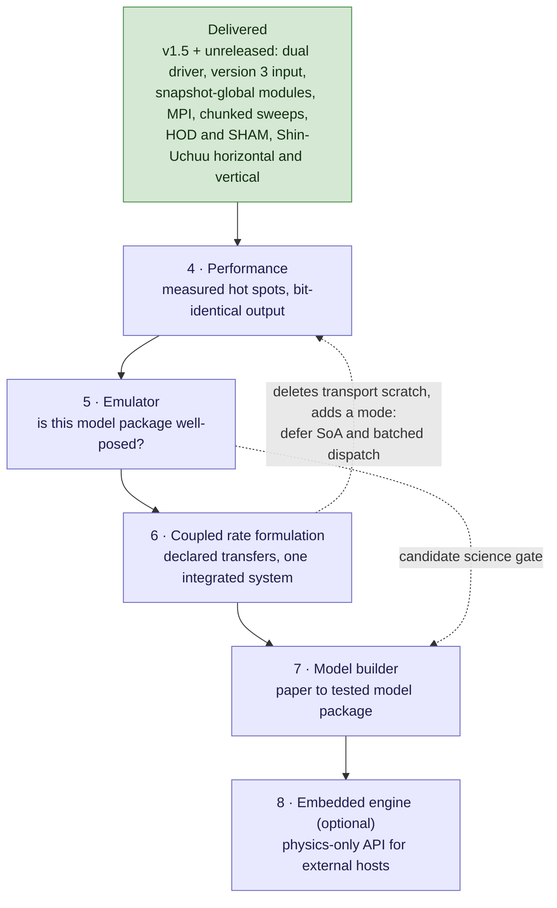

# Mimic Development Pathway

**Status:** Active planning index for `docs/dev/` · last revised 2026-10-20.
**Scope:** The work still to do, in order, and the document that owns each piece. Finished work leaves `docs/dev/` for `archive/dev-plans/` and is summarised in one line under [Changelog](#changelog).

The architectural direction is governed by [`docs/VISION.md`](../VISION.md): a physics-agnostic core with runtime-configurable physics modules, metadata as structural truth, explicit validation, bounded memory, and reproducible output provenance. Durable facts about what Mimic is and does live in the guides, the package READMEs, the converter manual and format specification, the skills and the code; nothing outside `docs/dev/` cites anything in it.

---

## Where Things Stand

Roadmap steps 1 to 3 are complete (Shin-Uchuu end to end, snapshot-global modules, distributed snapshot operations), and so are the work that grew around them: the HOD and SHAM packages, chunked slab streaming, the Shin-Uchuu version 3 datasets and the cut, vertical Shin-Uchuu. The last release is v1.5 (2026-10-17); `main` carries the cut, vertical Shin-Uchuu above it, described in `CHANGELOG.md`'s Unreleased section, and the next release is the owner's call.

**Next task: step 4, performance.** The implementation plan is frozen: [`MIMIC-PERFORMANCE-IMPLEMENTATION-PLAN.md`](MIMIC-PERFORMANCE-IMPLEMENTATION-PLAN.md) (4.1 and 4.2, ten Mode B slices on one feature branch), written on 2026-10-20 against a fresh profile of `main`. Start its run in a fresh session. See [Step 4](#step-4-performance-next).

---

## The Ordered Road

Five steps remain. The numbered order is the **planned order**, not a dependency chain: each step is worth building on its own, but several are worth more in combination, and later steps constrain earlier ones (the dotted arrows).

| Step | Work | Owned by | Gate or next action |
|---|---|---|---|
| **4** | **Performance** — measured hot spots, bit-identical output | [`MIMIC-PERFORMANCE-IMPLEMENTATION-PLAN.md`](MIMIC-PERFORMANCE-IMPLEMENTATION-PLAN.md) (4.1, 4.2), from the catalogue [`OPTIMISATION-SPECTRUM.md`](OPTIMISATION-SPECTRUM.md) and the method of [`BENCHMARK-SAGE16-MINI-MILLENNIUM.md`](BENCHMARK-SAGE16-MINI-MILLENNIUM.md) | **Next.** Run the plan (see [Step 4](#step-4-performance-next)); 4.3 gets its own plan after it closes |
| **5** | **Emulator** — is a model package well-posed, and what constrains what | [`MIMIC-EMULATOR-PLAN.md`](MIMIC-EMULATOR-PLAN.md) | Run its calibrated-variance spike, outside the product tree |
| **6** | **Coupled rate formulation** — declared transfers, one integrated system | [`MIMIC-COUPLED-RATE-FORMULATION-PLAN.md`](MIMIC-COUPLED-RATE-FORMULATION-PLAN.md), with [`SAGE16-PRESCRIPTION-CLASSIFICATION.md`](SAGE16-PRESCRIPTION-CLASSIFICATION.md) as its settled input | Run its measurement spike (new files under `models/` only, no core change). The spike sets priority, solver family and the attribution baseline; it is not a veto |
| **7** | **Model builder** — paper to tested model package | [`MIMIC-MODEL-BUILDER-PLAN.md`](MIMIC-MODEL-BUILDER-PLAN.md), with the prototype proposal [`MIMIC-MODEL-BUILDER-PROTOTYPE.md`](MIMIC-MODEL-BUILDER-PROTOTYPE.md) | Refresh the brief against the current baseline; its re-review has been due since 2026-08-12. A prototype is proposed to start now, in parallel with step 4 (see the open candidates below) |
| **8** | **Embedded engine** — optional, possibly never | [`MIMIC-EMBEDDED-ENGINE-PLAN.md`](MIMIC-EMBEDDED-ENGINE-PLAN.md) | Nothing depends on it. Promote only if a scientific need arises |

**Open candidates, unnumbered and unscheduled.** Each becomes a step only when the owner chooses it.

- **Model builder prototype** (proposed 2026-10-20). Pull step 7 forward as a prototype: a Campaign Manager above ai-agent-coder's Project Manager that turns a brief into a charter, designs the campaign, writes and runs its own plans, validates with its own instruments and asks the owner only where its charter requires, tested on importing SAGE26 as `models/sage26`. It runs in parallel with step 4 and ahead of steps 5 and 6, which it helps rather than needs. Design, sequencing case and test stages: [`MIMIC-MODEL-BUILDER-PROTOTYPE.md`](MIMIC-MODEL-BUILDER-PROTOTYPE.md). Whether it becomes a numbered step is the owner's call.
- **Full Uchuu.** Converted only from its six-halo fixture. It is storage-bound before it is memory-bound (about 37 TB of source and about 26 TB of output), and it has its own super-forest question, which chunking and distribution cannot get past because a forest is never split. The Shin-Uchuu route (census, decided cut table, `convert_trees.py ingest --cut-table`) is the template.
- **Shin-Uchuu laptop acceptance.** The 16 GiB laptop class is met only by a proxy: one task at 128 chunks peaked at 6.17 GB on the Mac Studio under `MallocLargeCache=0`. It becomes an acceptance when a laptop of that class runs it.
- **`sage16` gates for the four `halos-only`-gated routes** (`micro-uchuu-horizontal`, `micro-uchuu-hdf5-horizontal`, `millennium-horizontal`, `mini-uchuu-horizontal`), whose parity is so far proved for `halos-only` only.
- **Output provenance for version 3 inputs**, so a run records the conversion that produced its input.

### Why this order

- **The coupled rate formulation is certain, not contingent** (decided 2026-08-20): sequential operator splitting has no defined answer, since permuting a run file's module list changes the result. Its constraints on earlier steps were honoured in advance and have landed: snapshot-global modules built the mode machinery as an open set that a rate mode can join, and distributed operation shards by whole forest, so no transfer-graph component is split across ranks.
- **Performance comes before the science instruments** because it is now written against the finished scale architecture (the dispatcher and drivers that steps 2 and 3 and chunked streaming changed), because the coupled-rate spike should compare solver families against an optimised baseline rather than one carrying removable overhead, and because Tier A is cheap and self-contained. Emulator campaigns are not a reason: they parallelise across cores with no shared state, so thread-per-forest buys a core-saturated campaign nothing.
- **The emulator precedes the coupled rate work** because it is an instrument: built early it can measure what follows it, and the coupled-rate gate needs two structures compared on equal footing, which a point calibration cannot do.
- **Step 6 constrains step 4:** batched dispatch and the SoA generator (spectrum items 17 and 19) stay out of step 4, because the coupled-rate work deletes the transport-scratch state SoA would transpose and owns the next extension of the mode machinery.

---

## Step 4: Performance (next)

[`OPTIMISATION-SPECTRUM.md`](OPTIMISATION-SPECTRUM.md) is an options catalogue of 40 entries, each classified by VISION principle, scientific risk and cost, and ordered by expected value. It is not a plan. Its measurements date from 2026-08-20 (commit `48ffc244`, the default vertical `sage16` mini-Millennium run, 3.32 s, a different machine). **4.1 is done** (2026-10-20): `main` at `5daa24ee` was re-profiled on both drivers with `scripts/profiling/` (vertical 2.6335 ± 0.0427 s, horizontal 2.7251 ± 0.0403 s; module dispatch 30.0% and 28.4%, the logging predicate 3.3% and 3.1%), every Tier A code claim was re-verified against the source, and the plan's "Frozen Facts and Evidence" holds the tables and the corrections. **4.2 is the frozen plan** [`MIMIC-PERFORMANCE-IMPLEMENTATION-PLAN.md`](MIMIC-PERFORMANCE-IMPLEMENTATION-PLAN.md): a reusable bit-identity gate against a reference commit, a diagnostic decomposition of the dispatch cost, then the `DEBUG_LOG` gate, per-call compaction of the dispatch loop, the vertical output-buffer seed, the HDF5 create-close-reopen, one exact module-local saving, an approval-gated build-flag evaluation, and a closing re-measurement that hands 4.3 its baseline. Spectrum items 3, 4, 6, 7, 8, 9, 11, 15 and the master-file half of 14 are not taken, with the measured or verified reason in the plan's decisions table.

| # | Work | Notes |
|---|---|---|
| **4.1** | **Re-measure and scope** | Re-profile the current `main` with [`scripts/profiling/`](../../scripts/profiling/) (the method of [`BENCHMARK-SAGE16-MINI-MILLENNIUM.md`](BENCHMARK-SAGE16-MINI-MILLENNIUM.md)). `-O2` folds static helpers into their translation unit, so per-component totals are trustworthy but per-line attribution inside `execute_phase` is not: add the two cheap instruments the spectrum asks for (a dispatch counter and a `--no-output` diagnostic flag) before committing to items 1, 2 or 32. The catalogue's basis is the vertical driver; the horizontal driver, now the production path for the largest datasets, has not been profiled the same way, so decide here whether the plan covers it |
| **4.2** | **Tier A — items 1–12, 14 and 15, the bit-identical set** | Estimated 15–25%, days to weeks, no output byte changes, no baseline regeneration, no vision change. The two largest are the `DEBUG_LOG` gate (4.15% measured) and precomputed mode-partitioned phase plans. Item 13 (LTO, `-O3`) is not in this set: it may perturb floating point and is promoted separately against the physics baseline |
| **4.3** | **Thread-per-forest parallelism** (spectrum item 16) | Estimated 6–9×, still bit-identical. Determinism is already in place (no RNG in the physics path, module statics write-once at `init()`); the blocker is enumerable global mutable state. Bit-identity is an acceptance criterion, not a check afterwards. The MPI decomposition keeps every call between FoF sweeps, so threads within a rank need only `MPI_THREAD_FUNNELED` |
| **4.4** | **Stop and re-measure** | Tiers B and C beyond this are months of work whose value depends on what 4.2 and 4.3 leave |

**Performance candidates recorded elsewhere.** Several residuals below are performance work: the vertical output-buffer seed (spectrum item 12, `MAXHALOFAC`), the comparator's whole-record reads, task 0's repeated `ForestIndex` scans under distribution, and reusing slab and output buffers across generations under chunking. Fold in whichever the re-measurement justifies.

**Already ruled out, with measurements** (the spectrum's Tier D): module-major interchange, static fusion and language changes, GPU offload at this scale, and substep reduction. Do not re-propose them without new evidence.

**How it runs.** Freeze an implementation plan with acceptance slices (the `implementation-plan` skill) before any code; every item must clear the byte-identical physics baseline, and anything touching the drivers must keep the distributed and chunked gates (`make tests-distributed`) and the cross-format identity gates green.

---

## Documents in `docs/dev/`

| Document | Role |
|---|---|
| `MIMIC-DEVELOPMENT-PATHWAY.md` | This index: the road ahead, the next task, and a one-line changelog of finished work |
| [`MIMIC-PERFORMANCE-IMPLEMENTATION-PLAN.md`](MIMIC-PERFORMANCE-IMPLEMENTATION-PLAN.md) | Step 4 (next): the frozen implementation plan for 4.1 and 4.2 |
| [`OPTIMISATION-SPECTRUM.md`](OPTIMISATION-SPECTRUM.md) | Step 4: the options catalogue the plan draws on |
| [`BENCHMARK-SAGE16-MINI-MILLENNIUM.md`](BENCHMARK-SAGE16-MINI-MILLENNIUM.md) | Step 4 input: the component-level CPU profile the spectrum is built on. Perishable: one machine, one dataset, one commit |
| [`MIMIC-EMULATOR-PLAN.md`](MIMIC-EMULATOR-PLAN.md) | Step 5: requirements brief |
| [`MIMIC-COUPLED-RATE-FORMULATION-PLAN.md`](MIMIC-COUPLED-RATE-FORMULATION-PLAN.md) | Step 6: requirements brief |
| [`SAGE16-PRESCRIPTION-CLASSIFICATION.md`](SAGE16-PRESCRIPTION-CLASSIFICATION.md) | Step 6 input: all 18 `sage16` prescriptions classified rate, jump, algebraic or forcing |
| [`MIMIC-MODEL-BUILDER-PLAN.md`](MIMIC-MODEL-BUILDER-PLAN.md) | Step 7: long-term planning brief |
| [`MIMIC-MODEL-BUILDER-PROTOTYPE.md`](MIMIC-MODEL-BUILDER-PROTOTYPE.md) | Step 7, proposed to start now: design brief for a prototype builder (a Campaign Manager above PM), the `sage16` → `sage26` exercise it is tested on, and the sequencing case against the rest of the road |
| [`MIMIC-EMBEDDED-ENGINE-PLAN.md`](MIMIC-EMBEDDED-ENGINE-PLAN.md) | Step 8: requirements brief, optional |

The horizontal input format specification is not a plan: it is [`convert/mimic-convert/HORIZONTAL-HDF5-FORMAT.md`](../../convert/mimic-convert/HORIZONTAL-HDF5-FORMAT.md), with version 3 the only supported version.

---

## Recorded Residuals

Known, bounded issues written down so nobody rediscovers them. None blocks the next task; each becomes work only when a plan takes it on. The archived records named in the [Changelog](#changelog) hold the measurements behind them.

**Performance**

- **The vertical driver's output buffer is seeded at five times the forest's halos and zero-filled** (`src/io/vertical/interface.c`, `MAXHALOFAC` 5 in `src/include/constants.h`), whatever the model outputs. On the cut Shin-Uchuu's largest forest (126,380,326 halos) the seed is 116.27 GB of the 164.8 GB `sage16` peak, against an output of 121,907,647 records. Sizing it from a measured output ratio, as the horizontal driver does, would cut that peak to an estimated 70 GB (not measured), and touches `src/core/` and every vertical package's memory profile.
- **The comparator reads whole records to compare one field.** `scripts/compare_cross_format_identity.py` reads Mimic's HDF5 output record by record, so each field costs a pass over both runs; the production cut-vertical comparison took 15,068 s at 291.2 GB on a rotational disk. A column-wise read, or an output layout that splits the compound dataset, would cut that several-fold.
- **Under distribution, task 0 scans every slab's `ForestIndex` column more than once at startup** (twice for the partition, plus its own `validate_columns` scan) while the other tasks wait. Minutes only at mini-Uchuu scale and above; kept because the reader stays partition-agnostic. Merge the scans first if startup time matters.
- **Slab and output buffers are reallocated per generation** under chunking, which feeds the macOS large-allocation cache; reusing them as the galaxy pools already are is a candidate.
- **`order_created_rows()` allocates four scratch arrays per FoF group with created rows**; measure on a full-box HOD run before adding run-persistent scratch.

**Science and modelling**

- **SHAM intrinsic scatter with deconvolution.** `sham_rank_match` is zero-scatter; honouring a target stellar mass function with scatter needs the target deconvolved first.
- **Orphan-inclusive SHAM** needs a defensible disruption or merging-time criterion; the shipped candidates are resolved-only.
- **Subhalo branches that never carried a galaxy are not SHAM candidates** (2.7% of resolved subhalos above `ShamMinVpeak` on micro-Uchuu), a percent-level low bias in the satellite fraction and clustering. The SHAM READMEs disclose it; a core or package option to seed galaxies on such branches is the follow-up.
- **`wp(rp)` with an SDSS overlay** is not built; the HOD and SHAM correlation figures are real-space `xi(r)`.
- **HOD mass-definition and cosmology caveats.** The Zheng, Coil & Zehavi (2007) fit uses a 200-times-mean mass and its own cosmology; a calibrated mock needs the fit redone on the catalogue's mass definition, with an in-run `M_min` solve to hold a number density.
- **Snapshot-global physics is unvalidated at production scale**: no global-run memory measured on a production-size snapshot, no observational validation, and a snapshot module needs the whole snapshot co-resident (`forest_chunks: 1`), so its memory is reducible only by distributing over MPI ranks.
- **An output-time filter for ghost scaffold rows.** HOD and SHAM write every scaffold row with `HODGhost` or `ShamGhost` set; at production scale most rows are scaffold (3,114,016 written for 10,986 sample members on micro-Uchuu), so a writer filter would save most of the output.

**Framework and identity**

- **Created-record identity has a scalar budget.** Created `UniqueGalaxyID` is `-(1 + ordinal + 1024 * host_key)` and must fit int64: it fits every fixture, horizontal full Uchuu and Millennium under both drivers, but not the vertical driver on Shin-Uchuu (ASCII or L-Halo) or full Uchuu, which therefore cannot create records. Source-halo ID plus an ordinal column would lift the ceiling.
- **An event cannot name a row created in the same callback**; deferring event delivery to the commit would allow it.
- **`h_convention: free` producer/consumer asymmetry**: a package declaring `units: Mpc/h` with `h_convention: free` would abort at `open_run` on correctly produced data (`convert/mimic-convert/column_schema.py` against `src/io/horizontal/read_horizontal_hdf5.c`). Unreachable today.
- **`VIEW_TAKING_OUTPUT_FUNCTIONS` crosses the core/model boundary** in `scripts/generate_properties.py`.
- **`enum InputProcessingOrder` still lives in `src/io/vertical/reader.h`.**
- **`input.first_file`/`last_file` are ignored by the horizontal reader**; kept because `mimic-plot` uses them for the volume fraction and outputs record them.

**Tests and tooling**

- **The `sage16` model-package tests are binary-bound** (17 files read `model_z0.000_0`), so no horizontal package runs them; making them format-neutral would let them run horizontally.
- **`micro-uchuu-hdf5-horizontal` has no committed test fixture**, so its generic unit and integration tiers skip; a small forests-HDF5 source generator would close it.
- **The cross-format identity gates are manual, dataset-present operations, not CI**, and the `micro-uchuu-ascii-horizontal` C reader battery has no unattended make target.
- **No end-to-end test runs a dataset whose created-record identity space does not fit** (the driver verdict and the module refusal are tested separately), and SHAM Type 1 inheritance has no end-to-end case because the fixture has no Type 1 galaxy.
- **`scripts/lint_parameter_usage.py` reads only literal `LOAD_PARAM_*("Name", ...)` calls.**
- **`tests-snapshot-global-identity` caches one worktree per head and model pair** and warns above 50 registrations until they are moved to cold storage and pruned.
- **The bounded battery's per-block retention is uncharged** (about 2.4 KB per row-scan block, about 51 MB at Shin-Uchuu scale, inside the ceiling's block allowance but not charged to it).
- **The comparator's pairing-persistence check has blind spots by construction** in the catalogue and lineage modes; the strict default mode, which the production gates use, needs no such check.
- **The converter's exact-file-set checks reject a macOS `.DS_Store`** in a stage directory; documented in the converter manual rather than tolerated in code.

---

## Data on the Two Machines

The datasets the packages read, as reorganised on 2026-10-20. Each family folder holds one folder per package plus `conversion-provenance/` (records needed to understand or re-run a conversion, with a README and a `REORGANISATION-2026-10-20.log` mapping old paths to new); every package's `snapshots` link resolves on both machines except `uchuu` on the Mac (the full Uchuu trees exist only on NT).

- **Mac:** `/Volumes/Internal/data/uchuu/{micro-uchuu,mini-uchuu}/`, `/Volumes/Internal/data/millennium/`, and Shin-Uchuu at `/Volumes/LaCie/data/uchuu/shin-uchuu/`, reached through the symlink `/Volumes/Internal/data/uchuu/shin-uchuu`; results under `/Volumes/Internal/results/mimic/`, with runs too large for Internal on `/Volumes/LaCie/results/mimic/` and linked back.
- **NT:** our conversions under `/fred/oz214/dcroton/{shin-uchuu,micro-uchuu,mini-uchuu,millennium}/` and the Shin-Uchuu `sage16` output under `/fred/oz214/dcroton/results/mimic/`; the source catalogues are msinha's under `/fred/oz214/simulations/uchuu/` and `/fred/oz004/simulations/Millennium`.

---

## Source-Of-Truth Boundaries and Standing Constraints

- `docs/VISION.md` owns architectural principles and changes only when implemented behaviour justifies it. Active plans own scope, acceptance and validation. The guides, package READMEs and `.agents/skills/` own durable instructions once a plan lands. `archive/dev-plans/` is historical record, never current instruction. Generated files stay generated.
- Keep `input.tree_type` as the reader selector and `input.processing_order` as the driver selector. Keep ctrees ASCII a live vertical reader. Preserve the ordinary physics-module ABI unless an approved plan changes it.
- Keep output identity deterministic across MPI task counts, chunk counts and equivalent vertical and horizontal inputs (per-`UniqueGalaxyID` equality).
- Horizontal input (format version 3) records gapped links losslessly; Mimic validates and aborts, never repairs.
- Do not retain backwards-compatibility code for replaced behaviour unless a plan says it stays live. Failing tests, generated-code drift, docs-link failures and validation failures are release blockers.

---

## Changelog

One line per finished piece of work. The record of each lives in its archived documents under `archive/dev-plans/` (gitignored local history) and its handoffs under `archive/handoffs/`; the durable description is in `CHANGELOG.md`, the guides and the package READMEs. Archived material is historical evidence, never a source of current instruction.

| Date | Work | Archived records |
|---|---|---|
| 2026-06-29 | **v1.0** released from `main`: the physics-agnostic core, the runtime-configurable module pipeline, the metadata-generated property system, the `sage16`, `sham` and `halos-only` packages and the vertical readers | — |
| 2026-07-18 → 08-13 | **Dual driver**: horizontal-HDF5 format, the first converter, the horizontal reader and driver, the cross-format identity gate (bitwise per `UniqueGalaxyID` on micro-Uchuu), per-snapshot output partitioning | `MIMIC-DUAL-DRIVER-PLAN.md`, `MIMIC-HORIZONTAL-DRIVER-PLAN.md`, `MIMIC-CONVERTER-IMPLEMENTATION-PLAN.md`, `MIMIC-SNAPSHOT-READER-PLAN.md`, `HORIZONTAL-OUTPUT-PARTITIONING-PLAN.md`, `chunked-output-plan.md`, `dual-driver-plan-review.md`, `PHASE-4B-REVIEW-AND-PRE-PHASE-5-WORK.md`, `PRE-PHASE-5-READINESS-REVIEW.md` |
| 2026-08-14 | **`Spin` units reconciled** across all packages, values byte-identical | `D8-SPIN-UNITS-RECONCILIATION-PLAN.md`, `D8-FOLLOWUP-RECONCILIATION-PLAN.md` |
| 2026-08-20 | **Default run profiled**, optimisation spectrum written, `sage16` prescriptions classified, emulator brief written, road ordered | (kept: the step 4 to 6 documents above) |
| 2026-08-25 → 09-17 | **Step 1, Shin-Uchuu**: subset rehearsal, converter scale pass, production conversion, `sage16` end to end; the `fix_flybys` defect found by the science check, removed, and the dataset reconverted (version 2), all science checks then passing exactly; the Uchuu-family particle mass corrected | `SHIN-UCHUU-CONVERSION-PLAN.md`, `SHIN-UCHUU-FLYBY-DEFECT-ADDENDUM.md`, `POST-PHASE-5-JOINT-REVIEW.md`, `POST-PHASE-5-WORK.md`, `CONVERTER-SCALE-PASS-PLAN.md` |
| 2026-09-23 → 09-30 | **Converter generalisation and the general horizontal runtime**: L-Halo, forests-HDF5 and ASCII sources to lossless format version 3, runnable on the gated routes; **v1.2** released | `MIMIC-CONVERTER-GENERALISATION-{PLAN,IMPLEMENTATION-PLAN,CODE-REVIEW,ACCEPTANCE}.md`, `MIMIC-CONVERTER-SOURCE-INVENTORY.md`, `MIMIC-CONVERTER-BASELINE-REFERENCE.md`, `MIMIC-GENERAL-HORIZONTAL-RUNTIME-{IMPLEMENTATION-PLAN,CODE-REVIEW,ACCEPTANCE}.md`, `MIMIC-V3-CONSUMER-DESIGN-REVIEW.md`, `HORIZONTAL-HDF5-FORMAT-V3-DRAFT.md` |
| 2026-10-01 → 10-02 | **Millennium and mini-Uchuu converted whole** and their `halos-only` parity gates passed bitwise | (conversion scripts in `archive/conversion-scripts-2026-10-full/`) |
| 2026-10-03 | **Step 2, snapshot-global modules**: the `process_snapshot` callback and `post_snapshot` phase | `snapshot-global-modules/` (plan, checks, review, acceptance, code review) |
| 2026-10-04 | **HOD and SHAM** packages and core record creation (`module_create_record()`) | `MIMIC-HOD-SHAM-{IMPLEMENTATION-PLAN,REVIEW,CODE-REVIEW}.md` |
| 2026-10-06 | **Step 3, distributed snapshot operations**: MPI forest decomposition, bitwise identical to serial | `MIMIC-DISTRIBUTED-SNAPSHOT-{PLAN,IMPLEMENTATION-PLAN,CODE-REVIEW,ACCEPTANCE}.md` |
| 2026-10-07 | **Chunked slab streaming** (`input.forest_chunks`), bitwise identical, peak memory falling nearly as `1/G` | `MIMIC-CHUNKED-SLAB-STREAMING-{PLAN,IMPLEMENTATION-PLAN,REVIEW,ACCEPTANCE}.md` |
| 2026-10-07 → 10-17 | **Shin-Uchuu version 3**: forest-blocked ASCII route, the super-forest census and the cut decision, the rewriter, the uncut and cut production datasets, version 2 retired; **v1.5** released | `MIMIC-SHIN-UCHUU-V3-{PLAN,IMPLEMENTATION-PLAN,ACCEPTANCE,REVIEW}.md`, `MIMIC-SHIN-UCHUU-FOREST-CENSUS.md` |
| 2026-10-15 → 10-20 | **The cut, vertical Shin-Uchuu**: `write_vertical_trees.py` and the `shin-uchuu-lhalo` package; the vertical `sage16` run bitwise identical to the horizontal one at production scale; the SAGE26 reader brief, since implemented in SAGE26 | `shin-uchuu-cut-vertical-brief-2026-10-15.md`, `MIMIC-SHIN-UCHUU-CUT-VERTICAL-{IMPLEMENTATION-PLAN,ACCEPTANCE,REVIEW}.md`, `SAGE26-SHIN-UCHUU-LHALO-READER-BRIEF.md` |
| 2026-10-20 | **Data reorganised** on the Mac and NT into one layout per machine, every conversion copied to NT with SHA-256 verification; `docs/dev/` cut to the work still to do and this pathway rewritten | `MIMIC-DEVELOPMENT-PATHWAY-2026-10-20-before-rewrite.md` (the full previous pathway, with every dated outcome) |

**History decision, standing: `f81e2385` is not squashed into `13c0c9a7`** (2026-08-14). It is cited by SHA in archived records, the two commits are not adjacent, and the boundary is the evidence for the rule now in the validation skill (run the full suite as the last action). `git bisect skip` covers the two red commits.
