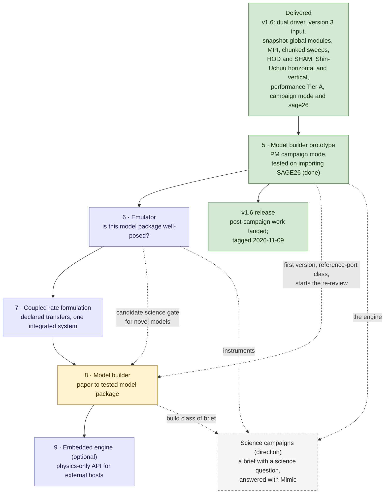

# Mimic Development Pathway

**Status:** Active planning index for `docs/dev/` · last revised 2026-11-10.
**Scope:** The work still to do, in order, and the document that owns each piece. Finished work leaves `docs/dev/` for `archive/dev-plans/` and is summarised in one line under [Changelog](#changelog).

The architectural direction is governed by [`docs/VISION.md`](../VISION.md): a physics-agnostic core with runtime-configurable physics modules, metadata as structural truth, explicit validation, bounded memory, and reproducible output provenance. Durable facts about what Mimic is and does live in the guides, the package READMEs, the converter manual and format specification, the skills and the code; nothing outside `docs/dev/` cites anything in it.

---

## Where Things Stand

Roadmap steps 1 to 5 are complete (Shin-Uchuu end to end, snapshot-global modules, distributed snapshot operations, performance Tier A, and the model builder prototype: campaign mode, exercised on the SAGE26 import), and so is the work that grew around them: the HOD and SHAM packages, chunked slab streaming, the Shin-Uchuu version 3 datasets and the cut, vertical Shin-Uchuu, and the `sage26` model package. The last release is v1.6 (2026-11-09), which carries all of it; `CHANGELOG.md` describes it.

**Next: the hand-back to the SAGE26 team, then step 8's re-review.** The sage26 import landed on `main` on 2026-11-08 (merge `275dd6cd`, campaign sage26 signed off at `470068a3`), the post-campaign work it deferred landed on 2026-11-09, and v1.6 was tagged and published the same day; the [Changelog](#changelog) has the lines. What is left is small and lives in [`MIMIC-BACKLOG.md`](MIMIC-BACKLOG.md), which also holds the hand-back and the release recipe. Step 6's spike can run alongside; its implementation plan is written (2026-11-10).

---

## Where This Is Heading

**The goal the remaining steps serve is science campaigns** (proposed 2026-11-10, not yet adopted): the owner writes a brief containing a science question, and a Campaign Manager answers it with Mimic in a long, mostly unattended campaign, reading the literature, building tools and models, running experiments, judging the results against the brief, and bringing the owner in where a decision is the owner's. [`MIMIC-SCIENCE-CAMPAIGNS-MAP.md`](MIMIC-SCIENCE-CAMPAIGNS-MAP.md) holds the map, the gaps and the reasoning.

Read against that goal, the road's parts are one system:

- **Engine:** campaign mode (built), taking three classes of brief: port (done, the import), build (step 8) and investigate (new).
- **Apparatus:** Mimic (built). A model package is a hypothesis that can be run, and swapping a module in a run file is a controlled experiment.
- **Instruments:** step 6's spike builds the first evaluation boundary and its first method. Others join as campaigns need them, chosen by the question asked: is the effect numerical, what matters, what does the data exclude, where is the fit, does it predict held-out data, is structure A better supported than B.
- **Constraints:** one shared source of observations, consumed by the figures and the instruments alike (missing).
- **Literature and write-up:** sci-paper, a separate repository still in development; the owner intends to finish it by writing the Mimic paper with it.

The largest gap is not a tool. An import is gated by parity with a reference, and an open question has none, so a science campaign needs claims as its unit of progress, each with a test declared in advance, and a refutation counted as an answer.

**The map is a direction, not a commitment.** Its decisions are open, and the steps below are chosen for what they tell us; any of them may redraw the map and the order of the road.

**Next steps that shape it**, in order (steps 1, 3 and 4 can run alongside each other):

1. **Run the step 6 spike as planned.** It gives a verdict on history matching and the evaluation boundary as working code.
2. **Hold step 8's re-review with the map as an input.** It decides whether the model builder becomes the build class of brief.
3. **Run a science shakedown:** one question with a held-out answer, written as a brief on the existing template with a claim ledger. It shows whether campaign mode can carry a science question as it stands, and what an experiment costs. This is the step that tests the map.
4. **Write the Mimic paper with sci-paper.** It shows what the write-up leg needs.
5. **Then decide** where observational constraints live and which bounded real question is the second campaign.

---

## The Ordered Road

Four numbered steps remain. The numbered order is the **planned order**, not a dependency chain: each step is worth building on its own, but several are worth more in combination. The dotted arrows mark where one step feeds a later one, and [Why this order](#why-this-order) records where a later step constrains other work.

| Step | Work | Owned by | Gate or next action |
|---|---|---|---|
| **5** | **Model builder prototype** — PM campaign mode: a Campaign Manager that plans, runs and validates a campaign against an owner-approved dossier through child PMs and read-only tasks, tested on importing SAGE26 as `models/sage26` | The campaign dossiers (shakedown, shakedown 2, sage26) and ai-agent-coder's `campaign-mode.md`; the design brief is archived | **Done** (2026-11-08): the import met all five targets and is merged; see [Step 5](#step-5-model-builder-prototype-done). The work it deferred landed on 2026-11-09 (the [Changelog](#changelog) line); the toolkit's own machinery work document is in ai-agent-coder (`docs/sage26-campaign-machinery-work-20261108.md`) |
| **6** | **Emulator** — is a model package well-posed, and what constrains what | [`MIMIC-EMULATOR-PLAN.md`](MIMIC-EMULATOR-PLAN.md), with [`MIMIC-EMULATOR-IMPLEMENTATION-PLAN.md`](MIMIC-EMULATOR-IMPLEMENTATION-PLAN.md) for its spike | Run its calibrated-variance spike under the implementation plan: seven Mode B slices in a new repository outside the product tree, written so that, on a pass, it is the first version of the instrument step 8 and later campaigns would call. It changes nothing in this repository, so it can run alongside the re-review, provided the default binary is not rebuilt meanwhile. The map reads its spec, capture and provenance as the evaluation boundary other methods would share; what is promoted after the verdict is decided then |
| **7** | **Coupled rate formulation** — declared transfers, one integrated system | [`MIMIC-COUPLED-RATE-FORMULATION-PLAN.md`](MIMIC-COUPLED-RATE-FORMULATION-PLAN.md), with [`SAGE16-PRESCRIPTION-CLASSIFICATION.md`](SAGE16-PRESCRIPTION-CLASSIFICATION.md) and [`SAGE26-PRESCRIPTION-CLASSIFICATION.md`](SAGE26-PRESCRIPTION-CLASSIFICATION.md) as its settled inputs | Run its measurement spike (new files under `models/` only, no core change). The spike sets priority, solver family and the attribution baseline; it is not a veto. It is also a candidate early science campaign (the map) |
| **8** | **Model builder** — paper to tested model package | [`MIMIC-MODEL-BUILDER-PLAN.md`](MIMIC-MODEL-BUILDER-PLAN.md) | Its re-review, due since 2026-08-12, starts from the sage26 campaign's retrospective and the post-campaign review's axis 1, now that v1.6 is released. Novel models still need a science gate, with step 6 the candidate. The map proposes that its orchestration become the build class of campaign brief, with its requirements kept: an input to the re-review, not a decision |
| **9** | **Embedded engine** — optional, possibly never | [`MIMIC-EMBEDDED-ENGINE-PLAN.md`](MIMIC-EMBEDDED-ENGINE-PLAN.md) | Nothing depends on it. Promote only if a scientific need arises |

**Open candidates, unnumbered and unscheduled.** Each becomes a step only when the owner chooses it.

- **The map's pieces:** a science shakedown campaign, a science brief template with a claim ledger (in ai-agent-coder, tried first as a convention on existing targets), and one shared source of observational constraints that the figures consume (a Mimic change outside the core). Each waits on the map's decisions; [Where This Is Heading](#where-this-is-heading) orders the steps that inform them.
- **4.3, thread-per-forest parallelism** (spectrum item 16). `mpirun` already scales both drivers to 85 to 86% efficiency at 16 ranks on the full mini-Uchuu box ([`MIMIC-PERFORMANCE-REFERENCE.md`](MIMIC-PERFORMANCE-REFERENCE.md)), so threads would buy that efficiency gap and intra-node balance, not a new order of magnitude; they pay where memory rather than cores is the bound (where `input.forest_chunks` already applies). Determinism is in place (no RNG in the physics path, module statics write-once at `init()`); the work is instancing enumerable global mutable state, with bit-identity an acceptance criterion and `MPI_THREAD_FUNNELED` sufficient, since the MPI decomposition keeps every call between FoF sweeps.
- **Further performance work** (the spectrum's Tiers B and C, and the performance residuals below). Months of work whose value is best judged after 4.3, if it runs. Batched dispatch and the SoA generator (items 17 and 19) stay deferred behind step 7, and the spectrum's Tier D (module-major interchange, static fusion and language changes, GPU offload at this scale, substep reduction) is ruled out with measurements: do not re-propose it without new evidence. The baseline to measure against is the closing composite in the spectrum's [Tier A outcome](OPTIMISATION-SPECTRUM.md#outcome-of-the-tier-a-plan-2026-10-22) (full tables in the archived acceptance record's Slice 9). Any of it starts from a frozen implementation plan with acceptance slices, must clear `make tests-reference-identity REFERENCE_COMMIT=<hash>`, and, if it touches the drivers, must keep the distributed and chunked gates (`make tests-distributed`) and the cross-format identity gates green.
- **Full Uchuu.** Converted only from its six-halo fixture. It is storage-bound before it is memory-bound (about 37 TB of source and about 26 TB of output), and it has its own super-forest question, which chunking and distribution cannot get past because a forest is never split. The Shin-Uchuu route (census, decided cut table, `convert_trees.py ingest --cut-table`) is the template.
- **Shin-Uchuu laptop acceptance.** The 16 GiB laptop class is met only by a proxy: one task at 128 chunks peaked at 6.17 GB on the Mac Studio under `MallocLargeCache=0`. It becomes an acceptance when a laptop of that class runs it.
- **`sage16` gates for the four `halos-only`-gated routes** (`micro-uchuu-horizontal`, `micro-uchuu-hdf5-horizontal`, `millennium-horizontal`, `mini-uchuu-horizontal`), whose parity is so far proved for `halos-only` only.
- **Output provenance for version 3 inputs**, so a run records the conversion that produced its input.
- **Key SAGE26's regime draw upstream, then compare on Mimic's own core.** A keyed CGM-regime draw in SAGE26 (the hand-back asks for it) would remove the one stochastic difference between the codes and allow a deterministic own-core comparison; the remaining differences (the particle-mass constant, the substep floor, float halo state and the rest of the alignment set, each measured in `tools/core-alignment/items.md` on the `sage26/import-tooling` branch) would then be measured on their own. When SAGE26 has one, re-key `models/sage26/shared/sage_keyed_draw.h` to match and re-measure T1 unaligned.

### Why this order

- **The prototype comes first (decided 2026-10-22)** because nothing still on the road is its prerequisite, and the later steps gain more from it than it gains from them. Its exercise is a reference port, gated by comparison with SAGE26's own output, which is a stronger gate than step 6 would supply. Importing SAGE26 gives the emulator the second distinct model structure its case and its gate need, and the builder turns step 7's migration of each package into a campaign, a candidate second exercise. It uses step 4's byte gate, `make tests-reference-identity`, as its "existing packages unchanged" ratchet.
- **The coupled rate formulation is certain, not contingent** (decided 2026-08-20): sequential operator splitting has no defined answer, since permuting a run file's module list changes the result. Its constraints on earlier steps were honoured in advance and have landed: snapshot-global modules built the mode machinery as an open set that a rate mode can join, distributed operation shards by whole forest, so no transfer-graph component is split across ranks, and the performance work added no dispatch mode.
- **The emulator precedes the coupled rate work** because it is an instrument: built early it can measure what follows it, and the coupled-rate gate needs two structures compared on equal footing, which a point calibration cannot do.
- **Step 7 constrains any further performance work:** batched dispatch and the SoA generator (spectrum items 17 and 19) stay out of every performance plan, because the coupled-rate work deletes the transport-scratch state SoA would transpose and owns the next extension of the mode machinery.

---

## Step 5: Model Builder Prototype (done)

The design brief that shaped this step is archived as `archive/dev-plans/MIMIC-MODEL-BUILDER-PROTOTYPE-2026-10-24-design-brief.md` (revised 2026-10-23 to match campaign mode as built, retired 2026-10-24 once it only restated the toolkit's own contract); the live contract is ai-agent-coder's `skills/project-manager/references/campaign-mode.md`, and the live plan of work is each campaign's dossier. ai-agent-coder's Project Manager (PM) has a **campaign mode** (Mode C), built on ai-agent-coder's branch `feature/pm-campaign-mode` (at `30783f1`, not yet merged to its `main`). A Campaign Manager (CM), a `project-manager` seat in campaign mode, keeps a **dossier**: a small git repository whose `brief.md` (goal, targets and tolerances, allowed paths and the pinned protected-paths policy file, reserved decisions, budgets, exclusions) only the owner changes. It delivers against that dossier by itself, through three kinds of node:
- **change nodes:** small implementation plans run by ordinary child PMs in their own worktrees, then merged;
- **evidence nodes:** 1–2 slice plans whose deliverable is a committed report, read and never merged;
- **task nodes:** hand-written, read-only `orchestrator` tasks.

Validation, diagnosis and plan review are just nodes. Worktrees and parallel sessions are designed in, and the first campaigns run serially. Importing SAGE26 as `models/sage26` is the exercise it is built and tested against, after a shakedown campaign proves the machinery on Mimic. It is a first working version of step 8's builder for the reference-port class, and [`MIMIC-MODEL-BUILDER-PLAN.md`](MIMIC-MODEL-BUILDER-PLAN.md) stays its requirements anchor.

| # | Work | Where | Notes |
|---|---|---|---|
| **5.1** | **Implementation** | ai-agent-coder | **Done** (2026-10-23, on `feature/pm-campaign-mode`, now at `30783f1` after a documentation reflow to the Mode A/B/C vocabulary and `launch-child --setup`; merging it to ai-agent-coder's `main` is the owner's call): protected paths in PM (`check-plan` and `init --policy`, enforced by `grant` and floor fact 5), the four child commands `launch-child`, `wait-child`, `answer-child` and `stop-child`, a question channel for Developers and child PMs, the campaign-mode reference and dossier template, the Mode B launcher's campaign-child block with PM's plan-defect section aligned to it, and a deliberate VISION revision; about 1,700 lines of Python and 688 PM tests, from a ten-slice PM Mode B run, a post-run review and its panel-reviewed hardening. The archived brief's *What Was Built* has the detail |
| **5.2** | **Groundwork** | The owner's machine | **Done** before the shakedown (2026-10-24). The replay corpus gathered from `archive/`, each campaign with its starting commit; the step 4 run's costs, from the PM run report and ledger named in `archive/dev-plans/HANDOFF-performance-tier-a-2026-10-22.md` and from the harness; the answer key moved out of the Obsidian vault, beyond the reach of any agent running a campaign; the environment (container or VM, the notification channel); one worktree parent directory the owner trusts in each harness, since a trust dialog fails a child's launch; `campaign-policy.json`, committed here by the owner by hand on `main` at preflight, after settling what it protects, and pinned in the brief by the file's SHA-256 digest (`shasum -a 256 campaign-policy.json`, the value a child's `run.json` records as `policy.protected_paths_source.sha256`) and the commit that added it. The environment is settled here, not in `brief.md`. **Status:** `campaign-policy.json` committed on `main` (2026-10-24); the directories, the `integration/shakedown` checkout and the model-free trial done; the trust check, the answer key and the environment remain the owner's, as ordered preflight steps in the companion files `campaigns/sage26-OWNER.md` and `campaigns/shakedown-OWNER.md` beside the dossiers. The costs were not extracted, so the spend limit is the owner's to set, and the replay corpus waits on P0r |
| **5.3** | **The shakedown campaigns** | `integration/shakedown` and `integration/shakedown2` here, from the dossiers at `/Users/dcroton/Local/git-repos/campaigns/shakedown/` and `shakedown2/` | **Done** (2026-10-24 to 10-27). A throwaway `models/shakedown`, a copy of `halos-only`, built and gated on mini-Millennium with `sage16` unchanged, through a change node, a ratchet, a reserved node, a refused protected-path plan, a kill-and-restart and a clean cleanup; the first run's review (ai-agent-coder's `docs/shakedown-review-20261025.md`) and its fixes, then a second run clean. The branches are archive-tagged and never merged |
| **5.4** | **P0 and P0r** | The campaign dossier | **P0 done** (2026-11-03): the owner reviewed the CM's evidence and first work table against the held-out answer key before any change node launched; every must-find item was found, two should-find items were not (sage16's binary-bound tests; the step 7 classification, since written). P0r, replaying archived campaigns against their human-approved answers, is unscheduled |
| **5.5** | **The import** | `integration/sage26` here, merged to `main` as `275dd6cd` | **Done** (2026-11-03 to 11-08; signed off at `470068a3`). 54 child runs (21 change nodes, 22 ratchets, 6 evidence, 2 experiments, 3 instrument), 100 slices all accepted, about 103 plan-review rounds, one acceptance audit on a different model; 145 h of child time over five days. All five targets met: bit-for-bit parity with SAGE26 at all 56 snapshots under a frozen ten-patch core-alignment set and, on Mimic's own core, SAGE26 up to the random realisation of the CGM-regime draw; both drivers identical; `sage16` unchanged; the gates green; 48 figures and the documents; since the v1.6 cleanup the oracle, the instrument and the alignment set live on the `sage26/import-tooling` and `sage26/core-alignment` branches, not on `main`. The brief's targets, reserved classes and no-loosening rule held; the dossier at `/Users/dcroton/Local/git-repos/campaigns/sage26/` (archive copy `/Volumes/Internal/results/sage26-campaign/dossier.git`) holds the record, and its `post-campaign/` directory the review on three axes: the import, the machinery (the toolkit changes, now ai-agent-coder's `docs/sage26-campaign-machinery-work-20261108.md`) and the cleanup. Step 8's re-review follows the post-campaign work |

**Next action.** v1.6 is released (2026-11-09). Next, the hand-back to the SAGE26 team (under *Release* in [`MIMIC-BACKLOG.md`](MIMIC-BACKLOG.md)), then step 8's re-review, from the campaign's retrospective and the review's axis 1.

**Hold-out discipline (historical; it bound this index while the campaigns ran).** The exercise tests the builder only if it finds the obstacles itself, so no document here named them and the answer key stayed outside every repository until the sign-off (it is now committed to the dossier). The import's `brief.md` *Exclusions* named all of `docs/dev/` in any checkout and through git history, including this index, whose step 5 section and residuals describe the repository's known limits. They also named:
- the main checkout's `archive/` and `.orchestrator/`, since gitignored copies of excluded documents sit there (archived plans, review inputs);
- `archive/` in ai-agent-coder;
- the owner's SAGE26 checkout and the Obsidian vault;
- other sessions' transcripts and scratch space;
- the owner's companion file.

The rule for a future campaign is the same: do not pre-solve campaign content, since fixing a gap, residual or upstream issue the campaign would hit, or doing any of the exercise's work by hand, removes test signal. The toolkit lesson of this campaign is that the exclusion must be mechanical (a sparse checkout the launcher applies), not a read denial inside a worktree: ai-agent-coder's machinery work document, item 1.

**What lands in this repository.** `campaign-policy.json` at the root, committed by the owner by hand on `main` at the import's preflight, holding protected paths only and pinned in each campaign's `brief.md` by the file's SHA-256 digest (`shasum -a 256 campaign-policy.json`, the value a child's `run.json` records as `policy.protected_paths_source.sha256`) and the commit that added it; then whatever the campaign itself lands, node by node, on its integration branch, whose merge to `main` is the owner's. Nothing tracked changes for a child PM's HANDOFF.md, which `launch-child` keeps untracked through the product repository's git exclude file. Campaign mode lives in ai-agent-coder's `project-manager` skill, and each campaign's dossier lives outside both repositories.

---

## Documents in `docs/dev/`

| Document | Role |
|---|---|
| `MIMIC-DEVELOPMENT-PATHWAY.md` | This index: the road ahead, the next task, and a one-line changelog of finished work |
| [`MIMIC-SCIENCE-CAMPAIGNS-MAP.md`](MIMIC-SCIENCE-CAMPAIGNS-MAP.md) | Direction brief, proposed and not adopted: the goal the remaining steps serve (science campaigns), its parts and who owns each, the gaps ranked, the toolkit for judging ideas, the VISION principles extended, the next steps and the open decisions |
| [`MIMIC-BACKLOG.md`](MIMIC-BACKLOG.md) | Standing: small items, bounded fixes and decisions not being addressed now, each with what to do and how to accept it; also the release recipe and the SAGE26 hand-back |
| (archived) `MIMIC-MODEL-BUILDER-PROTOTYPE-2026-10-24-design-brief.md` | Step 5's design brief, in `archive/dev-plans/` since 2026-10-24: the live contract is ai-agent-coder's `campaign-mode.md` and the live plan of work is each campaign dossier; this index's [Step 5](#step-5-model-builder-prototype-done) keeps the exercise, the hold-out discipline and what lands here decisions, the import's drafted brief, and the design review's findings |
| [`MIMIC-EMULATOR-PLAN.md`](MIMIC-EMULATOR-PLAN.md) | Step 6: requirements brief |
| [`MIMIC-EMULATOR-IMPLEMENTATION-PLAN.md`](MIMIC-EMULATOR-IMPLEMENTATION-PLAN.md) | Step 6: implementation plan for the brief's calibrated-variance spike, run in a repository outside this one |
| [`MIMIC-COUPLED-RATE-FORMULATION-PLAN.md`](MIMIC-COUPLED-RATE-FORMULATION-PLAN.md) | Step 7: requirements brief |
| [`SAGE16-PRESCRIPTION-CLASSIFICATION.md`](SAGE16-PRESCRIPTION-CLASSIFICATION.md) | Step 7 input: all 18 `sage16` prescriptions classified rate, jump, algebraic or forcing |
| [`SAGE26-PRESCRIPTION-CLASSIFICATION.md`](SAGE26-PRESCRIPTION-CLASSIFICATION.md) | Step 7 input: the `sage26` prescriptions classified the same way, the ones shared with `sage16` cross-referenced and the new ones (two-regime CGM, FIRE, FFB, H2, concentration, ICS, SFR histories) in full |
| [`MIMIC-MODEL-BUILDER-PLAN.md`](MIMIC-MODEL-BUILDER-PLAN.md) | Step 8: long-term planning brief, and step 5's requirements anchor |
| [`MIMIC-EMBEDDED-ENGINE-PLAN.md`](MIMIC-EMBEDDED-ENGINE-PLAN.md) | Step 9: requirements brief, optional |
| [`OPTIMISATION-SPECTRUM.md`](OPTIMISATION-SPECTRUM.md) | Performance reference: the options catalogue, annotated with the outcome of each Tier A item; the source for 4.3 and any Tier B or C plan |
| [`BENCHMARK-SAGE16-MINI-MILLENNIUM.md`](BENCHMARK-SAGE16-MINI-MILLENNIUM.md) | Performance reference: the component-level CPU profile the spectrum is built on. Perishable: one machine, one dataset, one commit |
| [`MIMIC-PERFORMANCE-REFERENCE.md`](MIMIC-PERFORMANCE-REFERENCE.md) | Performance reference: the research-scale profile (`sage16` on the full mini-Uchuu box, both drivers), MPI scaling, the comparison with mini-Millennium and the per-halo cost model. Perishable in the same way |

The horizontal input format specification is not a plan: it is [`convert/mimic-convert/HORIZONTAL-HDF5-FORMAT.md`](../../convert/mimic-convert/HORIZONTAL-HDF5-FORMAT.md), with version 3 the only supported version.

---

## Recorded Residuals

Known, bounded issues written down so nobody rediscovers them. None blocks the next task; each becomes work only when a plan takes it on. The archived records named in the [Changelog](#changelog) hold the measurements behind them.

**Performance**

- **The vertical FoF workspace is still zero-filled** (0.93% of the vertical mini-Millennium run, kept because its readers test `galaxy == NULL`), and its seed is pinned separately at half the tree's halos. For scale, the cut Shin-Uchuu's largest forest (126,380,326 halos, file 0) runs `sage16` vertically at a **measured 70.96 GB peak** (2026-10-22, `MallocLargeCache=0`): the output buffer is 24.4 GB, the galaxy pool 22.9 GB and the input forest 11.1 GB, and the remaining ~13 GB (the FoF workspace and the rest) was not decomposed.
- **The comparator reads whole records to compare one field.** `scripts/compare_cross_format_identity.py` reads Mimic's HDF5 output record by record, so each field costs a pass over both runs; the production cut-vertical comparison took 15,068 s at 291.2 GB on a rotational disk. A column-wise read, or an output layout that splits the compound dataset, would cut that several-fold.
- **Under distribution, task 0 scans every slab's `ForestIndex` column more than once at startup** (twice for the partition, plus its own `validate_columns` scan) while the other tasks wait. Minutes only at mini-Uchuu scale and above; kept because the reader stays partition-agnostic. Merge the scans first if startup time matters.
- **Slab and output buffers are reallocated per generation** under chunking, which feeds the macOS large-allocation cache; reusing them as the galaxy pools already are is a candidate.
- **`order_created_rows()` allocates four scratch arrays per FoF group with created rows**; measure on a full-box HOD run before adding run-persistent scratch.

**Science and modelling**

- **SHAM intrinsic scatter with deconvolution.** `sham_rank_match` is zero-scatter; honouring a target stellar mass function with scatter needs the target deconvolved first.
- **Orphan-inclusive SHAM** needs a defensible disruption or merging-time criterion; the shipped candidates are resolved-only.
- **Subhalo branches that never carried a galaxy are not SHAM candidates** (2.7% of resolved subhalos above `ShamMinVpeak` on micro-Uchuu), a percent-level low bias in the satellite fraction and clustering. The SHAM READMEs disclose it; a core or package option to seed galaxies on such branches is the follow-up.
- **`wp(rp)` with an SDSS overlay** is not built; the HOD and SHAM correlation figures are real-space `xi(r)`.
- **HOD mass-definition and cosmology caveats.** The Zheng, Coil & Zehavi (2007) fit uses a 200-times-mean mass and its own cosmology; a calibrated mock needs the fit redone on the catalogue's mass definition, with an in-run `M_min` solve to hold a number density.
- **Snapshot-global physics is unvalidated at production scale**: no global-run memory measured on a production-size snapshot, no observational validation, and a snapshot module needs the whole snapshot co-resident (`forest_chunks: 1`), so its memory is reducible only by distributing over MPI ranks.
- **An output-time filter for ghost scaffold rows.** HOD and SHAM write every scaffold row with `HODGhost` or `ShamGhost` set; at production scale most rows are scaffold (3,114,016 written for 10,986 sample members on micro-Uchuu), so a writer filter would save most of the output.

**Framework and identity**

- **Created-record identity has a scalar budget.** Created `UniqueGalaxyID` is `-(1 + ordinal + 1024 * host_key)` and must fit int64: it fits every fixture, horizontal full Uchuu and Millennium under both drivers, but not the vertical driver on Shin-Uchuu (ASCII or L-Halo) or full Uchuu, which therefore cannot create records. Source-halo ID plus an ordinal column would lift the ceiling.
- **An event cannot name a row created in the same callback**; deferring event delivery to the commit would allow it.
- **`h_convention: free` producer/consumer asymmetry**: a package declaring `units: Mpc/h` with `h_convention: free` would abort at `open_run` on correctly produced data (`convert/mimic-convert/column_schema.py` against `src/io/horizontal/read_horizontal_hdf5.c`). Unreachable today.
- **`VIEW_TAKING_OUTPUT_FUNCTIONS` crosses the core/model boundary** in `scripts/generate_properties.py`.
- **`enum InputProcessingOrder` still lives in `src/io/vertical/reader.h`.**
- **`input.first_file`/`last_file` are ignored by the horizontal reader**; kept because `mimic-plot` uses them for the volume fraction and outputs record them.

**The sage26 import**

- **The items the import deferred** landed on 2026-11-09 or are in [`MIMIC-BACKLOG.md`](MIMIC-BACKLOG.md): fixed-length array properties of any length, ordered unit-conversion chains, the shipped `sage26` run files and SAGE26's substep floor, the `sage16` lessons, the keyed CGM draw, the Linux floor and the oracle toolchain.
- **The oracle is bound to one toolchain.** The 1,044 fixtures are compared bit for bit only on the pinned Apple clang build and macOS version and SKIP elsewhere; regenerating them needs the staged SAGE26 source (`/Volumes/Internal/results/sage26-campaign/reference-src/`, at `11b1ae8`).
- **The T1 reference is outside the repository.** SAGE26's own mini-Millennium output, which the comparator pins by digest, lives on the results volume; without it the comparator's synthetic controls still run but no parity measurement can be re-made.
- **`sage26`'s Linux floor is 5.5e-4 relative** (gcc 13, arm64) against a macOS baseline, under CI's relaxed 1e-3 gate; `sage16` matches strictly on the same host.

**Tests and tooling**

- **The `sage16` model-package tests are binary-bound** (17 files read `model_z0.000_0`), so no horizontal package runs them; making them format-neutral would let them run horizontally.
- **`micro-uchuu-hdf5-horizontal` has no committed test fixture**, so its generic unit and integration tiers skip; a small forests-HDF5 source generator would close it.
- **The cross-format identity gates are manual, dataset-present operations, not CI**, and the `micro-uchuu-ascii-horizontal` C reader battery has no unattended make target.
- **No end-to-end test runs a dataset whose created-record identity space does not fit** (the driver verdict and the module refusal are tested separately), and SHAM Type 1 inheritance has no end-to-end case because the fixture has no Type 1 galaxy.
- **`scripts/lint_parameter_usage.py` reads only literal `LOAD_PARAM_*("Name", ...)` calls.**
- **`tests-snapshot-global-identity` caches one worktree per head and model pair** and warns above 50 registrations until they are moved to cold storage and pruned.
- **The bounded battery's per-block retention is uncharged** (about 2.4 KB per row-scan block, about 51 MB at Shin-Uchuu scale, inside the ceiling's block allowance but not charged to it).
- **The comparator's pairing-persistence check has blind spots by construction** in the catalogue and lineage modes; the strict default mode, which the production gates use, needs no such check.
- **The converter's exact-file-set checks reject a macOS `.DS_Store`** in a stage directory; documented in the converter manual rather than tolerated in code.

---

## Data on the Two Machines

The datasets the packages read, as reorganised on 2026-10-20. Each family folder holds one folder per package plus `conversion-provenance/` (records needed to understand or re-run a conversion, with a README and a `REORGANISATION-2026-10-20.log` mapping old paths to new); every package's `snapshots` link resolves on both machines except `uchuu` on the Mac (the full Uchuu trees exist only on NT).

- **Mac:** `/Volumes/Internal/data/uchuu/{micro-uchuu,mini-uchuu}/`, `/Volumes/Internal/data/millennium/`, and Shin-Uchuu at `/Volumes/LaCie/data/uchuu/shin-uchuu/`, reached through the symlink `/Volumes/Internal/data/uchuu/shin-uchuu`; results under `/Volumes/Internal/results/mimic/`, with runs too large for Internal on `/Volumes/LaCie/results/mimic/` and linked back.
- **NT:** our conversions under `/fred/oz214/dcroton/{shin-uchuu,micro-uchuu,mini-uchuu,millennium}/` and the Shin-Uchuu `sage16` output under `/fred/oz214/dcroton/results/mimic/`; the source catalogues are msinha's under `/fred/oz214/simulations/uchuu/` and `/fred/oz004/simulations/Millennium`.

---

## Source-Of-Truth Boundaries and Standing Constraints

- `docs/VISION.md` owns architectural principles and changes only when implemented behaviour justifies it. Active plans own scope, acceptance and validation. The guides, package READMEs and `.agents/skills/` own durable instructions once a plan lands. `archive/dev-plans/` is historical record, never current instruction. Generated files stay generated.
- Keep `input.tree_type` as the reader selector and `input.processing_order` as the driver selector. Keep ctrees ASCII a live vertical reader. Preserve the ordinary physics-module ABI unless an approved plan changes it.
- Keep output identity deterministic across MPI task counts, chunk counts and equivalent vertical and horizontal inputs (per-`UniqueGalaxyID` equality).
- Horizontal input (format version 3) records gapped links losslessly; Mimic validates and aborts, never repairs.
- Do not retain backwards-compatibility code for replaced behaviour unless a plan says it stays live. Failing tests, generated-code drift, docs-link failures and validation failures are release blockers.

---

## Changelog

One line per finished piece of work. The record of each lives in its archived documents under `archive/dev-plans/` (gitignored local history) and its handoffs under `archive/handoffs/`; the durable description is in `CHANGELOG.md`, the guides and the package READMEs. Archived material is historical evidence, never a source of current instruction.

| Date | Work | Archived records |
|---|---|---|
| 2026-06-29 | **v1.0** released from `main`: the physics-agnostic core, the runtime-configurable module pipeline, the metadata-generated property system, the `sage16`, `sham` and `halos-only` packages and the vertical readers | — |
| 2026-07-18 → 08-13 | **Dual driver**: horizontal-HDF5 format, the first converter, the horizontal reader and driver, the cross-format identity gate (bitwise per `UniqueGalaxyID` on micro-Uchuu), per-snapshot output partitioning | `MIMIC-DUAL-DRIVER-PLAN.md`, `MIMIC-HORIZONTAL-DRIVER-PLAN.md`, `MIMIC-CONVERTER-IMPLEMENTATION-PLAN.md`, `MIMIC-SNAPSHOT-READER-PLAN.md`, `HORIZONTAL-OUTPUT-PARTITIONING-PLAN.md`, `chunked-output-plan.md`, `dual-driver-plan-review.md`, `PHASE-4B-REVIEW-AND-PRE-PHASE-5-WORK.md`, `PRE-PHASE-5-READINESS-REVIEW.md` |
| 2026-08-14 | **`Spin` units reconciled** across all packages, values byte-identical | `D8-SPIN-UNITS-RECONCILIATION-PLAN.md`, `D8-FOLLOWUP-RECONCILIATION-PLAN.md` |
| 2026-08-20 | **Default run profiled**, optimisation spectrum written, `sage16` prescriptions classified, emulator brief written, road ordered | (kept: the spectrum, the benchmark, the classification and the emulator brief, listed above) |
| 2026-08-25 → 09-17 | **Step 1, Shin-Uchuu**: subset rehearsal, converter scale pass, production conversion, `sage16` end to end; the `fix_flybys` defect found by the science check, removed, and the dataset reconverted (version 2), all science checks then passing exactly; the Uchuu-family particle mass corrected | `SHIN-UCHUU-CONVERSION-PLAN.md`, `SHIN-UCHUU-FLYBY-DEFECT-ADDENDUM.md`, `POST-PHASE-5-JOINT-REVIEW.md`, `POST-PHASE-5-WORK.md`, `CONVERTER-SCALE-PASS-PLAN.md` |
| 2026-09-23 → 09-30 | **Converter generalisation and the general horizontal runtime**: L-Halo, forests-HDF5 and ASCII sources to lossless format version 3, runnable on the gated routes; **v1.2** released | `MIMIC-CONVERTER-GENERALISATION-{PLAN,IMPLEMENTATION-PLAN,CODE-REVIEW,ACCEPTANCE}.md`, `MIMIC-CONVERTER-SOURCE-INVENTORY.md`, `MIMIC-CONVERTER-BASELINE-REFERENCE.md`, `MIMIC-GENERAL-HORIZONTAL-RUNTIME-{IMPLEMENTATION-PLAN,CODE-REVIEW,ACCEPTANCE}.md`, `MIMIC-V3-CONSUMER-DESIGN-REVIEW.md`, `HORIZONTAL-HDF5-FORMAT-V3-DRAFT.md` |
| 2026-10-01 → 10-02 | **Millennium and mini-Uchuu converted whole** and their `halos-only` parity gates passed bitwise | (conversion scripts in `archive/conversion-scripts-2026-10-full/`) |
| 2026-10-03 | **Step 2, snapshot-global modules**: the `process_snapshot` callback and `post_snapshot` phase | `snapshot-global-modules/` (plan, checks, review, acceptance, code review) |
| 2026-10-04 | **HOD and SHAM** packages and core record creation (`module_create_record()`) | `MIMIC-HOD-SHAM-{IMPLEMENTATION-PLAN,REVIEW,CODE-REVIEW}.md` |
| 2026-10-06 | **Step 3, distributed snapshot operations**: MPI forest decomposition, bitwise identical to serial | `MIMIC-DISTRIBUTED-SNAPSHOT-{PLAN,IMPLEMENTATION-PLAN,CODE-REVIEW,ACCEPTANCE}.md` |
| 2026-10-07 | **Chunked slab streaming** (`input.forest_chunks`), bitwise identical, peak memory falling nearly as `1/G` | `MIMIC-CHUNKED-SLAB-STREAMING-{PLAN,IMPLEMENTATION-PLAN,REVIEW,ACCEPTANCE}.md` |
| 2026-10-07 → 10-17 | **Shin-Uchuu version 3**: forest-blocked ASCII route, the super-forest census and the cut decision, the rewriter, the uncut and cut production datasets, version 2 retired; **v1.5** released | `MIMIC-SHIN-UCHUU-V3-{PLAN,IMPLEMENTATION-PLAN,ACCEPTANCE,REVIEW}.md`, `MIMIC-SHIN-UCHUU-FOREST-CENSUS.md` |
| 2026-10-15 → 10-20 | **The cut, vertical Shin-Uchuu**: `write_vertical_trees.py` and the `shin-uchuu-lhalo` package; the vertical `sage16` run bitwise identical to the horizontal one at production scale; the SAGE26 reader brief, since implemented in SAGE26 | `shin-uchuu-cut-vertical-brief-2026-10-15.md`, `MIMIC-SHIN-UCHUU-CUT-VERTICAL-{IMPLEMENTATION-PLAN,ACCEPTANCE,REVIEW}.md`, `SAGE26-SHIN-UCHUU-LHALO-READER-BRIEF.md` |
| 2026-10-20 | **Data reorganised** on the Mac and NT into one layout per machine, every conversion copied to NT with SHA-256 verification; `docs/dev/` cut to the work still to do and this pathway rewritten | `MIMIC-DEVELOPMENT-PATHWAY-2026-10-20-before-rewrite.md` (the full previous pathway, with every dated outcome) |
| 2026-10-20 → 10-22 | **Step 4, the Tier A performance plan** (4.1 and 4.2): a byte gate against any ancestor commit, `DEBUG_LOG` level-first, init-time dispatch plans, the vertical output-buffer seed, no build flag adopted; mini-Millennium 11.8% (vertical) and 10.3% (horizontal) faster, the Shin-Uchuu super-forest 165 GB to 71 GB, every galaxy byte-identical on the mini-Millennium gate; a post-run review and its hardening follow-up; merged to `main` | `MIMIC-PERFORMANCE-{IMPLEMENTATION-PLAN,ACCEPTANCE,REVIEW}.md` and `HANDOFF-performance-tier-a-2026-10-22.md` (in `archive/dev-plans/`); `MIMIC-PERFORMANCE-REFERENCE.md` and `OPTIMISATION-SPECTRUM.md` stay in `docs/dev/` as references |
| 2026-10-20 → 10-22 | **Model builder prototype brief** written on `claude/sage26-import-strategy-5i8npo` while step 4 ran, merged to `main` and adopted as step 5; the road renumbered (emulator 6, coupled rate 7, model builder 8, embedded engine 9) and step 4 folded into the delivered work, with 4.3 an open candidate | `MIMIC-MODEL-BUILDER-PROTOTYPE-2026-10-24-design-brief.md` (in `archive/dev-plans/`, archived 2026-10-24) |
| 2026-10-22 → 10-23 | **Step 5 redesigned as PM campaign mode**: the separate Campaign Manager seat and `cm.py` replaced by a parent PM (named the Campaign Manager when built) delivering against an owner-approved dossier through child PMs in worktrees and read-only tasks; brainstormed with Codex, then reviewed by a Codex and Fable panel against the ai-agent-coder code; the brief rewritten in place | `MIMIC-MODEL-BUILDER-PROTOTYPE-2026-10-22-campaign-manager-design.md`, `MIMIC-MODEL-BUILDER-SETUPS-2026-10-23.md` (in `archive/dev-plans/`) |
| 2026-10-23 | **Campaign mode built in ai-agent-coder** (step 5.1): protected paths, the four child commands, the question channel, the campaign-mode reference and dossier template, the launcher's campaign-child block and a VISION revision, on its branch `feature/pm-campaign-mode` (`ff57e57`, unmerged there); a ten-slice PM Mode B run, then a post-run review and its panel-reviewed hardening; the step 5 brief and this index revised to match | None in this repository (the plan and the review are archived in ai-agent-coder) |
| 2026-10-23 | **The SAGE26 import's brief**: the owner chose the import next with P0 as its first checkpoint, in place of stages 1 and 2 (the model-free trial kept as preflight); `brief.md` and the owner's companion file drafted in a dossier outside the repository and reviewed by a Codex and Fable panel over two rounds; `sage16` re-measured against original SAGE on mini-Millennium: the 2026-06 report's "bit-identical" figures were within-1e-6 fractions, the 2026-07-01 precision widening loosened per-galaxy agreement (83–98% within 1e-6 at z=0) while population outcomes hold (totals within 0.2%, mass functions within 1%), the owner accepted it as scientifically close, and the skills, the `sage16` README and its comparison tool were corrected to match | None (the dossier is outside the repository) |
| 2026-10-24 | **Campaign preflight and tidy-up**: `campaign-policy.json` committed on `main`; `.gitignore` ignores `mimic_venv` as a directory or a symlink, so a node worktree's venv link needs no exclude step; the step 5 design brief archived, since ai-agent-coder's `campaign-mode.md` is the contract and the dossiers the plan of work; a shakedown campaign (a throwaway `models/shakedown`) drafted to run before the import, and sage26 made an independent import campaign; ai-agent-coder's toolkit reflowed to the Mode A/B/C vocabulary with `launch-child --setup` (`30783f1`) | `MIMIC-MODEL-BUILDER-PROTOTYPE-2026-10-24-design-brief.md` (in `archive/dev-plans/`); the dossiers are outside the repository |
| 2026-10-24 → 10-27 | **Two shakedown campaigns** (step 5.3): the throwaway `models/shakedown` package built and gated by a CM through child PMs; the first run's review (ai-agent-coder `docs/shakedown-review-20261025.md`) and its fixes, then a second shakedown clean; the toolkit at `b496bf5` | None in this repository (the dossiers are outside it; the branches are archive-tagged) |
| 2026-11-03 → 11-08 | **Step 5, the SAGE26 import** (5.4, 5.5): campaign sage26 imported SAGE26 at `11b1ae8` as `models/sage26` (26 modules, the function-level oracle, the galaxy-by-galaxy instrument, the ten-patch core-alignment set, 48 figures) through 54 child runs and 100 accepted slices; bit for bit with SAGE26 at all 56 snapshots core-aligned, SAGE26 up to one random draw on Mimic's own core; both drivers identical; `sage16` unchanged; signed off at `470068a3`, merged to `main` as `275dd6cd`; the post-campaign review on three axes, its release fixes and non-physics follow-ups committed on `main`; the deferred items written up as `SAGE-POST-CAMPAIGN-WORK.md` | The dossier at `/Users/dcroton/Local/git-repos/campaigns/sage26/` (archive `/Volumes/Internal/results/sage26-campaign/dossier.git`): `decisions.md` D1–D72, `evidence.md` E1–E47, `validation/`, `post-campaign/` |
| 2026-11-09 | **The SAGE post-campaign work**, one commit per group, each reviewed by an independent Codex and Opus panel: core `375be172` (non-finite model parameters refused; the `MinDynamicSubsteps` floor with bounds on the substep keys; the vertical driver fatal with no input file; the module limit asserted at build time), `sage16` `fd8579e8` and `sage26` `30b44f7e` (star formation capped at the cold gas when the supernova calculator is left out; `AGNrecipe 0` stops black-hole growth at every site; `sage26` also refuses `AGNrecipe` 1 and 3, calls `exp10` at the FFB threshold and forms the SFR-history bin in 64 bits), with every shipped output unchanged (strict baselines, the oracle tier, and the reference-identity byte gate against `407b3edc`); the items not taken on moved to `MIMIC-BACKLOG.md` | `SAGE-POST-CAMPAIGN-WORK.md` (in `archive/dev-plans/`) |
| 2026-11-09 | **The `sage26` user-facing cleanup for v1.6**, reviewed over three rounds by an independent Codex and Opus panel: the import's verification apparatus (comparator, controls, core-alignment set, function-level oracle with its 1,044 fixtures and 24 oracle tests) moved off `main` to the `sage26/import-tooling` and `sage26/core-alignment` branches on `origin`; every source, header, test, property note, plot docstring, README and run file rewritten to the `sage16` level of detail with no citation, configuration label, campaign or `sage16` comparison left; code tokens unchanged but for test-local identifier renames, verified by comment-stripped token comparison; run files added for every simulation package `sage16` ships, each built and validated and ten run on local data | `docs/dev/SAGE26-IMPORT-TOOLING.md` on the `sage26/import-tooling` branch |
| 2026-11-09 | **v1.6** released from `main` and published on GitHub: the `sage26` package, the cut Shin-Uchuu on the vertical driver with the two Shin-Uchuu packages renamed, the Tier A performance work, the post-campaign fixes and Python 3.12; the release notes condensed from the full *Unreleased* record (which stays in git history at `cb60175d`); the build's recorded version now taken from release tags only, since the local `archive/*` tags had become the nearest tag | — |
| 2026-11-10 | **Science-campaign map written**: a direction brief that reads steps 6 and 8, campaign mode and sci-paper as parts of one goal, proposed and not adopted, with its decisions left open and the next steps that inform them added to this index | (kept: the map, listed above) |

**History decision, standing: `f81e2385` is not squashed into `13c0c9a7`** (2026-08-14). It is cited by SHA in archived records, the two commits are not adjacent, and the boundary is the evidence for the rule now in the validation skill (run the full suite as the last action). `git bisect skip` covers the two red commits.
