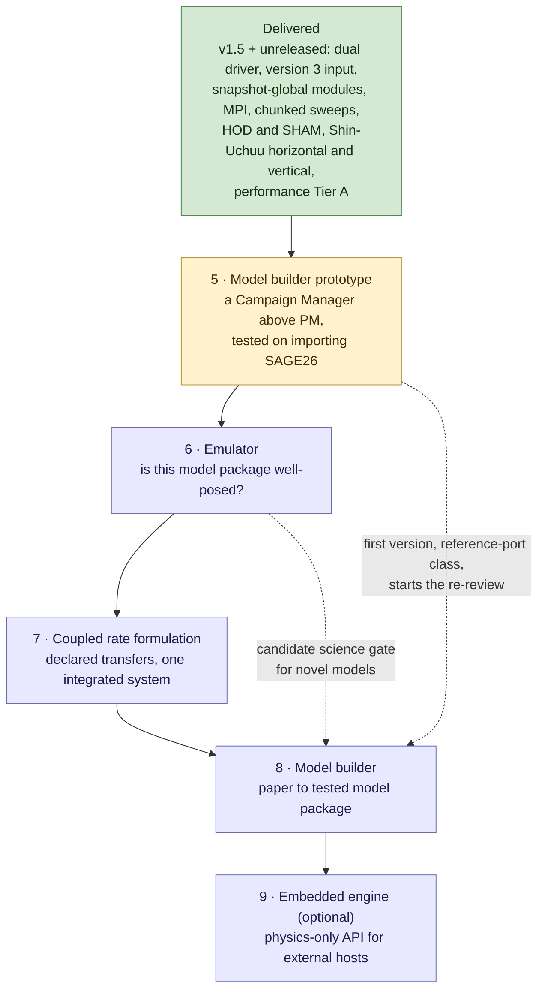

# Mimic Development Pathway

**Status:** Active planning index for `docs/dev/` · last revised 2026-10-22.
**Scope:** The work still to do, in order, and the document that owns each piece. Finished work leaves `docs/dev/` for `archive/dev-plans/` and is summarised in one line under [Changelog](#changelog).

The architectural direction is governed by [`docs/VISION.md`](../VISION.md): a physics-agnostic core with runtime-configurable physics modules, metadata as structural truth, explicit validation, bounded memory, and reproducible output provenance. Durable facts about what Mimic is and does live in the guides, the package READMEs, the converter manual and format specification, the skills and the code; nothing outside `docs/dev/` cites anything in it.

---

## Where Things Stand

Roadmap steps 1 to 4 are complete (Shin-Uchuu end to end, snapshot-global modules, distributed snapshot operations, and performance Tier A), and so is the work that grew around them: the HOD and SHAM packages, chunked slab streaming, the Shin-Uchuu version 3 datasets and the cut, vertical Shin-Uchuu. The last release is v1.5 (2026-10-17); `main` carries the cut, vertical Shin-Uchuu and the Tier A performance work above it, described in `CHANGELOG.md`'s Unreleased section, and the next release is the owner's call.

**Next: step 5, the model builder prototype (decided 2026-10-22).** A Campaign Manager one level above ai-agent-coder's Project Manager turns a brief into a charter the owner approves, designs and runs the campaign, and validates it with its own instruments; importing SAGE26 as `models/sage26` is the exercise it is built and tested against. Under the brief's recommendation most of the build happens in ai-agent-coder, and the first acceptance target is P0, design only. See [Step 5](#step-5-model-builder-prototype-next).

---

## The Ordered Road

Five steps remain. The numbered order is the **planned order**, not a dependency chain: each step is worth building on its own, but several are worth more in combination. The dotted arrows mark where one step feeds a later one, and [Why this order](#why-this-order) records where a later step constrains other work.

| Step | Work | Owned by | Gate or next action |
|---|---|---|---|
| **5** | **Model builder prototype** — a Campaign Manager above PM that plans, runs and validates a campaign, tested on importing SAGE26 as `models/sage26` | [`MIMIC-MODEL-BUILDER-PROTOTYPE.md`](MIMIC-MODEL-BUILDER-PROTOTYPE.md), under step 8's brief as its requirements anchor | **Next.** Settle the open owner decisions, then plan the Campaign Manager in ai-agent-coder (see [Step 5](#step-5-model-builder-prototype-next)) |
| **6** | **Emulator** — is a model package well-posed, and what constrains what | [`MIMIC-EMULATOR-PLAN.md`](MIMIC-EMULATOR-PLAN.md) | Run its calibrated-variance spike, outside the product tree. It needs no repository change, so it can run alongside step 5 |
| **7** | **Coupled rate formulation** — declared transfers, one integrated system | [`MIMIC-COUPLED-RATE-FORMULATION-PLAN.md`](MIMIC-COUPLED-RATE-FORMULATION-PLAN.md), with [`SAGE16-PRESCRIPTION-CLASSIFICATION.md`](SAGE16-PRESCRIPTION-CLASSIFICATION.md) as its settled input | Run its measurement spike (new files under `models/` only, no core change). The spike sets priority, solver family and the attribution baseline; it is not a veto |
| **8** | **Model builder** — paper to tested model package | [`MIMIC-MODEL-BUILDER-PLAN.md`](MIMIC-MODEL-BUILDER-PLAN.md) | Its re-review, due since 2026-08-12, starts from the step 5 brief and ends step 5, after its retrospective. Novel models still need a science gate, with step 6 the candidate |
| **9** | **Embedded engine** — optional, possibly never | [`MIMIC-EMBEDDED-ENGINE-PLAN.md`](MIMIC-EMBEDDED-ENGINE-PLAN.md) | Nothing depends on it. Promote only if a scientific need arises |

**Open candidates, unnumbered and unscheduled.** Each becomes a step only when the owner chooses it. Under step 5's hold-out discipline, none is to be taken on ahead of the campaign merely because the SAGE26 import might meet it.

- **4.3, thread-per-forest parallelism** (spectrum item 16). `mpirun` already scales both drivers to 85 to 86% efficiency at 16 ranks on the full mini-Uchuu box ([`MIMIC-PERFORMANCE-REFERENCE.md`](MIMIC-PERFORMANCE-REFERENCE.md)), so threads would buy that efficiency gap and intra-node balance, not a new order of magnitude; they pay where memory rather than cores is the bound (where `input.forest_chunks` already applies). Determinism is in place (no RNG in the physics path, module statics write-once at `init()`); the work is instancing enumerable global mutable state, with bit-identity an acceptance criterion and `MPI_THREAD_FUNNELED` sufficient, since the MPI decomposition keeps every call between FoF sweeps.
- **Further performance work** (the spectrum's Tiers B and C, and the performance residuals below). Months of work whose value is best judged after 4.3, if it runs. Batched dispatch and the SoA generator (items 17 and 19) stay deferred behind step 7, and the spectrum's Tier D (module-major interchange, static fusion and language changes, GPU offload at this scale, substep reduction) is ruled out with measurements: do not re-propose it without new evidence. The baseline to measure against is the closing composite in the spectrum's [Tier A outcome](OPTIMISATION-SPECTRUM.md#outcome-of-the-tier-a-plan-2026-10-22) (full tables in the archived acceptance record's Slice 9). Any of it starts from a frozen implementation plan with acceptance slices, must clear `make tests-reference-identity REFERENCE_COMMIT=<hash>`, and, if it touches the drivers, must keep the distributed and chunked gates (`make tests-distributed`) and the cross-format identity gates green.
- **Full Uchuu.** Converted only from its six-halo fixture. It is storage-bound before it is memory-bound (about 37 TB of source and about 26 TB of output), and it has its own super-forest question, which chunking and distribution cannot get past because a forest is never split. The Shin-Uchuu route (census, decided cut table, `convert_trees.py ingest --cut-table`) is the template.
- **Shin-Uchuu laptop acceptance.** The 16 GiB laptop class is met only by a proxy: one task at 128 chunks peaked at 6.17 GB on the Mac Studio under `MallocLargeCache=0`. It becomes an acceptance when a laptop of that class runs it.
- **`sage16` gates for the four `halos-only`-gated routes** (`micro-uchuu-horizontal`, `micro-uchuu-hdf5-horizontal`, `millennium-horizontal`, `mini-uchuu-horizontal`), whose parity is so far proved for `halos-only` only.
- **Output provenance for version 3 inputs**, so a run records the conversion that produced its input.

### Why this order

- **The prototype comes first (decided 2026-10-22)** because nothing still on the road is its prerequisite, and the later steps gain more from it than it gains from them. Its exercise is a reference port, gated by comparison with SAGE26's own output, which is a stronger gate than step 6 would supply. Importing SAGE26 gives the emulator the second distinct model structure its case and its gate need, and the builder turns step 7's migration of each package into a campaign, a candidate second exercise. It uses step 4's byte gate, `make tests-reference-identity`, as its "existing packages unchanged" ratchet.
- **The coupled rate formulation is certain, not contingent** (decided 2026-08-20): sequential operator splitting has no defined answer, since permuting a run file's module list changes the result. Its constraints on earlier steps were honoured in advance and have landed: snapshot-global modules built the mode machinery as an open set that a rate mode can join, distributed operation shards by whole forest, so no transfer-graph component is split across ranks, and the performance work added no dispatch mode.
- **The emulator precedes the coupled rate work** because it is an instrument: built early it can measure what follows it, and the coupled-rate gate needs two structures compared on equal footing, which a point calibration cannot do.
- **Step 7 constrains any further performance work:** batched dispatch and the SoA generator (spectrum items 17 and 19) stay out of every performance plan, because the coupled-rate work deletes the transport-scratch state SoA would transpose and owns the next extension of the mode machinery.

---

## Step 5: Model Builder Prototype (next)

[`MIMIC-MODEL-BUILDER-PROTOTYPE.md`](MIMIC-MODEL-BUILDER-PROTOTYPE.md) is the design brief. It adds a **Campaign Manager (CM)**, an agent seat plus a small `cm.py` toolkit, one level above ai-agent-coder's Project Manager (PM). PM carries out one frozen plan. The CM turns a brief into a charter the owner approves once, designs the campaign as a graph of nodes, writes and independently reviews each node's plan, runs it under PM, validates the result with its own instruments, and asks the owner only where the charter requires. Importing SAGE26 as `models/sage26` is the exercise it is built and tested against. It is a first working version of step 8's builder for the reference-port class, and [`MIMIC-MODEL-BUILDER-PLAN.md`](MIMIC-MODEL-BUILDER-PLAN.md) stays its requirements anchor.

| # | Work | Where | Notes |
|---|---|---|---|
| **5.1** | **Owner decisions** | The owner | The brief's Decisions 1 and 6 are settled (start now, as step 5). Open: 2, where the CM lives; 3, how much plan approval is delegated in v0; 4, serial or parallel nodes; 5, upstream repositories; 7, seats and a spend ceiling for P3, which waits on 5.2's costs. Also the environment: the isolation (container or VM) and the notification channel |
| **5.2** | **Groundwork** | The owner's machine | The replay corpus gathered from `archive/`, each campaign with its starting commit; the step 4 run's costs, from the PM run report and ledger named in `archive/dev-plans/HANDOFF-performance-tier-a-2026-10-22.md` and from the harness; the answer key kept outside every repository |
| **5.3** | **Build the CM** | ai-agent-coder (Decision 2's recommendation), then `.agents/builder/` here | In the brief's build order: an implementation plan for `cm.py` and the `campaign-manager` skill, run under PM; `cm.py` tested offline against a stub PM and stub instruments; PM's machine-facing adjustments (launch without a human present, a machine-readable outcome, a completion signal); the `plan-review`, `recon` and `diagnose` skills; then the minimal Mimic domain profile and the instrument contracts for the existing gates |
| **5.4** | **P0 and P0r** | The campaign directory | Design only: brief, intake questions, charter, dossier and graph, then stop, scored against the held-out answer key. P0r replays archived campaigns against their human-approved answers. The first acceptance target |
| **5.5** | **P1 to P3** | A campaign integration branch here | One `implement` node end to end; then the first `instrument` nodes, a science gate and a `diagnose` cycle; then the full campaign over several days, ending in the independent science audit, the owner's sign-off and the retrospective, then step 8's re-review. Each of the brief's fault injections must be seen before P3 |

**First action.** Settle Decisions 2 to 5 and the environment, with 5.2 alongside (Decision 7 waits on its costs), then write the CM's implementation plan in ai-agent-coder with the `implementation-plan` skill.

**Hold-out discipline binds this index too.** The exercise tests the CM only if it finds the obstacles itself. No document here names them, and the answer key stays outside every repository. The test charters exclude the builder's own design documents, and should exclude this index as well, since its step 5 section and residuals describe the repository's known limits. Do not pre-solve campaign content: fixing a gap, residual or upstream issue the import would hit, or doing any of the exercise's work by hand, removes test signal.

**What lands in this repository.** The domain profile under `.agents/builder/` and the instrument contracts for the existing gates, then whatever the campaign itself lands, node by node, on its integration branch; merging that branch to `main` is the owner's. Under Decision 2's recommendation the CM, its toolkit and its skills live in ai-agent-coder; the campaign directory lives outside both repositories.

---

## Documents in `docs/dev/`

| Document | Role |
|---|---|
| `MIMIC-DEVELOPMENT-PATHWAY.md` | This index: the road ahead, the next task, and a one-line changelog of finished work |
| [`MIMIC-MODEL-BUILDER-PROTOTYPE.md`](MIMIC-MODEL-BUILDER-PROTOTYPE.md) | Step 5: design brief for the prototype (a Campaign Manager above PM), the `sage16` → `sage26` exercise and its hold-out discipline, the build order and test stages, and the sequencing case |
| [`MIMIC-EMULATOR-PLAN.md`](MIMIC-EMULATOR-PLAN.md) | Step 6: requirements brief |
| [`MIMIC-COUPLED-RATE-FORMULATION-PLAN.md`](MIMIC-COUPLED-RATE-FORMULATION-PLAN.md) | Step 7: requirements brief |
| [`SAGE16-PRESCRIPTION-CLASSIFICATION.md`](SAGE16-PRESCRIPTION-CLASSIFICATION.md) | Step 7 input: all 18 `sage16` prescriptions classified rate, jump, algebraic or forcing |
| [`MIMIC-MODEL-BUILDER-PLAN.md`](MIMIC-MODEL-BUILDER-PLAN.md) | Step 8: long-term planning brief, and step 5's requirements anchor |
| [`MIMIC-EMBEDDED-ENGINE-PLAN.md`](MIMIC-EMBEDDED-ENGINE-PLAN.md) | Step 9: requirements brief, optional |
| [`OPTIMISATION-SPECTRUM.md`](OPTIMISATION-SPECTRUM.md) | Performance reference: the options catalogue, annotated with the outcome of each Tier A item; the source for 4.3 and any Tier B or C plan |
| [`BENCHMARK-SAGE16-MINI-MILLENNIUM.md`](BENCHMARK-SAGE16-MINI-MILLENNIUM.md) | Performance reference: the component-level CPU profile the spectrum is built on. Perishable: one machine, one dataset, one commit |
| [`MIMIC-PERFORMANCE-REFERENCE.md`](MIMIC-PERFORMANCE-REFERENCE.md) | Performance reference: the research-scale profile (`sage16` on the full mini-Uchuu box, both drivers), MPI scaling, the comparison with mini-Millennium and the per-halo cost model. Perishable in the same way |

The horizontal input format specification is not a plan: it is [`convert/mimic-convert/HORIZONTAL-HDF5-FORMAT.md`](../../convert/mimic-convert/HORIZONTAL-HDF5-FORMAT.md), with version 3 the only supported version.

---

## Recorded Residuals

Known, bounded issues written down so nobody rediscovers them. None blocks the next task; each becomes work only when a plan takes it on. The archived records named in the [Changelog](#changelog) hold the measurements behind them.

**Performance**

- **The vertical FoF workspace is still zero-filled** (0.93% of the vertical mini-Millennium run, kept because its readers test `galaxy == NULL`), and its seed is pinned separately at half the tree's halos. For scale, the cut Shin-Uchuu's largest forest (126,380,326 halos, file 0) runs `sage16` vertically at a **measured 70.96 GB peak** (2026-10-22, `MallocLargeCache=0`): the output buffer is 24.4 GB, the galaxy pool 22.9 GB and the input forest 11.1 GB, and the remaining ~13 GB (the FoF workspace and the rest) was not decomposed.
- **The comparator reads whole records to compare one field.** `scripts/compare_cross_format_identity.py` reads Mimic's HDF5 output record by record, so each field costs a pass over both runs; the production cut-vertical comparison took 15,068 s at 291.2 GB on a rotational disk. A column-wise read, or an output layout that splits the compound dataset, would cut that several-fold.
- **Under distribution, task 0 scans every slab's `ForestIndex` column more than once at startup** (twice for the partition, plus its own `validate_columns` scan) while the other tasks wait. Minutes only at mini-Uchuu scale and above; kept because the reader stays partition-agnostic. Merge the scans first if startup time matters.
- **Slab and output buffers are reallocated per generation** under chunking, which feeds the macOS large-allocation cache; reusing them as the galaxy pools already are is a candidate.
- **`order_created_rows()` allocates four scratch arrays per FoF group with created rows**; measure on a full-box HOD run before adding run-persistent scratch.

**Science and modelling**

- **SHAM intrinsic scatter with deconvolution.** `sham_rank_match` is zero-scatter; honouring a target stellar mass function with scatter needs the target deconvolved first.
- **Orphan-inclusive SHAM** needs a defensible disruption or merging-time criterion; the shipped candidates are resolved-only.
- **Subhalo branches that never carried a galaxy are not SHAM candidates** (2.7% of resolved subhalos above `ShamMinVpeak` on micro-Uchuu), a percent-level low bias in the satellite fraction and clustering. The SHAM READMEs disclose it; a core or package option to seed galaxies on such branches is the follow-up.
- **`wp(rp)` with an SDSS overlay** is not built; the HOD and SHAM correlation figures are real-space `xi(r)`.
- **HOD mass-definition and cosmology caveats.** The Zheng, Coil & Zehavi (2007) fit uses a 200-times-mean mass and its own cosmology; a calibrated mock needs the fit redone on the catalogue's mass definition, with an in-run `M_min` solve to hold a number density.
- **Snapshot-global physics is unvalidated at production scale**: no global-run memory measured on a production-size snapshot, no observational validation, and a snapshot module needs the whole snapshot co-resident (`forest_chunks: 1`), so its memory is reducible only by distributing over MPI ranks.
- **An output-time filter for ghost scaffold rows.** HOD and SHAM write every scaffold row with `HODGhost` or `ShamGhost` set; at production scale most rows are scaffold (3,114,016 written for 10,986 sample members on micro-Uchuu), so a writer filter would save most of the output.

**Framework and identity**

- **Created-record identity has a scalar budget.** Created `UniqueGalaxyID` is `-(1 + ordinal + 1024 * host_key)` and must fit int64: it fits every fixture, horizontal full Uchuu and Millennium under both drivers, but not the vertical driver on Shin-Uchuu (ASCII or L-Halo) or full Uchuu, which therefore cannot create records. Source-halo ID plus an ordinal column would lift the ceiling.
- **An event cannot name a row created in the same callback**; deferring event delivery to the commit would allow it.
- **`h_convention: free` producer/consumer asymmetry**: a package declaring `units: Mpc/h` with `h_convention: free` would abort at `open_run` on correctly produced data (`convert/mimic-convert/column_schema.py` against `src/io/horizontal/read_horizontal_hdf5.c`). Unreachable today.
- **`VIEW_TAKING_OUTPUT_FUNCTIONS` crosses the core/model boundary** in `scripts/generate_properties.py`.
- **`enum InputProcessingOrder` still lives in `src/io/vertical/reader.h`.**
- **`input.first_file`/`last_file` are ignored by the horizontal reader**; kept because `mimic-plot` uses them for the volume fraction and outputs record them.

**Tests and tooling**

- **The `sage16` model-package tests are binary-bound** (17 files read `model_z0.000_0`), so no horizontal package runs them; making them format-neutral would let them run horizontally.
- **`micro-uchuu-hdf5-horizontal` has no committed test fixture**, so its generic unit and integration tiers skip; a small forests-HDF5 source generator would close it.
- **The cross-format identity gates are manual, dataset-present operations, not CI**, and the `micro-uchuu-ascii-horizontal` C reader battery has no unattended make target.
- **No end-to-end test runs a dataset whose created-record identity space does not fit** (the driver verdict and the module refusal are tested separately), and SHAM Type 1 inheritance has no end-to-end case because the fixture has no Type 1 galaxy.
- **`scripts/lint_parameter_usage.py` reads only literal `LOAD_PARAM_*("Name", ...)` calls.**
- **`tests-snapshot-global-identity` caches one worktree per head and model pair** and warns above 50 registrations until they are moved to cold storage and pruned.
- **The bounded battery's per-block retention is uncharged** (about 2.4 KB per row-scan block, about 51 MB at Shin-Uchuu scale, inside the ceiling's block allowance but not charged to it).
- **The comparator's pairing-persistence check has blind spots by construction** in the catalogue and lineage modes; the strict default mode, which the production gates use, needs no such check.
- **The converter's exact-file-set checks reject a macOS `.DS_Store`** in a stage directory; documented in the converter manual rather than tolerated in code.

---

## Data on the Two Machines

The datasets the packages read, as reorganised on 2026-10-20. Each family folder holds one folder per package plus `conversion-provenance/` (records needed to understand or re-run a conversion, with a README and a `REORGANISATION-2026-10-20.log` mapping old paths to new); every package's `snapshots` link resolves on both machines except `uchuu` on the Mac (the full Uchuu trees exist only on NT).

- **Mac:** `/Volumes/Internal/data/uchuu/{micro-uchuu,mini-uchuu}/`, `/Volumes/Internal/data/millennium/`, and Shin-Uchuu at `/Volumes/LaCie/data/uchuu/shin-uchuu/`, reached through the symlink `/Volumes/Internal/data/uchuu/shin-uchuu`; results under `/Volumes/Internal/results/mimic/`, with runs too large for Internal on `/Volumes/LaCie/results/mimic/` and linked back.
- **NT:** our conversions under `/fred/oz214/dcroton/{shin-uchuu,micro-uchuu,mini-uchuu,millennium}/` and the Shin-Uchuu `sage16` output under `/fred/oz214/dcroton/results/mimic/`; the source catalogues are msinha's under `/fred/oz214/simulations/uchuu/` and `/fred/oz004/simulations/Millennium`.

---

## Source-Of-Truth Boundaries and Standing Constraints

- `docs/VISION.md` owns architectural principles and changes only when implemented behaviour justifies it. Active plans own scope, acceptance and validation. The guides, package READMEs and `.agents/skills/` own durable instructions once a plan lands. `archive/dev-plans/` is historical record, never current instruction. Generated files stay generated.
- Keep `input.tree_type` as the reader selector and `input.processing_order` as the driver selector. Keep ctrees ASCII a live vertical reader. Preserve the ordinary physics-module ABI unless an approved plan changes it.
- Keep output identity deterministic across MPI task counts, chunk counts and equivalent vertical and horizontal inputs (per-`UniqueGalaxyID` equality).
- Horizontal input (format version 3) records gapped links losslessly; Mimic validates and aborts, never repairs.
- Do not retain backwards-compatibility code for replaced behaviour unless a plan says it stays live. Failing tests, generated-code drift, docs-link failures and validation failures are release blockers.

---

## Changelog

One line per finished piece of work. The record of each lives in its archived documents under `archive/dev-plans/` (gitignored local history) and its handoffs under `archive/handoffs/`; the durable description is in `CHANGELOG.md`, the guides and the package READMEs. Archived material is historical evidence, never a source of current instruction.

| Date | Work | Archived records |
|---|---|---|
| 2026-06-29 | **v1.0** released from `main`: the physics-agnostic core, the runtime-configurable module pipeline, the metadata-generated property system, the `sage16`, `sham` and `halos-only` packages and the vertical readers | — |
| 2026-07-18 → 08-13 | **Dual driver**: horizontal-HDF5 format, the first converter, the horizontal reader and driver, the cross-format identity gate (bitwise per `UniqueGalaxyID` on micro-Uchuu), per-snapshot output partitioning | `MIMIC-DUAL-DRIVER-PLAN.md`, `MIMIC-HORIZONTAL-DRIVER-PLAN.md`, `MIMIC-CONVERTER-IMPLEMENTATION-PLAN.md`, `MIMIC-SNAPSHOT-READER-PLAN.md`, `HORIZONTAL-OUTPUT-PARTITIONING-PLAN.md`, `chunked-output-plan.md`, `dual-driver-plan-review.md`, `PHASE-4B-REVIEW-AND-PRE-PHASE-5-WORK.md`, `PRE-PHASE-5-READINESS-REVIEW.md` |
| 2026-08-14 | **`Spin` units reconciled** across all packages, values byte-identical | `D8-SPIN-UNITS-RECONCILIATION-PLAN.md`, `D8-FOLLOWUP-RECONCILIATION-PLAN.md` |
| 2026-08-20 | **Default run profiled**, optimisation spectrum written, `sage16` prescriptions classified, emulator brief written, road ordered | (kept: the spectrum, the benchmark, the classification and the emulator brief, listed above) |
| 2026-08-25 → 09-17 | **Step 1, Shin-Uchuu**: subset rehearsal, converter scale pass, production conversion, `sage16` end to end; the `fix_flybys` defect found by the science check, removed, and the dataset reconverted (version 2), all science checks then passing exactly; the Uchuu-family particle mass corrected | `SHIN-UCHUU-CONVERSION-PLAN.md`, `SHIN-UCHUU-FLYBY-DEFECT-ADDENDUM.md`, `POST-PHASE-5-JOINT-REVIEW.md`, `POST-PHASE-5-WORK.md`, `CONVERTER-SCALE-PASS-PLAN.md` |
| 2026-09-23 → 09-30 | **Converter generalisation and the general horizontal runtime**: L-Halo, forests-HDF5 and ASCII sources to lossless format version 3, runnable on the gated routes; **v1.2** released | `MIMIC-CONVERTER-GENERALISATION-{PLAN,IMPLEMENTATION-PLAN,CODE-REVIEW,ACCEPTANCE}.md`, `MIMIC-CONVERTER-SOURCE-INVENTORY.md`, `MIMIC-CONVERTER-BASELINE-REFERENCE.md`, `MIMIC-GENERAL-HORIZONTAL-RUNTIME-{IMPLEMENTATION-PLAN,CODE-REVIEW,ACCEPTANCE}.md`, `MIMIC-V3-CONSUMER-DESIGN-REVIEW.md`, `HORIZONTAL-HDF5-FORMAT-V3-DRAFT.md` |
| 2026-10-01 → 10-02 | **Millennium and mini-Uchuu converted whole** and their `halos-only` parity gates passed bitwise | (conversion scripts in `archive/conversion-scripts-2026-10-full/`) |
| 2026-10-03 | **Step 2, snapshot-global modules**: the `process_snapshot` callback and `post_snapshot` phase | `snapshot-global-modules/` (plan, checks, review, acceptance, code review) |
| 2026-10-04 | **HOD and SHAM** packages and core record creation (`module_create_record()`) | `MIMIC-HOD-SHAM-{IMPLEMENTATION-PLAN,REVIEW,CODE-REVIEW}.md` |
| 2026-10-06 | **Step 3, distributed snapshot operations**: MPI forest decomposition, bitwise identical to serial | `MIMIC-DISTRIBUTED-SNAPSHOT-{PLAN,IMPLEMENTATION-PLAN,CODE-REVIEW,ACCEPTANCE}.md` |
| 2026-10-07 | **Chunked slab streaming** (`input.forest_chunks`), bitwise identical, peak memory falling nearly as `1/G` | `MIMIC-CHUNKED-SLAB-STREAMING-{PLAN,IMPLEMENTATION-PLAN,REVIEW,ACCEPTANCE}.md` |
| 2026-10-07 → 10-17 | **Shin-Uchuu version 3**: forest-blocked ASCII route, the super-forest census and the cut decision, the rewriter, the uncut and cut production datasets, version 2 retired; **v1.5** released | `MIMIC-SHIN-UCHUU-V3-{PLAN,IMPLEMENTATION-PLAN,ACCEPTANCE,REVIEW}.md`, `MIMIC-SHIN-UCHUU-FOREST-CENSUS.md` |
| 2026-10-15 → 10-20 | **The cut, vertical Shin-Uchuu**: `write_vertical_trees.py` and the `shin-uchuu-lhalo` package; the vertical `sage16` run bitwise identical to the horizontal one at production scale; the SAGE26 reader brief, since implemented in SAGE26 | `shin-uchuu-cut-vertical-brief-2026-10-15.md`, `MIMIC-SHIN-UCHUU-CUT-VERTICAL-{IMPLEMENTATION-PLAN,ACCEPTANCE,REVIEW}.md`, `SAGE26-SHIN-UCHUU-LHALO-READER-BRIEF.md` |
| 2026-10-20 | **Data reorganised** on the Mac and NT into one layout per machine, every conversion copied to NT with SHA-256 verification; `docs/dev/` cut to the work still to do and this pathway rewritten | `MIMIC-DEVELOPMENT-PATHWAY-2026-10-20-before-rewrite.md` (the full previous pathway, with every dated outcome) |
| 2026-10-20 → 10-22 | **Step 4, the Tier A performance plan** (4.1 and 4.2): a byte gate against any ancestor commit, `DEBUG_LOG` level-first, init-time dispatch plans, the vertical output-buffer seed, no build flag adopted; mini-Millennium 11.8% (vertical) and 10.3% (horizontal) faster, the Shin-Uchuu super-forest 165 GB to 71 GB, every galaxy byte-identical on the mini-Millennium gate; a post-run review and its hardening follow-up; merged to `main` | `MIMIC-PERFORMANCE-{IMPLEMENTATION-PLAN,ACCEPTANCE,REVIEW}.md` and `HANDOFF-performance-tier-a-2026-10-22.md` (in `archive/dev-plans/`); `MIMIC-PERFORMANCE-REFERENCE.md` and `OPTIMISATION-SPECTRUM.md` stay in `docs/dev/` as references |
| 2026-10-20 → 10-22 | **Model builder prototype brief** written on `claude/sage26-import-strategy-5i8npo` while step 4 ran, merged to `main` and adopted as step 5; the road renumbered (emulator 6, coupled rate 7, model builder 8, embedded engine 9) and step 4 folded into the delivered work, with 4.3 an open candidate | (kept: `MIMIC-MODEL-BUILDER-PROTOTYPE.md` is the step 5 brief) |

**History decision, standing: `f81e2385` is not squashed into `13c0c9a7`** (2026-08-14). It is cited by SHA in archived records, the two commits are not adjacent, and the boundary is the evidence for the rule now in the validation skill (run the full suite as the last action). `git bisect skip` covers the two red commits.
