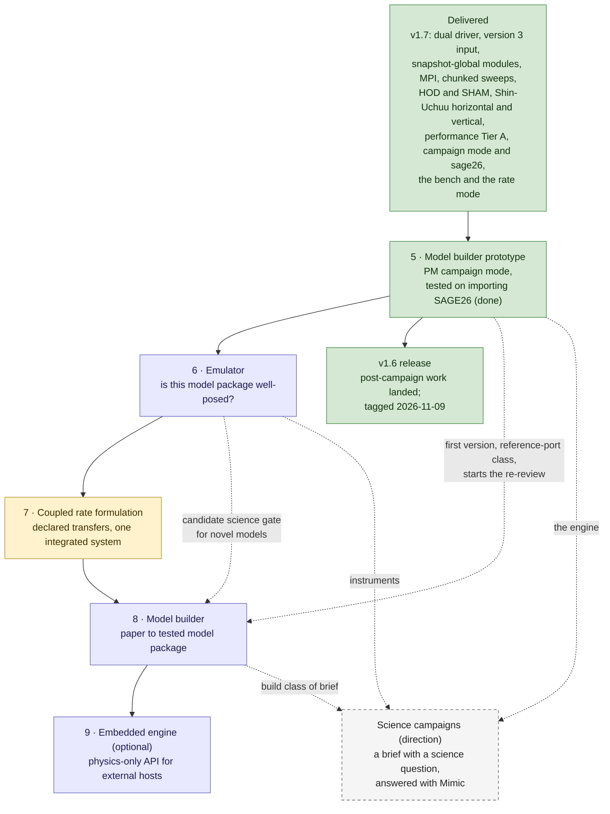

# Mimic Development Pathway

**Status:** Active planning index for `docs/dev/`, and the entry point for the next piece of work · last revised 2026-11-21.
**Scope:** The work still to do, in order, and the document that owns each piece. Finished work leaves `docs/dev/` for `archive/dev-plans/` and is summarised in one line under [Changelog](#changelog).

The architectural direction is governed by [`docs/VISION.md`](../VISION.md): a physics-agnostic core with runtime-configurable physics modules, metadata as structural truth, explicit validation, bounded memory, and reproducible output provenance. Durable facts about what Mimic is and does live in the guides, the package READMEs, the converter manual and format specification, the skills and the code; nothing outside `docs/dev/` cites anything in it.

---

## Where Things Stand

Roadmap steps 1 to 5 are complete (Shin-Uchuu end to end, snapshot-global modules, distributed snapshot operations, performance Tier A, and the model builder prototype: campaign mode, exercised on the SAGE26 import), and so is the work that grew around them: the HOD and SHAM packages, chunked slab streaming, the Shin-Uchuu version 3 datasets and the cut, vertical Shin-Uchuu, and the `sage26` model package. v1.6 (2026-11-09) carries all of it. The last release is v1.7 (2026-11-14), which adds the bench and the rate mode; `CHANGELOG.md` describes both.

**Step 7, stage 1 of [`AGENTIC-SCIENCE-ARCHITECTURE.md`](AGENTIC-SCIENCE-ARCHITECTURE.md), the coupled rate formulation's processing mode, is built, reviewed, closed, on `main` and released in v1.7 (2026-11-14). Four lab campaigns have since closed, `lab-physics` (2026-11-16), `lab-universe` (2026-11-17), `lab-families` (2026-11-18) and `lab-build` (2026-11-19), and `uchuu-trees` closed (2026-11-22: signed off by the owner on 2026-11-21, its production changes merged into `main` locally on 2026-11-22); what happens next, in order, is [The sequence from here](#the-sequence-from-here-owner-2026-11-17).** It was merged on 2026-11-14 (merge `8ec117b9` of branch `feature/coupled-rate-mode`, which stays on origin), before the lab campaigns, by the owner's decision of that day. The thirteen-slice plan ran from 2026-11-12 to 11-14. A post-implementation review on 2026-11-14 covered the whole branch (six independent domain reviewers, the suites re-run, experiments on the real mini-Millennium data) and found one blocking defect and ten further weaknesses; the owner accepted every finding and simplification, and all were implemented the same day. The review removed the starting-step rule (a nearly empty galaxy fed by a source failed before its first step; law evaluations on the fixture run on real data fell from 22.1 million to 5.5 million) and guarded the boundary between discrete phases and a rate segment (a negative or non-finite reservoir at segment start is refused, a total left not finite is refused, duplicate observers and a transfer into itself are refused). The tracer bound now tolerates a rounding residue, and the implicit scheme no longer underflows on a stiff system started off its slow manifold, but it is first order and documented as experimental. The end-to-end tests gained a stiff case and a comparison that can detect a missing canonical order. An independent external panel (Codex gpt-6.1-sol and Claude Opus 5.5, read-only, two rounds) then reviewed the implementation: no blocking finding, and the second round was clean apart from one stale pointer, since fixed. Validated on 2026-11-14 at commit `41217609`: the five package suites (sage16, sage26, halos-only, hod, sham) pass with strict baselines; the byte gate against `39a8d28e` passes all 8 legs with 0 galaxy differences, so no production output changed; `generate` and `check-generated` pass for all 50 pairs; and the rate battery (541 checks), the distributed gate (264), the snapshot-global battery (115 cases), the converter suite (1,211) and the bench suite (269) pass. The three CI jobs, run by hand at `ef6899be` in an Ubuntu 24.04 container (gcc 13.3; arm64, and emulated x86_64 without the converter and bench suites), pass with no compiler warning (run as root, such a container skips four permission-denial cases that two steps require; they pass as an unprivileged user, rerun on arm64 only). CI's first run with the mode, on the merge commit, passed all three jobs the same day. The mode as built is specified by the Doxygen of `src/core/rate_integrator.h`, `src/core/rate_assembly.h` and `src/core/module_registry.h` and explained in the Developer Guide's [Rate Callback Contract](../DEVELOPER-GUIDE.md#rate-callback-contract); the implementation plan, its acceptance record and the review are archived in `archive/dev-plans/` since 2026-11-14. The mode is proven on a model-neutral fixture only; no model package uses it, and the implicit scheme is experimental. v1.7 was tagged and published on 2026-11-14 and carries the bench and the rate mode. Nothing is owed on this step; the next actions are [The sequence from here](#the-sequence-from-here-owner-2026-11-17), run on the Mac Studio by the steps in `LAB-CAMPAIGNS-OWNER.md`, and how `main` sits beside the four lab campaigns is under [Merge order and the lab campaigns](#merge-order-and-the-lab-campaigns). The rate mode's open follow-ups are in the backlog's [Rate mode](MIMIC-BACKLOG.md#rate-mode) section. The architecture document is the working direction since 2026-11-12: it orders the work from here, and it may supersede the rest of this index depending on how its shakedowns go. The hand-back is with the SAGE26 team, who are working through it (about a month, as the owner judged on 2026-11-14); Mimic's `sage26` stays as released until they finish and is updated then. The sage26 import landed on `main` on 2026-11-08 (merge `275dd6cd`, campaign sage26 signed off at `470068a3`), the post-campaign work it deferred landed on 2026-11-09, and v1.6 was tagged and published the same day; the [Changelog](#changelog) has the lines. What is left is small and lives in [`MIMIC-BACKLOG.md`](MIMIC-BACKLOG.md), which also holds the hand-back and the release recipe. Step 6 is promoted (2026-11-12): the spike passed, and its evaluation boundary with history matching as the first method now lives in Mimic as `bench/mimic-bench/` (the bench), cleaned up as its post-implementation review recommended; the order of the work that follows is under [The order from here](#where-this-is-heading).

### The sequence from here (owner, 2026-11-17)

**This is the entry point.** The paper's own state is in the paper workspace's `paper/STATE.md`, which points back here for the order; the campaigns' operating steps are in `LAB-CAMPAIGNS-OWNER.md` beside the dossiers.

`lab-universe` closed on 2026-11-17 with four claims. Reviewing it, the owner's session found that the mini-Uchuu trees are wrong at z = 0: the L-Halo files (2022, converted outside Mimic by sage-model from the 2021 Consistent-Trees ASCII trees) carry a flyby demotion at their last snapshot, 3,108,878 FoF centrals (about 9% of the z = 0 halos) turned into satellites of their forest's most massive central and marked with a negative `MostBoundID`, the step Mimic removed from its own reader and converter on 2026-09-09 (the `mimic-failure-archaeology` skill, incident 9). `mini-uchuu-horizontal` inherits it. Every micro-Uchuu package and Shin-Uchuu were scanned and are clean. That explains `lab-universe`'s K1 (the z = 0 satellite-fraction gap between micro- and mini-Uchuu is the artefact, not volume) and puts K3's z = 0 half and K4 in question; K2 and K3's z ≈ 1.4 and 2 results do not touch it. It is our error, not paper material. `uchuu-trees` corrected it: mini-Uchuu regenerated from the 2021 ASCII trees by `convert/mimic-convert/ctrees_to_lhalo.py`, a second defect found and corrected on the way (in multi-tree forests, halos of later trees took another halo's `MostBoundID`), `Len` set at the suite's particle mass 0.0327 for mini- and micro-Uchuu, both horizontal sets remade, the converter guarded against the signature, and the reissued data installed on 2026-11-22; with `sage16`, the z = 0 satellite-fraction gap fell from +0.156 to +0.029. The record is [`UCHUU-TREES-CONVERSION.md`](UCHUU-TREES-CONVERSION.md).

| Step | Work | State |
|---|---|---|
| 0 | Toolkit fixes from `lab-universe` (ai-agent-coder `3dc95d1`: E1, E4, E5; E6 and E7 held in its `docs/deferred-machinery.md`), and the `lab-families` and `lab-build` briefs revised: the owner's mid-campaign instructions written in (a fourth attempt for a very-close slice, a campaign map at each milestone, Qwen as the third panel seat with Codex held for the audit), one *Declaring* clause, the instrument clause widened to any quoted script, an input-hygiene line, and two platform notes (the mini-Uchuu defect, missing tree files exiting 0) | Done 2026-11-17 |
| 1 | `lab-universe`'s findings pulled into the paper workspace as they stand, with the mini-Uchuu caveat beside K1, K3 and K4 so they cannot be misused | Done 2026-11-17 (paper workspace `01c3b5e`: `campaign-findings/lab-universe/`, `claims.md` E2a to E2d, trace-checked) |
| 2 | A new campaign, `uchuu-trees`, written (dossier `campaigns/uchuu-trees`, with `uchuu-trees-launcher.md` and `uchuu-trees-OWNER.md` beside it): audit every Uchuu dataset and the Millennium packages for the signature, full Uchuu from one or two files the owner copies from NT; correct mini-Uchuu in both forms by a route its Campaign Manager works out and brings to the owner before acting (re-conversion from the 2021 ASCII trees changes the package shape; a repair of the 2022 L-Halo files with the ASCII trees as the oracle may not); a converter guard against the signature; a re-test of K1 on the corrected trees (the z = 0 gap should vanish); every dependent updated. The owner copies the ASCII trees (about 770 GB; NT's `du` reports half that, because its filesystem compresses on disk) beforehand. Lands on `main` by the owner's merge | Written 2026-11-17; `campaign-preflight --owner` ready; launched 2026-11-19, after step 3 (step 4). Data staged 2026-11-18: the mini-Uchuu ASCII trees and the full-Uchuu sample (`mergertree_info.h5`, `mergertree_0.h5`) are on LaCie, with checksums matching NT. Signed off 2026-11-21; merged into `main` locally 2026-11-22 (the owner pushes) |
| 3 | `lab-families`, then `lab-build`, one after the other on their pinned base; each one's findings go into the paper as it closes | `lab-families` finished 2026-11-18 (owner) and is in the paper (paper workspace `4834621`: `campaign-findings/lab-families/`, `claims.md` E3a to E3d, trace-checked). Its lessons were applied before `lab-build` (owner, 2026-11-18): ai-agent-coder `f099ee7` (`answer-child --note`, controls owed per function down to the last writer, one plan-review sentence; reviewed clean by an external panel), and the `lab-build` brief revised for T4, T5 and the findings' shape; the `lab-build` and `uchuu-trees` briefs re-pinned to `f099ee7`. `lab-build` finished 2026-11-19 (owner) and is in the paper (paper workspace `180a6d9`: `campaign-findings/lab-build/`, `claims.md` E4a to E4e, recomputed from the reducer tables and trace-checked; `paper/science-focus-inputs.md` for step 6). Its lessons were applied before `uchuu-trees` (owner, 2026-11-19): ai-agent-coder `f8ab719` (`pm dossier counts` for the campaign's own record, a proportion rule for what needs controls, a named holdout, and five small fixes; reviewed by an external panel), and the `uchuu-trees` brief re-pinned to it, with T7 saying how those counts are quoted; `campaign-preflight --owner` is `ready` | Done 2026-11-19 |
| 4 | `uchuu-trees` runs | Launched 2026-11-19; signed off by the owner on 2026-11-21; the reissued data installed on 2026-11-22 and the release merged into `main` locally on 2026-11-22 ([`UCHUU-TREES-CONVERSION.md`](UCHUU-TREES-CONVERSION.md)). Its findings are read into the paper with ai-agent-science's `evidence.md` when it closes, and ai-agent-coder's three pending sentences (the architecture document's stage 3) follow |
| 5 | Decide whether K3's z = 0 half or K4 is re-run on the corrected trees; if so, one small campaign for that alone | Folded into 6 (owner, 2026-11-19): no re-run by default. Neither result is strong even on correct trees (K3 is confounded across simulation families and does not survive refinement; K4 extrapolates and its margin shrinks with refinement), E2b is unaffected, and `uchuu-trees`' T5 re-tests K1 on the corrected trees anyway. A re-run happens only if the chosen focus needs a simulation-axis result that E2b and that re-test cannot carry |
| 6 | The paper's science case chosen and refined from all the campaigns, with step 5's question settled against it | After 4 |

Stage 2a of the architecture document (sci-paper becomes ai-agent-science) was built on 2026-11-17, beside 3 to 5, and the paper workspace was migrated to it the same day; still only one session at a time in the paper workspace. The campaign toolkit (ai-agent-coder) is frozen from step 3's first launch until the last of these campaigns closes: it is one iCloud-synced copy that every brief pins, and later lessons wait. The owner lifted the freeze between `lab-families` and `lab-build` (2026-11-18) and again between `lab-build` and `uchuu-trees` (2026-11-19), each time for the lessons step 3 names; it is frozen again from `uchuu-trees`' launch. ai-agent-science is not pinned by any brief, and stage 2b changes it as the paper teaches it (v5, 2026-11-19: a core of rules, a map of stages, reader briefs and per-paper reference files; v6, 2026-11-21: every stage has a file, with the stylist central to planning and writing; v6.1 the same day: an investigation can commission the reader briefs; see the architecture document).

---

## Where This Is Heading

**The goal the remaining steps serve is science campaigns:** the owner writes a brief containing a science question, and a Campaign Manager answers it with Mimic in a long, mostly unattended campaign, reading the literature, building tools and models, running experiments, judging the results against the brief, and bringing the owner in where a decision is the owner's. [`AGENTIC-SCIENCE-ARCHITECTURE.md`](AGENTIC-SCIENCE-ARCHITECTURE.md) is the working direction (adopted 2026-11-12): the homes, the tools and where each lives, what a science campaign run is, and the staged road. It superseded the science-campaigns map (proposed 2026-11-10), archived on 2026-11-21 to the gitignored `archive/dev-plans/`; the architecture document's [What Happens to `docs/dev`](AGENTIC-SCIENCE-ARCHITECTURE.md#what-happens-to-docsdev) says where the map's content now lives.

Read against that goal, the road's parts are one system:

- **Engine:** campaign mode (built), taking three classes of brief: port (done, the import), build (step 8) and investigate (new).
- **Apparatus:** Mimic (built). A model package is a hypothesis that can be run, and swapping a module in a run file is a controlled experiment.
- **Instruments:** the bench, `bench/mimic-bench/`, holds the first evaluation boundary and its first method (history matching with emulators), promoted from step 6's spike. Others join as campaigns need them, chosen by the question asked: is the effect numerical, what matters, what does the data exclude, where is the fit, does it predict held-out data, is structure A better supported than B.
- **Constraints:** one shared source of observations, consumed by the figures and the instruments alike (missing).
- **Literature and write-up:** ai-agent-science (sci-paper until 2026-11-17), a separate repository; v6.1 (2026-11-21) has a file for every stage of writing a paper, and its reader briefs (checker, challenger, referee and stylist) can also be commissioned by a campaign. What v6 built is refined by writing the Mimic paper: the stylist's runs, `evidence.md` on `uchuu-trees`' findings, the referee's first runs and `finish` at submission.

The largest gap is not a tool. An import is gated by parity with a reference, and an open question has none, so a science campaign needs claims as its unit of progress, each with a test declared in advance, and a refutation counted as an answer.

**The direction is not a frozen plan.** The stages below are chosen for what they tell us, and any of them may redraw the direction and the order of the road, including the numbered steps under [The Ordered Road](#the-ordered-road). The architecture document records the decisions taken and the ones still open.

**The order from here** follows the stages of the architecture document, whose table says what ends each:

1. **The rate mode of the coupled rate formulation (step 7), in Mimic's core: built, reviewed, closed and merged into `main` (2026-11-14, merge `8ec117b9`) and released in v1.7 the same day.** It ran as an ordinary Mode B plan derived from [its brief](MIMIC-COUPLED-RATE-FORMULATION-PLAN.md) and is proven on a model-neutral fixture; the plan, its acceptance record and the post-implementation review are archived in `archive/dev-plans/`. The merge came before the lab campaigns, which stay on their pinned base (see [Merge order and the lab campaigns](#merge-order-and-the-lab-campaigns)). No model package is converted in this step.
2. **The paper skill and the Mimic paper.** sci-paper was restructured as ai-agent-science (stage 2a, built 2026-11-17), reshaped as v5 (2026-11-19) and completed as v6 and v6.1 (2026-11-21), every stage with a file; it is refined from use by writing the Mimic paper, which is the first paper. The four lab campaigns supply the paper's demonstration experiments (see [Merge order and the lab campaigns](#merge-order-and-the-lab-campaigns)). This shares nothing with step 1 and can run beside it.
3. **Minimal versions on branches** of ai-agent-coder, ai-agent-science and Mimic. (Overtaken in practice for the toolkits: the lab campaigns ran without them, ai-agent-coder took their lessons on its `main`, and ai-agent-science reached v6.1; what stays owed is listed in the architecture document's stage 3.) The Mimic branch gives the figures and the bench one source of observational tables, reviews where the bench lives (decided on 2026-11-12 as inside Mimic, `bench/mimic-bench/`), consolidates `docs/dev/`, and holds step 8's re-review, which the architecture document proposes to close by retiring the model-builder plan with its requirements carried.
4. **The numerics campaigns, on the published models** (the first science campaigns planned as such; the lab campaigns of 2026-11-14 to 11-19 ran before them as shakedowns). `sage16` and `sage26` stay as published. A small campaign measures their numerics as shipped (time-step convergence and module-order dependence). A large one then forks `sage16` onto the rate mode as `sage16rate`, shows convergence and order-independence, and seeks the parameters that reproduce the published results, if that is possible. The forks are not new models for publication: they test and develop the machinery, as the SAGE26 import did for campaign mode, and each campaign's lessons go back into the toolkits.
5. **`sage26` forked the same way,** then a paper to reproduce and an open question.

Two small measurements on the bench still stand, and either can run at any time: the direct roughness measurement of the count noise (tight clusters of runs, minutes; [the brief's requirement 3](MIMIC-EMULATOR-PLAN.md#requirements-carried-to-the-instrument-plan)), and a time-step capture, which a `run_file.overrides` of `SubSteps` already carries. A question answered by direct evaluation needs two small bench changes first, because a spec today requires the emulator sections and takes its bins from the constraint table: analysis without the emulator sections, and an explicit bin grid. The bench's own instrument plan waits on a defended discrepancy budget with a numerical term and on the one source of observational tables.

### Merge order and the lab campaigns

**The lab campaigns.** Four small science campaigns supply the demonstration experiments for the Mimic paper (stage 2 of the order above). Each varies one thing Mimic makes interchangeable: `lab-physics` varies the physics (which combinations of the choices between SAGE16 and SAGE26 carry the non-additivity that SAGE26 Paper I found), `lab-universe` varies the simulation (with nothing re-tuned, which predictions belong to the model and which to the simulation), `lab-families` varies the kind of model (what a semi-analytic model, a SHAM and an HOD each assume, on the same trees), and `lab-build` varies the scientist (what it takes for agents to add a published prescription as a new module, under `models/lab-build/`). Their dossiers, the owner guide (`LAB-CAMPAIGNS-OWNER.md`) and one launcher file per campaign are in `/Users/dcroton/Local/git-repos/campaigns/` on the Mac Studio, their one home, outside this repository. Each runs on its own branch `integration/<id>` in its own checkout (`/Users/dcroton/Local/git-repos/mimic-<id>`), created from the campaign base pinned in its brief, `main` at `4bafe3b0`. None lands anything on `main`, and each ends with `findings.md` and `figures/` in its dossier, which the paper reads. The order was `lab-physics` first and alone (it is the shakedown of the new conventions), then `lab-universe`, then `lab-families` and `lab-build` one after the other ([The sequence from here](#the-sequence-from-here-owner-2026-11-17)). `lab-physics` ran from 2026-11-14 to 11-16 and `lab-universe` from 2026-11-16 to 11-17, and both are signed off; `lab-families` followed and finished on 2026-11-18, and `lab-build` ran from 2026-11-18 to 11-19; all four are signed off.

**How the paper uses them (owner, 2026-11-16).** The paper's focus is not fixed in advance. The four campaigns gather evidence first; the paper is then shaped around the results that prove most promising and convincing, and if none is strong enough, what they taught is used to design further campaigns. So no campaign has to carry the paper, and refinement of any one result waits until all four can be compared.

**Decision (owner, 2026-11-14): the rate mode is merged into `main` first, and the campaigns stay on their pinned base.** The merge was made and pushed the same day (merge `8ec117b9`). No brief was re-pinned and no integration checkout was touched.

Why this order:

- The campaigns were written and preflight-tested against the pinned base, and their tooling expects `main` to move, so the merge changes nothing for them.
- Nothing a campaign does lands on `main`, and none uses the rate mode, so the two do not interact.
- The rate mode changes no production output. The byte gate compares every galaxy byte against `39a8d28e`, and the campaign base differs from that commit only in `docs/dev`, so a result obtained at the pinned base is the result the merged `main` gives. That is the statement the paper needs.
- Waiting would have kept a branch of about 24,500 changed lines unmerged for the weeks the campaigns take, with every fix to `main` carried across, and would have held back the release and the next stage of the road (the numerics campaign and the `sage16rate` fork), which need the mode on `main`.

**The picture while the campaigns run:**

| Order | Campaign | Checkout and branch | Base | State (update as each moves) |
|---|---|---|---|---|
| 1, alone | `lab-physics` | `mimic-lab-physics`, `integration/lab-physics` | `4bafe3b0` | Finished and signed off (2026-11-16): 14 plan nodes, integration head `7d1e7c8c`, nothing outside `experiments/lab-physics/` changed; five claims declared, four supported and one unresolved; findings in its dossier |
| 2 | `lab-universe` | `mimic-lab-universe`, `integration/lab-universe` | `4bafe3b0` | Finished and signed off (2026-11-17): 9 plan nodes, integration head `6413cdba`, nothing outside `experiments/lab-universe/` changed; four claims: K1 and K2 supported, K3 supported at the shipped step only, K4 unresolved; K1's z = 0 gap is the mini-Uchuu tree defect ([The sequence from here](#the-sequence-from-here-owner-2026-11-17)) |
| 3 | `lab-families` | `mimic-lab-families`, `integration/lab-families` | `4bafe3b0` | Finished and signed off (2026-11-18): 17 plan nodes (budget raised from 16 by the owner), measured integration head `6d680104`, then `3faae55f` (the owner's re-pin of the product policy, its one change outside `experiments/lab-families/`); four claims, C1 to C4 supported, each surviving SubSteps 10, 30 and 100; findings in the paper; micro-Uchuu only, so the defect does not reach it |
| 4 | `lab-build` | `mimic-lab-build`, `integration/lab-build` | `4bafe3b0` | Finished and signed off (2026-11-19): 22 of 26 plan nodes, integration head `5569efd6`, 214 files changed, all under `models/lab-build/` and `experiments/lab-build/`; five claims, C1 to C5, supported at SubSteps 10, 30 and 100 on mini-Millennium files 4 to 7, of which only the SubSteps 30 and 100 legs were held out (the SubSteps 10 leg had already run as quality assurance, and C5's statistic uses it; the owner kept the verdicts with that qualification); findings in the paper; `models/lab-build/` comes to `main` only if the owner wants it |
| 5 | `uchuu-trees` (not a lab campaign) | `mimic-uchuu-trees`, `integration/uchuu-trees` | `257c1358` | Written 2026-11-17; toolkit pin `f8ab719` (2026-11-19); launched 2026-11-19, signed off 2026-11-21; corrected mini-Uchuu and audited the Uchuu suite; its production changes (converter tools and guard, the rate-phase test fix, documentation) merged into `main` locally on 2026-11-22, with `experiments/` kept off `main` at local tags |

- **`main` and the campaign base now differ, and that is expected.** `main` is the base plus the rate mode (and whatever lands later). The campaign toolkit's `campaign-preflight` checks that each integration branch descends from the pinned base, not that `main` equals it; the difference is not a fault and needs no action.
- **A campaign that needs a core fix** gets it by the fix landing on `main` and `main` being merged into that campaign's integration branch. That also brings the rate mode, which is inert in a run file with no rate phase; record the merge in the campaign's dossier, since its runs before and after it are on different commits.
- **v1.7 was released from `main` on 2026-11-14 and does not affect the campaigns.** The campaign base is not a release: `git describe` gives `v1.6-18-g4bafe3b0`, which is v1.6 plus the bench, the rewritten `sage16` and `sage26` tests and the UTC run times.
- **The paper cites the campaign base** for the experiments. That v1.7 gives the same galaxy output is measured where the byte gate ran, `halos-only` and `sage16` on mini-Millennium. For the other models and simulations a campaign uses, the paper makes the statement only after re-running the demonstrations it keeps at v1.7 and comparing by content; that waits until the paper's focus is chosen.
- **The three remaining briefs were revised on 2026-11-16** for the campaign toolkit's owner preflight (`campaign-preflight --owner`, which replaces the hand-written preflight script) and with what `lab-physics` showed: a confirming run must be held out from the exploration, because the runs are deterministic; raw output is compared by content, because a rebuild changes every output file's bytes and none of its data; and the audit's fixes are budgeted. Raw outputs for all four campaigns are on `/Volumes/Scratch`. Later the same day `lab-families` and `lab-build` gained their prior-work inputs, and each of the three policies came to deny the other lab campaigns' integration checkouts and node worktrees too; their branches stay readable through git, because every checkout is a worktree of this repository, and each brief says so.
- **`lab-build`'s `models/lab-build/`**, if the owner wants it on `main`, merges onto a `main` that has the rate mode: a one-directory merge, plus a port of its baseline test, since a package forked at the base carries the output-name assertion that v1.7 replaced with `check_output_names` (read from the code, not run).

**Considered and not chosen:** finishing the campaigns and then merging, which keeps `main` equal to the campaign base throughout at the costs in the fourth reason above; and merging and then moving the four campaigns to the new `main`, which would run the paper's experiments on the release that describes them but needs all four briefs re-pinned and the preflight and setup trials re-run, for no change in any result.

**After the campaigns:** keep the branches (the evidence reports live on the node branches); the paper session reads the dossiers; and `lab-build`'s package comes to `main` only if the owner wants it there.

---

## The Ordered Road

Four numbered steps remain. The numbered order is the **planned order**, not a dependency chain: each step is worth building on its own, but several are worth more in combination. The dotted arrows mark where one step feeds a later one, and [Why this order](#why-this-order) records where a later step constrains other work.

| Step | Work | Owned by | Gate or next action |
|---|---|---|---|
| **5** | **Model builder prototype** — PM campaign mode: a Campaign Manager that plans, runs and validates a campaign against an owner-approved dossier through child PMs and read-only tasks, tested on importing SAGE26 as `models/sage26` | The campaign dossiers (shakedown, shakedown 2, sage26) and ai-agent-coder's `campaign-mode.md`; the design brief is archived | **Done** (2026-11-08): the import met all five targets and is merged; see [Step 5](#step-5-model-builder-prototype-done). The work it deferred landed on 2026-11-09 (the [Changelog](#changelog) line); the toolkit's own machinery work document is in ai-agent-coder (`docs/sage26-campaign-machinery-work-20261108.md`) |
| **6** | **Emulator** — is a model package well-posed, and what constrains what | [`MIMIC-EMULATOR-PLAN.md`](MIMIC-EMULATOR-PLAN.md); the spike's implementation plan and review are archived (`archive/dev-plans/MIMIC-EMULATOR-IMPLEMENTATION-PLAN.md`, `archive/dev-plans/MIMIC-EMULATOR-SPIKE-REVIEW-2026-11-11.md`) | **Promoted (2026-11-12).** The calibrated-variance spike passed (2026-11-11: 400 training and 200 holdout `sage16` runs, 16 core outputs, a 0.1 dex gate budget not yet defended; Bayes linear 15 of 16 outputs validated, Gaussian process 16 of 16). The owner accepted every recommendation of its review: Gaussian process primary, declared count noise in the fit and at prediction, `log10 phi`, and the instrument inside Mimic. The package moved into `bench/mimic-bench/` with the review's boundary cleanup, simplifications and test additions; the spike's own repository, `mimic-emulator` (local only), is archived as the spike's record. Next: the instrument plan, after gate item 2 (a declared constraint set with a defended discrepancy budget); its requirements are listed in the brief |
| **7** | **Coupled rate formulation** — declared transfers, one integrated system | [`MIMIC-COUPLED-RATE-FORMULATION-PLAN.md`](MIMIC-COUPLED-RATE-FORMULATION-PLAN.md), with [`SAGE16-PRESCRIPTION-CLASSIFICATION.md`](SAGE16-PRESCRIPTION-CLASSIFICATION.md) and [`SAGE26-PRESCRIPTION-CLASSIFICATION.md`](SAGE26-PRESCRIPTION-CLASSIFICATION.md) as its settled inputs | **Stage 1 built, reviewed, closed, merged into `main` (2026-11-14, merge `8ec117b9`) and released in v1.7.** The rate mode is implemented and proven on a model-neutral fixture (thirteen slices on branch `feature/coupled-rate-mode`, Project Manager Mode B), then reviewed as a whole and its findings implemented the same day; the implementation plan, the acceptance record and the post-implementation review are archived in `archive/dev-plans/`, and [Where Things Stand](#where-things-stand) has the validation. The merge came before the lab campaigns ([Merge order and the lab campaigns](#merge-order-and-the-lab-campaigns)). The brief's measurement spike, its new package and its recalibration become campaign work on a fork of `sage16` (`sage16rate`), under the architecture document's stage 4 |
| **8** | **Model builder** — paper to tested model package | [`MIMIC-MODEL-BUILDER-PLAN.md`](MIMIC-MODEL-BUILDER-PLAN.md) | Its re-review, due since 2026-08-12, starts from the sage26 campaign's retrospective and the post-campaign review's axis 1, now that v1.6 is released. Novel models still need a science gate, with step 6 the candidate. The science-campaigns map (archived 2026-11-21) proposed that its orchestration become the build class of campaign brief, with its requirements kept, and `lab-build` (2026-11-19) has since exercised that class. The architecture document proposes to close the re-review at its stage 3 by retiring the plan with its requirements carried as the clauses of a build brief |
| **9** | **Embedded engine** — optional, possibly never | [`MIMIC-EMBEDDED-ENGINE-PLAN.md`](MIMIC-EMBEDDED-ENGINE-PLAN.md) | Nothing depends on it. Promote only if a scientific need arises |

**Open candidates, unnumbered and unscheduled.** Each becomes a step only when the owner chooses it.

- **The map's pieces:** a science shakedown campaign, a science brief template with a claim ledger (in ai-agent-coder, tried first as a convention on existing targets), and one shared source of observational constraints that the figures consume (a Mimic change outside the core). Each belongs to stage 3 or 4 of [`AGENTIC-SCIENCE-ARCHITECTURE.md`](AGENTIC-SCIENCE-ARCHITECTURE.md); [Where This Is Heading](#where-this-is-heading) has the order.
- **4.3, thread-per-forest parallelism** (spectrum item 16). `mpirun` already scales both drivers to 85 to 86% efficiency at 16 ranks on the full mini-Uchuu box ([`MIMIC-PERFORMANCE-REFERENCE.md`](MIMIC-PERFORMANCE-REFERENCE.md)), so threads would buy that efficiency gap and intra-node balance, not a new order of magnitude; they pay where memory rather than cores is the bound (where `input.forest_chunks` already applies). Determinism is in place (no RNG in the physics path, module statics write-once at `init()`); the work is instancing enumerable global mutable state, with bit-identity an acceptance criterion and `MPI_THREAD_FUNNELED` sufficient, since the MPI decomposition keeps every call between FoF sweeps.
- **Further performance work** (the spectrum's Tiers B and C, and the performance residuals below). Months of work whose value is best judged after 4.3, if it runs. Batched dispatch and the SoA generator (items 17 and 19) stay deferred behind step 7, and the spectrum's Tier D (module-major interchange, static fusion and language changes, GPU offload at this scale, substep reduction) is ruled out with measurements: do not re-propose it without new evidence. The baseline to measure against is the closing composite in the spectrum's [Tier A outcome](OPTIMISATION-SPECTRUM.md#outcome-of-the-tier-a-plan-2026-10-22) (full tables in the archived acceptance record's Slice 9). Any of it starts from a frozen implementation plan with acceptance slices, must clear `make tests-reference-identity REFERENCE_COMMIT=<hash>`, and, if it touches the drivers, must keep the distributed and chunked gates (`make tests-distributed`) and the cross-format identity gates green.
- **Full Uchuu.** Converted only from its six-halo fixture. It is storage-bound before it is memory-bound (about 37 TB of source and about 26 TB of output), and it has its own super-forest question, which chunking and distribution cannot get past because a forest is never split. The Shin-Uchuu route (census, decided cut table, `convert_trees.py ingest --cut-table`) is the template.
- **Shin-Uchuu laptop acceptance.** The 16 GiB laptop class is met only by a proxy: one task at 128 chunks peaked at 6.17 GB on the Mac Studio under `MallocLargeCache=0`. It becomes an acceptance when a laptop of that class runs it.
- **`sage16` gates for the four `halos-only`-gated routes** (`micro-uchuu-horizontal`, `micro-uchuu-hdf5-horizontal`, `millennium-horizontal`, `mini-uchuu-horizontal`), whose parity is so far proved for `halos-only` only.
- **Output provenance for version 3 inputs**, so a run records the conversion that produced its input.
- **Key SAGE26's regime draw upstream, then compare on Mimic's own core.** A keyed CGM-regime draw in SAGE26 (the hand-back asks for it) would remove the one stochastic difference between the codes and allow a deterministic own-core comparison; the remaining differences (the particle-mass constant, the substep floor, float halo state and the rest of the alignment set, each measured in `tools/core-alignment/items.md` on the `sage26/import-tooling` branch) would then be measured on their own. When SAGE26 has one, re-key `models/sage26/shared/sage_keyed_draw.h` to match and re-measure T1 unaligned.

### Why this order

- **The prototype comes first (decided 2026-10-22)** because nothing still on the road is its prerequisite, and the later steps gain more from it than it gains from them. Its exercise is a reference port, gated by comparison with SAGE26's own output, which is a stronger gate than step 6 would supply. Importing SAGE26 gives the emulator the second distinct model structure its case and its gate need, and the builder turns step 7's migration of each package into a campaign, a candidate second exercise. It uses step 4's byte gate, `make tests-reference-identity`, as its "existing packages unchanged" ratchet.
- **The coupled rate formulation is certain, not contingent** (decided 2026-08-20): sequential operator splitting has no defined answer, since permuting a run file's module list changes the result. Its constraints on earlier steps were honoured in advance and have landed: snapshot-global modules built the mode machinery as an open set that a rate mode can join, distributed operation shards by whole forest, so no transfer-graph component is split across ranks, and the performance work added no dispatch mode.
- **The emulator precedes the coupled rate work** because it is an instrument: built early it can measure what follows it, and the coupled-rate gate needs two structures compared on equal footing, which a point calibration cannot do.
- **Step 7 constrains any further performance work:** batched dispatch and the SoA generator (spectrum items 17 and 19) stay out of every performance plan, because the coupled-rate work deletes the transport-scratch state SoA would transpose and owns the next extension of the mode machinery.

---

## Step 5: Model Builder Prototype (done)

The design brief that shaped this step is archived as `archive/dev-plans/MIMIC-MODEL-BUILDER-PROTOTYPE-2026-10-24-design-brief.md` (revised 2026-10-23 to match campaign mode as built, retired 2026-10-24 once it only restated the toolkit's own contract); the live contract is ai-agent-coder's `skills/project-manager/references/campaign-mode.md`, and the live plan of work is each campaign's dossier. ai-agent-coder's Project Manager (PM) has a **campaign mode** (Mode C), built on ai-agent-coder's branch `feature/pm-campaign-mode` and merged to its `main` on 2026-11-08 (`1ab21d3`). A Campaign Manager (CM), a `project-manager` seat in campaign mode, keeps a **dossier**: a small git repository whose `brief.md` (goal, targets and tolerances, allowed paths and the pinned protected-paths policy file, reserved decisions, budgets, exclusions) only the owner changes. It delivers against that dossier by itself, through three kinds of node:
- **change nodes:** small implementation plans run by ordinary child PMs in their own worktrees, then merged;
- **evidence nodes:** 1–2 slice plans whose deliverable is a committed report, read and never merged;
- **task nodes:** hand-written, read-only `orchestrator` tasks.

Validation, diagnosis and plan review are just nodes. Worktrees and parallel sessions are designed in, and the first campaigns run serially. Importing SAGE26 as `models/sage26` is the exercise it is built and tested against, after a shakedown campaign proves the machinery on Mimic. It is a first working version of step 8's builder for the reference-port class, and [`MIMIC-MODEL-BUILDER-PLAN.md`](MIMIC-MODEL-BUILDER-PLAN.md) stays its requirements anchor.

| # | Work | Where | Notes |
|---|---|---|---|
| **5.1** | **Implementation** | ai-agent-coder | **Done** (2026-10-23, on `feature/pm-campaign-mode`, now at `30783f1` after a documentation reflow to the Mode A/B/C vocabulary and `launch-child --setup`; merged to ai-agent-coder's `main` on 2026-11-08 as `1ab21d3`): protected paths in PM (`check-plan` and `init --policy`, enforced by `grant` and floor fact 5), the four child commands `launch-child`, `wait-child`, `answer-child` and `stop-child`, a question channel for Developers and child PMs, the campaign-mode reference and dossier template, the Mode B launcher's campaign-child block with PM's plan-defect section aligned to it, and a deliberate VISION revision; about 1,700 lines of Python and 688 PM tests, from a ten-slice PM Mode B run, a post-run review and its panel-reviewed hardening. The archived brief's *What Was Built* has the detail |
| **5.2** | **Groundwork** | The owner's machine | **Done** before the shakedown (2026-10-24). The replay corpus gathered from `archive/`, each campaign with its starting commit; the step 4 run's costs, from the PM run report and ledger named in `archive/dev-plans/HANDOFF-performance-tier-a-2026-10-22.md` and from the harness; the answer key moved out of the Obsidian vault, beyond the reach of any agent running a campaign; the environment (container or VM, the notification channel); one worktree parent directory the owner trusts in each harness, since a trust dialog fails a child's launch; `campaign-policy.json`, committed here by the owner by hand on `main` at preflight, after settling what it protects, and pinned in the brief by the file's SHA-256 digest (`shasum -a 256 campaign-policy.json`, the value a child's `run.json` records as `policy.protected_paths_source.sha256`) and the commit that added it. The environment is settled here, not in `brief.md`. **Status:** `campaign-policy.json` committed on `main` (2026-10-24); the directories, the `integration/shakedown` checkout and the model-free trial done; the trust check, the answer key and the environment remain the owner's, as ordered preflight steps in the companion files `campaigns/sage26-OWNER.md` and `campaigns/shakedown-OWNER.md` beside the dossiers. The costs were not extracted, so the spend limit is the owner's to set, and the replay corpus waits on P0r |
| **5.3** | **The shakedown campaigns** | `integration/shakedown` and `integration/shakedown2` here, from the dossiers at `/Users/dcroton/Local/git-repos/campaigns/shakedown/` and `shakedown2/` | **Done** (2026-10-24 to 10-27). A throwaway `models/shakedown`, a copy of `halos-only`, built and gated on mini-Millennium with `sage16` unchanged, through a change node, a ratchet, a reserved node, a refused protected-path plan, a kill-and-restart and a clean cleanup; the first run's review (ai-agent-coder's `docs/shakedown-review-20261025.md`) and its fixes, then a second run clean. The branches are archive-tagged and never merged |
| **5.4** | **P0 and P0r** | The campaign dossier | **P0 done** (2026-11-03): the owner reviewed the CM's evidence and first work table against the held-out answer key before any change node launched; every must-find item was found, two should-find items were not (sage16's binary-bound tests; the step 7 classification, since written). P0r, replaying archived campaigns against their human-approved answers, is unscheduled |
| **5.5** | **The import** | `integration/sage26` here, merged to `main` as `275dd6cd` | **Done** (2026-11-03 to 11-08; signed off at `470068a3`). 54 child runs (21 change nodes, 22 ratchets, 6 evidence, 2 experiments, 3 instrument), 100 slices all accepted, about 103 plan-review rounds, one acceptance audit on a different model; 145 h of child time over five days. All five targets met: bit-for-bit parity with SAGE26 at all 56 snapshots under a frozen ten-patch core-alignment set and, on Mimic's own core, SAGE26 up to the random realisation of the CGM-regime draw; both drivers identical; `sage16` unchanged; the gates green; 48 figures and the documents; since the v1.6 cleanup the oracle, the instrument and the alignment set live on the `sage26/import-tooling` and `sage26/core-alignment` branches, not on `main`. The brief's targets, reserved classes and no-loosening rule held; the dossier at `/Users/dcroton/Local/git-repos/campaigns/sage26/` (archive copy `/Volumes/Internal/results/sage26-campaign/dossier.git`) holds the record, and its `post-campaign/` directory the review on three axes: the import, the machinery (the toolkit changes, now ai-agent-coder's `docs/sage26-campaign-machinery-work-20261108.md`) and the cleanup. Step 8's re-review follows the post-campaign work |

**Next action.** v1.6 is released (2026-11-09) and the hand-back is with the SAGE26 team (under *Release* in [`MIMIC-BACKLOG.md`](MIMIC-BACKLOG.md)). Step 8's re-review, from the campaign's retrospective and the review's axis 1, is folded into the architecture document's stage 3 (its open decision on retiring the model-builder plan); `lab-build` (2026-11-19) has since exercised the build class.

**Hold-out discipline (historical; it bound this index while the campaigns ran).** The exercise tests the builder only if it finds the obstacles itself, so no document here named them and the answer key stayed outside every repository until the sign-off (it is now committed to the dossier). The import's `brief.md` *Exclusions* named all of `docs/dev/` in any checkout and through git history, including this index, whose step 5 section and residuals describe the repository's known limits. They also named:
- the main checkout's `archive/` and `.orchestrator/`, since gitignored copies of excluded documents sit there (archived plans, review inputs);
- `archive/` in ai-agent-coder;
- the owner's SAGE26 checkout and the Obsidian vault;
- other sessions' transcripts and scratch space;
- the owner's companion file.

The rule for a future campaign is the same: do not pre-solve campaign content, since fixing a gap, residual or upstream issue the campaign would hit, or doing any of the exercise's work by hand, removes test signal. The toolkit lesson of this campaign is that the exclusion must be mechanical (a sparse checkout the launcher applies), not a read denial inside a worktree: ai-agent-coder's machinery work document, item 1.

**What lands in this repository.** `campaign-policy.json` at the root, committed by the owner by hand on `main` at the import's preflight, holding protected paths only and pinned in each campaign's `brief.md` by the file's SHA-256 digest (`shasum -a 256 campaign-policy.json`, the value a child's `run.json` records as `policy.protected_paths_source.sha256`) and the commit that added it; then whatever the campaign itself lands, node by node, on its integration branch, whose merge to `main` is the owner's. Nothing tracked changes for a child PM's HANDOFF.md, which `launch-child` keeps untracked through the product repository's git exclude file. Campaign mode lives in ai-agent-coder's `project-manager` skill, and each campaign's dossier lives outside both repositories.

---

## Documents in `docs/dev/`

| Document | Role |
|---|---|
| `MIMIC-DEVELOPMENT-PATHWAY.md` | This index: the road ahead, the next task, and a one-line changelog of finished work |
| [`AGENTIC-SCIENCE-ARCHITECTURE.md`](AGENTIC-SCIENCE-ARCHITECTURE.md) | The working direction (adopted 2026-11-12), reaching beyond Mimic: the homes (two toolkits, a subject, and records), the tools and where each lives, what a science campaign run is, the standard of evidence as clauses in a brief, the staged road, and the decisions taken and open. It revises the campaigns map and may supersede the rest of this directory |
| (archived) `MIMIC-SCIENCE-CAMPAIGNS-MAP.md` | Direction brief (2026-11-10), superseded by the architecture document and archived on 2026-11-21 to the gitignored `archive/dev-plans/`: four of its seven failures are carried in the architecture document's [The Standard of Evidence](AGENTIC-SCIENCE-ARCHITECTURE.md#the-standard-of-evidence) and three (process overwhelming the experiments, a question left too open, commitment to a refuted hypothesis) remain only in the archived map, last in git at `54c6bffc`; and where the rest of its content lives is in that document's [What Happens to `docs/dev`](AGENTIC-SCIENCE-ARCHITECTURE.md#what-happens-to-docsdev) |
| [`MIMIC-BACKLOG.md`](MIMIC-BACKLOG.md) | Standing: small items, bounded fixes and decisions not being addressed now, each with what to do and how to accept it; also the release recipe and the SAGE26 hand-back |
| (archived) `MIMIC-MODEL-BUILDER-PROTOTYPE-2026-10-24-design-brief.md` | Step 5's design brief, in `archive/dev-plans/` since 2026-10-24: the live contract is ai-agent-coder's `campaign-mode.md` and the live plan of work is each campaign dossier; this index's [Step 5](#step-5-model-builder-prototype-done) keeps the exercise, the hold-out discipline and what lands here decisions, the import's drafted brief, and the design review's findings |
| [`MIMIC-EMULATOR-PLAN.md`](MIMIC-EMULATOR-PLAN.md) | Step 6: requirements brief, promoted; holds the decisions taken at promotion and the instrument plan's requirements |
| (archived) `MIMIC-EMULATOR-IMPLEMENTATION-PLAN.md` | Step 6's spike plan, in `archive/dev-plans/` since 2026-11-11: the spike ran and passed, and its result is recorded in the brief's [Result of the spike](MIMIC-EMULATOR-PLAN.md#result-of-the-spike-2026-11-11) |
| (archived) `MIMIC-EMULATOR-SPIKE-REVIEW-2026-11-11.md` | Step 6's post-implementation review, in `archive/dev-plans/` since 2026-11-12: its findings are done in `bench/mimic-bench/` or carried as the brief's [requirements for the instrument plan](MIMIC-EMULATOR-PLAN.md#requirements-carried-to-the-instrument-plan) |
| [`MIMIC-COUPLED-RATE-FORMULATION-PLAN.md`](MIMIC-COUPLED-RATE-FORMULATION-PLAN.md) | Step 7: requirements brief for the rate mode in the core, revised 2026-11-12; it records the owner's decisions. Stage 1 is closed (2026-11-14) and the brief carries an as-built note where the mode differs from it |
| (archived) `MIMIC-COUPLED-RATE-IMPLEMENTATION-PLAN.md` | Step 7, stage 1's frozen implementation plan, in `archive/dev-plans/` since 2026-11-14: thirteen slices run by the Project Manager; the mode as built is specified by the Doxygen of `src/core/rate_integrator.h`, `src/core/rate_assembly.h` and `src/core/module_registry.h` and explained in the Developer Guide's [Rate Callback Contract](../DEVELOPER-GUIDE.md#rate-callback-contract) |
| (archived) `MIMIC-COUPLED-RATE-ACCEPTANCE.md` | Step 7, stage 1's acceptance record, in `archive/dev-plans/` since 2026-11-14: the brief's gate item by item with its evidence, every command with its exit code, the cost tables measured on the fixture, anything that did not pass, and an addendum for what the post-implementation review changed |
| (archived) `MIMIC-COUPLED-RATE-REVIEW-2026-11-14.md` | Step 7, stage 1's post-implementation review, in `archive/dev-plans/` since 2026-11-14: its findings are implemented, and what remains open is in the backlog's [Rate mode](MIMIC-BACKLOG.md#rate-mode) section |
| [`SAGE16-PRESCRIPTION-CLASSIFICATION.md`](SAGE16-PRESCRIPTION-CLASSIFICATION.md) | Step 7 input: all 18 `sage16` prescriptions classified rate, jump, algebraic or forcing |
| [`SAGE26-PRESCRIPTION-CLASSIFICATION.md`](SAGE26-PRESCRIPTION-CLASSIFICATION.md) | Step 7 input: the `sage26` prescriptions classified the same way, the ones shared with `sage16` cross-referenced and the new ones (two-regime CGM, FIRE, FFB, H2, concentration, ICS, SFR histories) in full |
| [`MIMIC-MODEL-BUILDER-PLAN.md`](MIMIC-MODEL-BUILDER-PLAN.md) | Step 8: long-term planning brief, and step 5's requirements anchor |
| [`MIMIC-EMBEDDED-ENGINE-PLAN.md`](MIMIC-EMBEDDED-ENGINE-PLAN.md) | Step 9: requirements brief, optional |
| [`OPTIMISATION-SPECTRUM.md`](OPTIMISATION-SPECTRUM.md) | Performance reference: the options catalogue, annotated with the outcome of each Tier A item; the source for 4.3 and any Tier B or C plan |
| [`BENCHMARK-SAGE16-MINI-MILLENNIUM.md`](BENCHMARK-SAGE16-MINI-MILLENNIUM.md) | Performance reference: the component-level CPU profile the spectrum is built on. Perishable: one machine, one dataset, one commit |
| [`UCHUU-TREES-CONVERSION.md`](UCHUU-TREES-CONVERSION.md) | Record (2026-11): how the reissued mini-Uchuu and micro-Uchuu tree data were made and checked, the two defects in the 2022 mini-Uchuu files, the gaps left, and where the data, tools and campaign instruments are |
| [`MIMIC-PERFORMANCE-REFERENCE.md`](MIMIC-PERFORMANCE-REFERENCE.md) | Performance reference: the research-scale profile (`sage16` on the full mini-Uchuu box, both drivers), MPI scaling, the comparison with mini-Millennium and the per-halo cost model. Perishable in the same way |

The horizontal input format specification is not a plan: it is [`convert/mimic-convert/HORIZONTAL-HDF5-FORMAT.md`](../../convert/mimic-convert/HORIZONTAL-HDF5-FORMAT.md), with version 3 the only supported version.

---

## Recorded Residuals

Known, bounded issues written down so nobody rediscovers them. None blocks the next task; each becomes work only when a plan takes it on. The archived records named in the [Changelog](#changelog) hold the measurements behind them.

**Performance**

- **The vertical FoF workspace is still zero-filled** (0.93% of the vertical mini-Millennium run, kept because its readers test `galaxy == NULL`), and its seed is pinned separately at half the tree's halos. For scale, the cut Shin-Uchuu's largest forest (126,380,326 halos, file 0) runs `sage16` vertically at a **measured 70.96 GB peak** (2026-10-22, `MallocLargeCache=0`): the output buffer is 24.4 GB, the galaxy pool 22.9 GB and the input forest 11.1 GB, and the remaining ~13 GB (the FoF workspace and the rest) was not decomposed.
- **The comparator reads whole records to compare one field.** `scripts/compare_cross_format_identity.py` reads Mimic's HDF5 output record by record, so each field costs a pass over both runs; the production cut-vertical comparison took 15,068 s at 291.2 GB on a rotational disk. A column-wise read, or an output layout that splits the compound dataset, would cut that several-fold.
- **Under distribution, task 0 scans every slab's `ForestIndex` column more than once at startup** (twice for the partition, plus its own `validate_columns` scan) while the other tasks wait. Minutes only at mini-Uchuu scale and above; kept because the reader stays partition-agnostic. Merge the scans first if startup time matters.
- **Slab and output buffers are reallocated per generation** under chunking, which feeds the macOS large-allocation cache; reusing them as the galaxy pools already are is a candidate.
- **`order_created_rows()` allocates four scratch arrays per FoF group with created rows**; measure on a full-box HOD run before adding run-persistent scratch.

**Science and modelling**

- **SHAM intrinsic scatter with deconvolution.** `sham_rank_match` is zero-scatter; honouring a target stellar mass function with scatter needs the target deconvolved first.
- **Orphan-inclusive SHAM** needs a defensible disruption or merging-time criterion; the shipped candidates are resolved-only.
- **Subhalo branches that never carried a galaxy are not SHAM candidates** (2.7% of resolved subhalos above `ShamMinVpeak` on micro-Uchuu), a percent-level low bias in the satellite fraction and clustering. The SHAM READMEs disclose it; a core or package option to seed galaxies on such branches is the follow-up.
- **`wp(rp)` with an SDSS overlay** is not built; the HOD and SHAM correlation figures are real-space `xi(r)`.
- **HOD mass-definition and cosmology caveats.** The Zheng, Coil & Zehavi (2007) fit uses a 200-times-mean mass and its own cosmology; a calibrated mock needs the fit redone on the catalogue's mass definition, with an in-run `M_min` solve to hold a number density.
- **Snapshot-global physics is unvalidated at production scale**: no global-run memory measured on a production-size snapshot, no observational validation, and a snapshot module needs the whole snapshot co-resident (`forest_chunks: 1`), so its memory is reducible only by distributing over MPI ranks.
- **An output-time filter for ghost scaffold rows.** HOD and SHAM write every scaffold row with `HODGhost` or `ShamGhost` set; at production scale most rows are scaffold (3,114,016 written for 10,986 sample members on micro-Uchuu), so a writer filter would save most of the output.

**Framework and identity**

- **Created-record identity has a scalar budget.** Created `UniqueGalaxyID` is `-(1 + ordinal + 1024 * host_key)` and must fit int64: it fits every fixture, horizontal full Uchuu and Millennium under both drivers, but not the vertical driver on Shin-Uchuu (ASCII or L-Halo) or full Uchuu, which therefore cannot create records. Source-halo ID plus an ordinal column would lift the ceiling.
- **An event cannot name a row created in the same callback**; deferring event delivery to the commit would allow it.
- **`h_convention: free` producer/consumer asymmetry**: a package declaring `units: Mpc/h` with `h_convention: free` would abort at `open_run` on correctly produced data (`convert/mimic-convert/column_schema.py` against `src/io/horizontal/read_horizontal_hdf5.c`). Unreachable today.
- **`VIEW_TAKING_OUTPUT_FUNCTIONS` crosses the core/model boundary** in `scripts/generate_properties.py`.
- **`enum InputProcessingOrder` still lives in `src/io/vertical/reader.h`.**
- **`input.first_file`/`last_file` are ignored by the horizontal reader**; kept because `mimic-plot` uses them for the volume fraction and outputs record them.
- **The rate mode's open follow-ups** (the implicit scheme's order, discrete-module residues, group memory and the rest) are in [`MIMIC-BACKLOG.md`](MIMIC-BACKLOG.md#rate-mode), not repeated here.

**The sage26 import**

- **The items the import deferred** landed on 2026-11-09 or are in [`MIMIC-BACKLOG.md`](MIMIC-BACKLOG.md): fixed-length array properties of any length, ordered unit-conversion chains, the shipped `sage26` run files and SAGE26's substep floor, the `sage16` lessons, the keyed CGM draw, the Linux floor and the oracle toolchain.
- **The oracle is bound to one toolchain.** The 1,044 fixtures are compared bit for bit only on the pinned Apple clang build and macOS version and SKIP elsewhere; regenerating them needs the staged SAGE26 source (`/Volumes/Internal/results/sage26-campaign/reference-src/`, at `11b1ae8`).
- **The T1 reference is outside the repository.** SAGE26's own mini-Millennium output, which the comparator pins by digest, lives on the results volume; without it the comparator's synthetic controls still run but no parity measurement can be re-made.
- **`sage26`'s Linux floor is 5.5e-4 relative** (gcc 13, arm64) against a macOS baseline, under CI's relaxed 1e-3 gate; `sage16` matches strictly on the same host.

**Tests and tooling**

- **The `sage16` model-package tests are binary-bound** (17 files read `model_z0.000_0`), so no horizontal package runs them; making them format-neutral would let them run horizontally.
- **`micro-uchuu-hdf5-horizontal` has no committed test fixture**, so its generic unit and integration tiers skip; a small forests-HDF5 source generator would close it.
- **The cross-format identity gates are manual, dataset-present operations, not CI**, and the `micro-uchuu-ascii-horizontal` C reader battery has no unattended make target.
- **No end-to-end test runs a dataset whose created-record identity space does not fit** (the driver verdict and the module refusal are tested separately), and SHAM Type 1 inheritance has no end-to-end case because the fixture has no Type 1 galaxy.
- **`scripts/lint_parameter_usage.py` reads only literal `LOAD_PARAM_*("Name", ...)` calls.**
- **`tests-snapshot-global-identity` caches one worktree per head and model pair** and warns above 50 registrations until they are moved to cold storage and pruned.
- **The bounded battery's per-block retention is uncharged** (about 2.4 KB per row-scan block, about 51 MB at Shin-Uchuu scale, inside the ceiling's block allowance but not charged to it).
- **The comparator's pairing-persistence check has blind spots by construction** in the catalogue and lineage modes; the strict default mode, which the production gates use, needs no such check.
- **`sage16` leaves rounding residues below zero in `MetalsHotGas`** (601 of 4,195 rows on the test trees, the most negative -2.7e-21): its single-precision reservoir updates subtract `metallicity * mass` as the reservoir empties. The baseline test's range check absorbs them with a 1e-15 slack; `sage26` has none. A clamp would change output and so belongs with a deliberate `sage16` change, if ever.
- **Unknown model parameters are accepted silently.** The old quasar and radio integration tests passed `fStabInstability`, `CoolingRecipe`, `CoolingEfficiency` and a misspelt `ReincorporationFactor`, which no module reads, and every run passed; `make lint-parameters` checks the module side only. A startup refusal of a `modules.parameters` key no configured module declares would close it.
- **`sage26`'s classic configuration is sensitive across platforms in `RcoolToRvir`**: with `CGMrecipeOn 0`, `SFprescription 0`, `FIREmodeOn 0`, `BulgeSizeOn 0` and the rest of the alternative branches, x86_64 Linux (gcc 13.3) differs from macOS by up to 1.3e-2 relative in two of 4,196 rows, against 4e-4 at worst for the default configuration. Not investigated.
- **A few branches no test reaches are unreachable by construction**: the modules' `isfinite` parameter checks (the core parser refuses a non-finite value first), `halo->dT > 0.0` false in `sage26_ffb_star_formation.c` (the timestep helper returns OK only for a positive `dT`), and the reionization ordering guard and the per-event producer guards of the quasar and starburst modules through `module_system_init()` (an earlier check refuses first). `sage26_initialise_merger_clock.c`'s header also says infall is never recorded without the recorder, but an orphan that was a central still gets `infallStellarMass`.
- **The converter's exact-file-set checks reject a macOS `.DS_Store`** in a stage directory; documented in the converter manual rather than tolerated in code.

---

## Data on the Two Machines

The datasets the packages read, as reorganised on 2026-10-20. Each family folder holds one folder per package plus `conversion-provenance/` (records needed to understand or re-run a conversion, with a README and a `REORGANISATION-2026-10-20.log` mapping old paths to new); every package's `snapshots` link resolves on both machines except `uchuu` on the Mac (the full Uchuu trees exist only on NT). Since 2026-11-22 the mini-Uchuu and micro-Uchuu L-Halo and horizontal sets are the reissued ones ([`UCHUU-TREES-CONVERSION.md`](UCHUU-TREES-CONVERSION.md)); on the Mac the superseded sets are on `/Volumes/Scratch/data/uchuu/{mini-uchuu,micro-uchuu}/` (`*-old`, and for mini-Uchuu the interim `*-0325-interim`), and the owner copies the reissued sets to NT in the same layout.

- **Mac:** `/Volumes/Internal/data/uchuu/{micro-uchuu,mini-uchuu}/`, `/Volumes/Internal/data/millennium/`, and Shin-Uchuu at `/Volumes/LaCie/data/uchuu/shin-uchuu/`, reached through the symlink `/Volumes/Internal/data/uchuu/shin-uchuu`; results under `/Volumes/Internal/results/mimic/`, with runs too large for Internal on `/Volumes/LaCie/results/mimic/` and linked back.
- **NT:** our conversions under `/fred/oz214/dcroton/{shin-uchuu,micro-uchuu,mini-uchuu,millennium}/` and the Shin-Uchuu `sage16` output under `/fred/oz214/dcroton/results/mimic/`; the source catalogues are msinha's under `/fred/oz214/simulations/uchuu/` and `/fred/oz004/simulations/Millennium`.

---

## Source-Of-Truth Boundaries and Standing Constraints

- `docs/VISION.md` owns architectural principles and changes only when implemented behaviour justifies it. Active plans own scope, acceptance and validation. The guides, package READMEs and `.agents/skills/` own durable instructions once a plan lands. `archive/dev-plans/` is historical record, never current instruction. Generated files stay generated.
- Keep `input.tree_type` as the reader selector and `input.processing_order` as the driver selector. Keep ctrees ASCII a live vertical reader. Preserve the ordinary physics-module ABI unless an approved plan changes it.
- Keep output identity deterministic across MPI task counts, chunk counts and equivalent vertical and horizontal inputs (per-`UniqueGalaxyID` equality).
- Horizontal input (format version 3) records gapped links losslessly; Mimic validates and aborts, never repairs.
- Do not retain backwards-compatibility code for replaced behaviour unless a plan says it stays live. Failing tests, generated-code drift, docs-link failures and validation failures are release blockers.

---

## Changelog

One line per finished piece of work. The record of each lives in its archived documents under `archive/dev-plans/` (gitignored local history) and its handoffs under `archive/handoffs/`; the durable description is in `CHANGELOG.md`, the guides and the package READMEs. Archived material is historical evidence, never a source of current instruction.

| Date | Work | Archived records |
|---|---|---|
| 2026-06-29 | **v1.0** released from `main`: the physics-agnostic core, the runtime-configurable module pipeline, the metadata-generated property system, the `sage16`, `sham` and `halos-only` packages and the vertical readers | — |
| 2026-07-18 → 08-13 | **Dual driver**: horizontal-HDF5 format, the first converter, the horizontal reader and driver, the cross-format identity gate (bitwise per `UniqueGalaxyID` on micro-Uchuu), per-snapshot output partitioning | `MIMIC-DUAL-DRIVER-PLAN.md`, `MIMIC-HORIZONTAL-DRIVER-PLAN.md`, `MIMIC-CONVERTER-IMPLEMENTATION-PLAN.md`, `MIMIC-SNAPSHOT-READER-PLAN.md`, `HORIZONTAL-OUTPUT-PARTITIONING-PLAN.md`, `chunked-output-plan.md`, `dual-driver-plan-review.md`, `PHASE-4B-REVIEW-AND-PRE-PHASE-5-WORK.md`, `PRE-PHASE-5-READINESS-REVIEW.md` |
| 2026-08-14 | **`Spin` units reconciled** across all packages, values byte-identical | `D8-SPIN-UNITS-RECONCILIATION-PLAN.md`, `D8-FOLLOWUP-RECONCILIATION-PLAN.md` |
| 2026-08-20 | **Default run profiled**, optimisation spectrum written, `sage16` prescriptions classified, emulator brief written, road ordered | (kept: the spectrum, the benchmark, the classification and the emulator brief, listed above) |
| 2026-08-25 → 09-17 | **Step 1, Shin-Uchuu**: subset rehearsal, converter scale pass, production conversion, `sage16` end to end; the `fix_flybys` defect found by the science check, removed, and the dataset reconverted (version 2), all science checks then passing exactly; the Uchuu-family particle mass corrected | `SHIN-UCHUU-CONVERSION-PLAN.md`, `SHIN-UCHUU-FLYBY-DEFECT-ADDENDUM.md`, `POST-PHASE-5-JOINT-REVIEW.md`, `POST-PHASE-5-WORK.md`, `CONVERTER-SCALE-PASS-PLAN.md` |
| 2026-09-23 → 09-30 | **Converter generalisation and the general horizontal runtime**: L-Halo, forests-HDF5 and ASCII sources to lossless format version 3, runnable on the gated routes; **v1.2** released | `MIMIC-CONVERTER-GENERALISATION-{PLAN,IMPLEMENTATION-PLAN,CODE-REVIEW,ACCEPTANCE}.md`, `MIMIC-CONVERTER-SOURCE-INVENTORY.md`, `MIMIC-CONVERTER-BASELINE-REFERENCE.md`, `MIMIC-GENERAL-HORIZONTAL-RUNTIME-{IMPLEMENTATION-PLAN,CODE-REVIEW,ACCEPTANCE}.md`, `MIMIC-V3-CONSUMER-DESIGN-REVIEW.md`, `HORIZONTAL-HDF5-FORMAT-V3-DRAFT.md` |
| 2026-10-01 → 10-02 | **Millennium and mini-Uchuu converted whole** and their `halos-only` parity gates passed bitwise | (conversion scripts in `archive/conversion-scripts-2026-10-full/`) |
| 2026-10-03 | **Step 2, snapshot-global modules**: the `process_snapshot` callback and `post_snapshot` phase | `snapshot-global-modules/` (plan, checks, review, acceptance, code review) |
| 2026-10-04 | **HOD and SHAM** packages and core record creation (`module_create_record()`) | `MIMIC-HOD-SHAM-{IMPLEMENTATION-PLAN,REVIEW,CODE-REVIEW}.md` |
| 2026-10-06 | **Step 3, distributed snapshot operations**: MPI forest decomposition, bitwise identical to serial | `MIMIC-DISTRIBUTED-SNAPSHOT-{PLAN,IMPLEMENTATION-PLAN,CODE-REVIEW,ACCEPTANCE}.md` |
| 2026-10-07 | **Chunked slab streaming** (`input.forest_chunks`), bitwise identical, peak memory falling nearly as `1/G` | `MIMIC-CHUNKED-SLAB-STREAMING-{PLAN,IMPLEMENTATION-PLAN,REVIEW,ACCEPTANCE}.md` |
| 2026-10-07 → 10-17 | **Shin-Uchuu version 3**: forest-blocked ASCII route, the super-forest census and the cut decision, the rewriter, the uncut and cut production datasets, version 2 retired; **v1.5** released | `MIMIC-SHIN-UCHUU-V3-{PLAN,IMPLEMENTATION-PLAN,ACCEPTANCE,REVIEW}.md`, `MIMIC-SHIN-UCHUU-FOREST-CENSUS.md` |
| 2026-10-15 → 10-20 | **The cut, vertical Shin-Uchuu**: `write_vertical_trees.py` and the `shin-uchuu-lhalo` package; the vertical `sage16` run bitwise identical to the horizontal one at production scale; the SAGE26 reader brief, since implemented in SAGE26 | `shin-uchuu-cut-vertical-brief-2026-10-15.md`, `MIMIC-SHIN-UCHUU-CUT-VERTICAL-{IMPLEMENTATION-PLAN,ACCEPTANCE,REVIEW}.md`, `SAGE26-SHIN-UCHUU-LHALO-READER-BRIEF.md` |
| 2026-10-20 | **Data reorganised** on the Mac and NT into one layout per machine, every conversion copied to NT with SHA-256 verification; `docs/dev/` cut to the work still to do and this pathway rewritten | `MIMIC-DEVELOPMENT-PATHWAY-2026-10-20-before-rewrite.md` (the full previous pathway, with every dated outcome) |
| 2026-10-20 → 10-22 | **Step 4, the Tier A performance plan** (4.1 and 4.2): a byte gate against any ancestor commit, `DEBUG_LOG` level-first, init-time dispatch plans, the vertical output-buffer seed, no build flag adopted; mini-Millennium 11.8% (vertical) and 10.3% (horizontal) faster, the Shin-Uchuu super-forest 165 GB to 71 GB, every galaxy byte-identical on the mini-Millennium gate; a post-run review and its hardening follow-up; merged to `main` | `MIMIC-PERFORMANCE-{IMPLEMENTATION-PLAN,ACCEPTANCE,REVIEW}.md` and `HANDOFF-performance-tier-a-2026-10-22.md` (in `archive/dev-plans/`); `MIMIC-PERFORMANCE-REFERENCE.md` and `OPTIMISATION-SPECTRUM.md` stay in `docs/dev/` as references |
| 2026-10-20 → 10-22 | **Model builder prototype brief** written on `claude/sage26-import-strategy-5i8npo` while step 4 ran, merged to `main` and adopted as step 5; the road renumbered (emulator 6, coupled rate 7, model builder 8, embedded engine 9) and step 4 folded into the delivered work, with 4.3 an open candidate | `MIMIC-MODEL-BUILDER-PROTOTYPE-2026-10-24-design-brief.md` (in `archive/dev-plans/`, archived 2026-10-24) |
| 2026-10-22 → 10-23 | **Step 5 redesigned as PM campaign mode**: the separate Campaign Manager seat and `cm.py` replaced by a parent PM (named the Campaign Manager when built) delivering against an owner-approved dossier through child PMs in worktrees and read-only tasks; brainstormed with Codex, then reviewed by a Codex and Fable panel against the ai-agent-coder code; the brief rewritten in place | `MIMIC-MODEL-BUILDER-PROTOTYPE-2026-10-22-campaign-manager-design.md`, `MIMIC-MODEL-BUILDER-SETUPS-2026-10-23.md` (in `archive/dev-plans/`) |
| 2026-10-23 | **Campaign mode built in ai-agent-coder** (step 5.1): protected paths, the four child commands, the question channel, the campaign-mode reference and dossier template, the launcher's campaign-child block and a VISION revision, on its branch `feature/pm-campaign-mode` (`ff57e57`, unmerged there); a ten-slice PM Mode B run, then a post-run review and its panel-reviewed hardening; the step 5 brief and this index revised to match | None in this repository (the plan and the review are archived in ai-agent-coder) |
| 2026-10-23 | **The SAGE26 import's brief**: the owner chose the import next with P0 as its first checkpoint, in place of stages 1 and 2 (the model-free trial kept as preflight); `brief.md` and the owner's companion file drafted in a dossier outside the repository and reviewed by a Codex and Fable panel over two rounds; `sage16` re-measured against original SAGE on mini-Millennium: the 2026-06 report's "bit-identical" figures were within-1e-6 fractions, the 2026-07-01 precision widening loosened per-galaxy agreement (83–98% within 1e-6 at z=0) while population outcomes hold (totals within 0.2%, mass functions within 1%), the owner accepted it as scientifically close, and the skills, the `sage16` README and its comparison tool were corrected to match | None (the dossier is outside the repository) |
| 2026-10-24 | **Campaign preflight and tidy-up**: `campaign-policy.json` committed on `main`; `.gitignore` ignores `mimic_venv` as a directory or a symlink, so a node worktree's venv link needs no exclude step; the step 5 design brief archived, since ai-agent-coder's `campaign-mode.md` is the contract and the dossiers the plan of work; a shakedown campaign (a throwaway `models/shakedown`) drafted to run before the import, and sage26 made an independent import campaign; ai-agent-coder's toolkit reflowed to the Mode A/B/C vocabulary with `launch-child --setup` (`30783f1`) | `MIMIC-MODEL-BUILDER-PROTOTYPE-2026-10-24-design-brief.md` (in `archive/dev-plans/`); the dossiers are outside the repository |
| 2026-10-24 → 10-27 | **Two shakedown campaigns** (step 5.3): the throwaway `models/shakedown` package built and gated by a CM through child PMs; the first run's review (ai-agent-coder `docs/shakedown-review-20261025.md`) and its fixes, then a second shakedown clean; the toolkit at `b496bf5` | None in this repository (the dossiers are outside it; the branches are archive-tagged) |
| 2026-11-03 → 11-08 | **Step 5, the SAGE26 import** (5.4, 5.5): campaign sage26 imported SAGE26 at `11b1ae8` as `models/sage26` (26 modules, the function-level oracle, the galaxy-by-galaxy instrument, the ten-patch core-alignment set, 48 figures) through 54 child runs and 100 accepted slices; bit for bit with SAGE26 at all 56 snapshots core-aligned, SAGE26 up to one random draw on Mimic's own core; both drivers identical; `sage16` unchanged; signed off at `470068a3`, merged to `main` as `275dd6cd`; the post-campaign review on three axes, its release fixes and non-physics follow-ups committed on `main`; the deferred items written up as `SAGE-POST-CAMPAIGN-WORK.md` | The dossier at `/Users/dcroton/Local/git-repos/campaigns/sage26/` (archive `/Volumes/Internal/results/sage26-campaign/dossier.git`): `decisions.md` D1–D72, `evidence.md` E1–E47, `validation/`, `post-campaign/` |
| 2026-11-09 | **The SAGE post-campaign work**, one commit per group, each reviewed by an independent Codex and Opus panel: core `375be172` (non-finite model parameters refused; the `MinDynamicSubsteps` floor with bounds on the substep keys; the vertical driver fatal with no input file; the module limit asserted at build time), `sage16` `fd8579e8` and `sage26` `30b44f7e` (star formation capped at the cold gas when the supernova calculator is left out; `AGNrecipe 0` stops black-hole growth at every site; `sage26` also refuses `AGNrecipe` 1 and 3, calls `exp10` at the FFB threshold and forms the SFR-history bin in 64 bits), with every shipped output unchanged (strict baselines, the oracle tier, and the reference-identity byte gate against `407b3edc`); the items not taken on moved to `MIMIC-BACKLOG.md` | `SAGE-POST-CAMPAIGN-WORK.md` (in `archive/dev-plans/`) |
| 2026-11-09 | **The `sage26` user-facing cleanup for v1.6**, reviewed over three rounds by an independent Codex and Opus panel: the import's verification apparatus (comparator, controls, core-alignment set, function-level oracle with its 1,044 fixtures and 24 oracle tests) moved off `main` to the `sage26/import-tooling` and `sage26/core-alignment` branches on `origin`; every source, header, test, property note, plot docstring, README and run file rewritten to the `sage16` level of detail with no citation, configuration label, campaign or `sage16` comparison left; code tokens unchanged but for test-local identifier renames, verified by comment-stripped token comparison; run files added for every simulation package `sage16` ships, each built and validated and ten run on local data | `docs/dev/SAGE26-IMPORT-TOOLING.md` on the `sage26/import-tooling` branch |
| 2026-11-09 | **v1.6** released from `main` and published on GitHub: the `sage26` package, the cut Shin-Uchuu on the vertical driver with the two Shin-Uchuu packages renamed, the Tier A performance work, the post-campaign fixes and Python 3.12; the release notes condensed from the full *Unreleased* record (which stays in git history at `cb60175d`); the build's recorded version now taken from release tags only, since the local `archive/*` tags had become the nearest tag | — |
| 2026-11-10 | **Science-campaign map written**: a direction brief that reads steps 6 and 8, campaign mode and sci-paper as parts of one goal, proposed and not adopted, with its decisions left open and the next steps that inform them added to this index | `MIMIC-SCIENCE-CAMPAIGNS-MAP.md` (in `archive/dev-plans/`, archived 2026-11-21) |
| 2026-11-10 → 11-11 | **Step 6's calibrated-variance spike run, verdict pass**: in the standalone repository `mimic-emulator` (local only, branch `spike/calibrated-variance`, evidence and report at `5402056`), the Bayes linear emulator met the criteria frozen before the main capture (400 training and 200 holdout `sage16` runs, 16 core outputs, a 0.1 dex gate budget); no Mimic file changed; the owner's promotion decision is pending | `MIMIC-EMULATOR-IMPLEMENTATION-PLAN.md` |
| 2026-11-12 | **Step 6 promoted; the bench lands in Mimic**: the owner accepted every recommendation of the spike's post-implementation review (Gaussian process primary, declared count noise in the fit and at prediction, `log10 phi`, the instrument inside Mimic); the spike's package moved to `bench/mimic-bench/` with the review's boundary cleanup (verification against the run file written, provenance from the bytes parsed, a request hash, `capture --design`, two-level manifests, clean interrupts, YAML 1.2 scalars), its simplifications (`analyse` split from the supplementary results and the table schemas, each emulator fitted once) and its test additions, as a stdlib-unittest suite run by `make tests-bench` and in CI; the brief now carries the instrument plan's requirements; the spike's repository `mimic-emulator` archived as its record | `MIMIC-EMULATOR-SPIKE-REVIEW-2026-11-11.md` (in `archive/dev-plans/`), `HANDOFF-emulator-spike-2026-11-11.md` (in `archive/handoffs/`) |
| 2026-11-12 | **The `sage26` and `sage16` test suites reviewed and rewritten**: all 829 hand-written `sage26` cases and all 429 `sage16` cases classed high, standard or low value against one rubric (45%, 27% and 28% for `sage26`; 22%, 32% and 46% for `sage16`, whose template `sage26` had inherited), then the low-value cases dropped, near-copies folded into tables, every integration test moved to one run per configuration on a pipeline that supplies its gas, and the gaps filled (the merger resolver, `BulgeSizeOn 3`, reionization, the reincorporation rate, the timestep helper, central parameter and placement refusal tables); `sage26` 46,610 to 30,842 test lines with coverage up from 5,075 to 5,220 of 5,647 lines and 198 to 51 launches, `sage16` 25,740 to 13,915; finite-value and declared-range checks on full-physics output; `sage16`'s figures tested through a harness shared with `sage26`; found and fixed on the way: the `sage16` baseline input lacked `sage_apply_metal_enrichment` (baseline regenerated), fourteen `sage16` figures under-declared their fields, the core non-finite scan skipped vector fields, and `TEST_ASSERT_DOUBLE_EQUAL` passed NaN; a second `sage26` baseline on the alternative parameter branches was built and then dropped (no coverage beyond the other tiers, and two galaxies' `RcoolToRvir` differ by up to 1.3e-2 on x86_64 Linux); reviewed over two rounds by an external panel (Codex and Opus, then opencode and Opus) | None (the per-case verdicts were working files) |
| 2026-11-12 | **Agentic science architecture written and adopted as the working direction**: two toolkits that hold method (ai-agent-coder with the one engine, and sci-paper to become ai-agent-science) and Mimic as the subject; a science campaign defined as an ordinary Mode C campaign whose targets are questions with verdicts; the standard of evidence as clauses in each brief; and a staged road (the rate mode in Mimic's core by an ordinary implementation plan, the paper skill and the Mimic paper, minimal versions on branches, then the first science campaigns on forks of the published models, `sage16rate` first). Revision 1 was evaluated by four independent reviews, and the owner's responses over two rounds set revision 2. This index now points at it and makes step 7 the next task | (kept: the document, listed above) |
| 2026-11-12 | **Coupled rate brief revised for the new order**: checked against the code at v1.6 by two independent reviews (every statement against the files, and the numerical design) and rewritten to govern the core rate mode alone. It now states the rate-law contract (a specific rate out of a donor, so reservoirs cannot go negative without clamping), how rate and discrete phases, substeps and jumps fit together, the kinds of state, the ledger, the integrator choice made without a stiffness measurement, the fixture problems the mode is proven on, and a gate on that fixture. Its measurement spike, its new package and its recalibration are recorded as campaign work | (kept: the brief, listed above; the earlier text is in git history) |
| 2026-11-12 | **The coupled rate implementation plan written**: it settles the owner's four decisions (the implicit scheme in stage 1, the names, rows on their own clocks, the generator edit, with the identity gates treating the schema's generator hash as build provenance), the explicit and implicit schemes, the reservoir and transfer metadata, the ledger, the proving fixture and the gates, in thirteen slices for the Project Manager; investigated by eight read-only reports and a numerical memo verified in a reference implementation, reviewed by an independent external panel (Codex and Opus); the brief revised to agree with it | `MIMIC-COUPLED-RATE-IMPLEMENTATION-PLAN.md` (in `archive/dev-plans/`, archived 2026-11-14) |
| 2026-11-12 → 11-14 | **Step 7, stage 1: the rate mode built and proven on a model-neutral fixture**: `process_rates`, a fourth dispatch mode over the FoF workspace whose modules declare conservative transfers between reservoirs that the core integrates as one system (explicit SSPRK(4,3) and linearly implicit schemes, a conservation ledger over rate segments and discrete phases, failure file, purity probe, step statistics and provenance, `make tests-rate`); thirteen slices on `feature/coupled-rate-mode`, every gate green, no production output changed; the documents of record and `CHANGELOG.md` describe it; merge and release still owed | (kept: `MIMIC-COUPLED-RATE-FORMULATION-PLAN.md`); `MIMIC-COUPLED-RATE-IMPLEMENTATION-PLAN.md`, `MIMIC-COUPLED-RATE-ACCEPTANCE.md` (in `archive/dev-plans/`, archived 2026-11-14) |
| 2026-11-14 | **The rate mode's post-implementation review and its implementation**: a whole-branch review found one blocking defect (a nearly empty galaxy fed by a source failed with `step_underflow` before its first step) and ten further weaknesses; every accepted finding and simplification implemented (starting rule removed, segment-start scale in the error weight, twice-filtered implicit estimate, tracer bound on the growth of the excess, observers as write-back amounts, segment-start domain check, discrete-ledger guards, new metadata refusals, one adaptive driver, a shared unit-test harness and a shared battery module, a stiff end-to-end case and real-data module reorderings); an independent external panel, two rounds, no blocking finding; all gates green and no production output changed | `MIMIC-COUPLED-RATE-REVIEW-2026-11-14.md` (in `archive/dev-plans/`, with the plan and the acceptance record archived the same day) |
| 2026-11-14 | **The rate mode merged into `main`, before the lab campaigns**: the owner's decision on merge order; merge `8ec117b9` of `feature/coupled-rate-mode`, pushed; the four campaigns stay on their pinned base `4bafe3b0`, with no brief re-pinned; CI's three jobs pass on the merge commit, the mode's first run on Linux in CI; the release is owed | [Merge order and the lab campaigns](#merge-order-and-the-lab-campaigns) |
| 2026-11-14 | **v1.7** released from `main` and published on GitHub: the bench and the rate mode, with the rewritten `sage16` and `sage26` test suites, the baseline tests' finite-value and range checks and UTC run times; the release notes are the CHANGELOG's v1.7 section, regrouped from the *Unreleased* record to the depth of v1.6; the hand-back is with the SAGE26 team and `sage26` stays as released until they finish; next is the `lab-physics` campaign | — |
| 2026-11-16 | **`lab-physics`, the first lab campaign, finished and signed off**: a two-level factorial over seven physics switches of `sage26` beside `sage16` on mini-Millennium at three `SubSteps` values, 14 plan nodes on `integration/lab-physics` (head `7d1e7c8c`), nothing outside `experiments/lab-physics/` changed; five claims declared before their confirming runs, four supported and one unresolved; the three remaining briefs revised with its lessons and for the toolkit's owner preflight; the paper's focus is to be chosen after all four campaigns | [Merge order and the lab campaigns](#merge-order-and-the-lab-campaigns) |
| 2026-11-17 | **`lab-universe` campaign** finished and signed off (dossier `campaigns/lab-universe`, integration head `6413cdba`); its review found the mini-Uchuu z = 0 flyby demotion, now step 2 of [The sequence from here](#the-sequence-from-here-owner-2026-11-17) | the dossier on the Mac Studio |
| 2026-11-17 | **Stage 2a of the architecture built**: sci-paper renamed ai-agent-science; its paper skills are one `paper` skill with modes (start, draft, voice, venue, and iterate's trace check), `literature` is unbound from the paper, every author question has a recorded default, and the Mimic paper's toolkit findings are folded in. Tested old against new and reviewed by an external panel (ai-agent-science Plan §14.5); the paper workspace migrated the same day. Stage 2b (iterate's structural read, frame, finish) is built by writing the Mimic paper |
| 2026-11-17 | **The rate battery runs on committed data only** (`94addaa9`), by the owner's rule that no test depends on external data: its cross-driver leg reads `tests/data/input/trees_063.0` and converts it at run time; `--offline` removed and CI runs the whole battery (542 checks, green on Linux). The three tests still needing external data are in the backlog's *Tests* section | — |
| 2026-11-18 | **`lab-families` finished** (owner); its findings are pulled into the paper next. The paper workspace now starts from `paper/STATE.md` (its `HANDOFF.md` archived) and ai-agent-science is at v4.1 (the workspace layout, `AGENTS.md` only) | — |
| 2026-11-18 | **`lab-families` read into the paper and its lessons applied before `lab-build`**: four claims, C1 to C4 supported, recomputed from their receipts (paper workspace `4834621`); the SAMs' zero orphans traced to `sage16` and `sage26` removing an orphan within its step, not to the input. ai-agent-coder `f099ee7`: `answer-child --note`, controls owed per function down to the last writer, a plan-review sentence (external panel, two rounds, clean); the `lab-build` brief revised (T4, T5, the findings' shape) and re-pinned with `uchuu-trees` | — |
| 2026-11-19 | **`lab-build` finished, read into the paper, and its lessons applied before `uchuu-trees`**: five claims, C1 to C5 supported, recomputed from the reducer tables (paper workspace `180a6d9`), with the inputs for the paper's focus (step 6) laid out; the time step is now the one finding all four lab campaigns touched. ai-agent-coder `f8ab719`: `pm dossier counts`, a proportion rule for what needs controls, a named holdout, five small fixes (external panel); the `uchuu-trees` brief re-pinned | — |
| 2026-11-19 | **ai-agent-science v5 merged to `main`**: after an independent design the owner accepted, the toolkit is a core of eight rules, a map of stages, procedures, reader briefs (checker, challenger, and the referee, which judges a paper against its field's norms and its journal's instructions to referees) and per-paper reference files in the workspace (`style.md`, `venue.md`, `field.md`) in place of venue files; reviewed by an external panel. The paper workspace moved onto it; the architecture document's tool table and stages 2a and 2b now describe it | — |
| 2026-11-21 | **ai-agent-science v6 and v6.1; `docs/dev/` brought to them**: v6 completes the toolkit as a first version, every stage with a file (`evidence.md` and `finish.md` among them), the stylist central to planning and writing, `traces.py sample` for the author's audit sheet, and no reply-letter procedure; v6.1 lets an investigation commission the reader briefs under its brief or plan. The paper workspace is on v6, with seven sections drafted and its science focus not yet chosen; `uchuu-trees` is in its last node. The architecture document and this index now describe v6.1, the four lab campaigns and `uchuu-trees`, and the science-campaigns map is archived | `MIMIC-SCIENCE-CAMPAIGNS-MAP.md` (in `archive/dev-plans/`) |
| 2026-11-19 → 11-22 | **`uchuu-trees`: mini-Uchuu corrected, the Uchuu tree data reissued**: the 2022 mini-Uchuu L-Halo files' flyby demotion and shared `MostBoundID` found and the files regenerated from the 2021 ASCII trees (`ctrees_to_lhalo.py`); `Len` at 0.0327 for mini- and micro-Uchuu (`lhalo_len.py`); both horizontal sets remade and their parity gates re-run; the converter's flyby-signature guard; the rate-phase checks fixed for any fixture; production changes merged into `main` locally, `experiments/` kept off `main` at local tags | [`UCHUU-TREES-CONVERSION.md`](UCHUU-TREES-CONVERSION.md); dossier `campaigns/uchuu-trees` |

**History decision, standing: `f81e2385` is not squashed into `13c0c9a7`** (2026-08-14). It is cited by SHA in archived records, the two commits are not adjacent, and the boundary is the evidence for the rule now in the validation skill (run the full suite as the last action). `git bisect skip` covers the two red commits.
