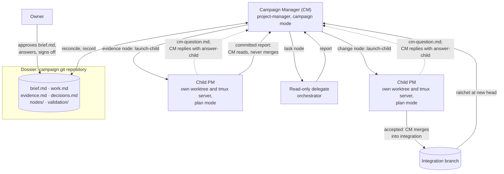
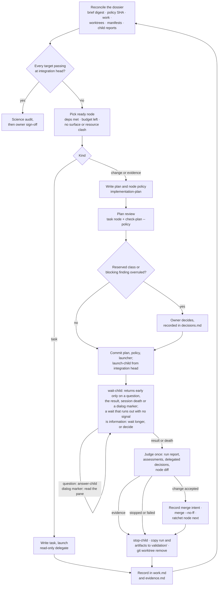
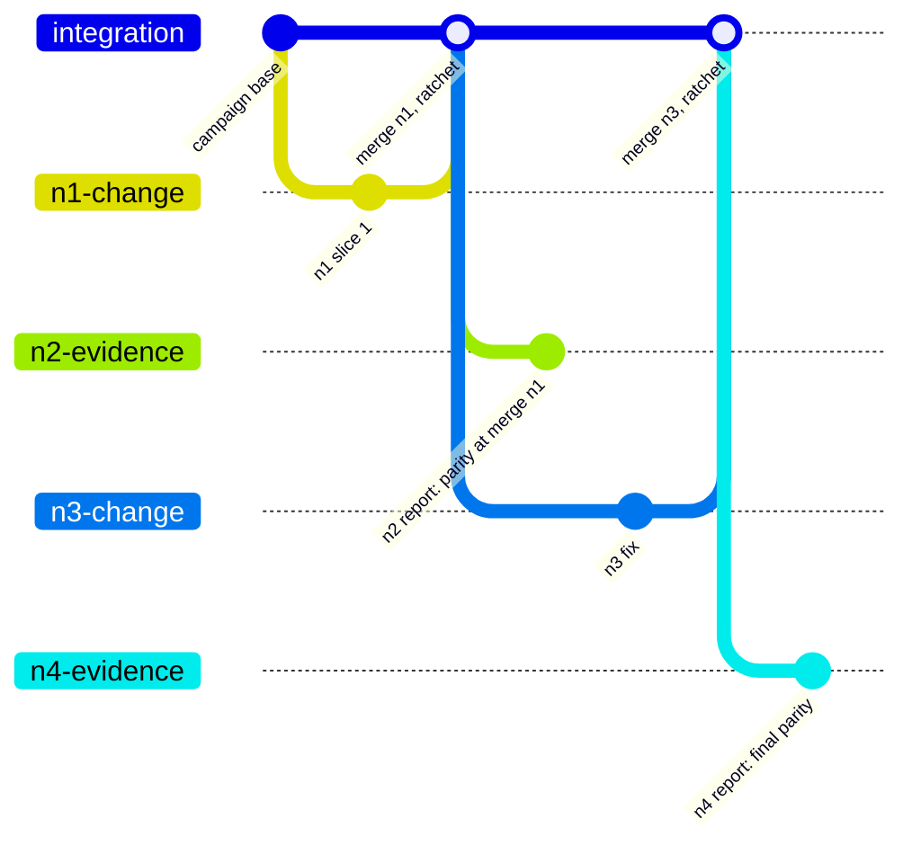

# Mimic Model Builder Prototype

**Status:** Design brief for pathway step 5, revised 2026-10-23 to match campaign mode as built. ai-agent-coder built it on its branch `feature/pm-campaign-mode`, at `ff57e57`, not yet merged to its `main` (the owner's call); until it is merged, `$PM` (the toolkit's `pm.py`) and the campaign-mode reference must come from a checkout of ai-agent-coder's `feature/pm-campaign-mode`, because a skill installed from its `main` has no `launch-child`. The next step is stage 1 of the [test stages](#stages): the model-free trial in ai-agent-coder's PM README, then the real-model scratch campaign. History: the first version (2026-10-20, adopted as step 5 on 2026-10-22) proposed a separate Campaign Manager seat with its own toolkit. A design review replaced it with a PM campaign mode, whose campaign seat the next version called the "parent PM" and whose owner file it called `agreed.md`; the build named that seat the Campaign Manager and that file `brief.md`. The earlier versions are archived as `archive/dev-plans/MIMIC-MODEL-BUILDER-PROTOTYPE-2026-10-22-campaign-manager-design.md` and `archive/dev-plans/MIMIC-MODEL-BUILDER-SETUPS-2026-10-23.md`.
**Scope:**
- A first working version of the model builder of [`MIMIC-MODEL-BUILDER-PLAN.md`](MIMIC-MODEL-BUILDER-PLAN.md) (pathway step 8), for the reference-port class.
- Given a goal agreed with the owner, it investigates, plans, executes, validates and diagnoses by itself, across days, until the goal is met, and asks the owner only where the brief requires.
- It extends ai-agent-coder's Project Manager (PM) rather than adding a layer. The work landed almost entirely in ai-agent-coder; Mimic contributes a protected-paths policy file, and through the campaign itself, the instruments.
- Importing SAGE26 as `models/sage26` is the exercise it is built and tested against.

**Relationship to the pathway:** It is step 5, ahead of the emulator (step 6) and the coupled rate formulation (step 7), as the owner decided on 2026-10-22; the reasoning is in the archived first version. The step 8 brief stays the requirements anchor, and its overdue re-review starts from this brief after the prototype's retrospective.
**Method:**
- Claude (Opus 5.5) brainstormed the shape with Codex (`gpt-6.1-sol`, high effort) over three rounds.
- The owner then set the design: a PM seat in campaign mode delivering against a dossier through small plans and tasks, with worktrees from the start.
- An independent panel, Codex and Fable (`claude-fable-5-1`, high effort), reviewed that design against the ai-agent-coder code in separate fresh sessions. Both found it sound with changes; [Panel Findings](#panel-findings-and-resolutions) records the resolutions.
- ai-agent-coder then built it, the owner revising several of the plan's decisions on the way; [What Was Built](#what-was-built) records the result and [Side Findings](#side-findings) the revision that reverses this brief's plan-defect rule.
- No seat read SAGE26 or the answer key.

**Hold-out:** This brief describes the builder. Test campaigns must not read it, its archived versions, or the pathway index (see [Hold-Out Discipline](#hold-out-discipline)).

---

## Summary

- **The Campaign Manager (CM) is the campaign seat.** A `project-manager` seat in campaign mode holds the dossier, decides what happens next, writes each piece of work, launches it, judges the result, merges it, and repeats until every target in the owner's brief is met. It never implements, and it never supervises a plan it wrote: a child PM does that.
- **The dossier is the authority, the state and the handoff.** It is a small git repository outside the product repos. Its `brief.md` is approved by the owner and frozen by a digest the owner supplies; the rest is the CM's own record. The CM holds no run token (a child's `PM_RUN_TOKEN=` line appears in the pane capture copied to `validation/<node>/`; it authorises only that child's state root, which the worktree removal deletes) and runs no `pm.py` run of its own. Git and the dossier already record everything a campaign needs to remember, so there is no second state store to drift from it.
- **Every piece of work is a node of one of three kinds, built from existing tools:**
  - a **change node**: a small implementation plan run by an ordinary child PM in its own worktree, then merged;
  - an **evidence node**: a 1–2 slice plan whose deliverable is a committed report, such as "confirm X", "find out why Z" or "measure parity". It is run the same way and read, not merged;
  - a **task node**: a hand-written, read-only `orchestrator` task for questions answered by reading and reasoning.

  Validation, diagnosis and plan review are simply nodes. Nothing about them needs special machinery.
- **Built for worktrees and parallel sessions; run serially first.** Every plan node has its own worktree, branch and private tmux server, and PM's state already lives per worktree. Running in parallel later means only launching more than one child before waiting, under three rules: no overlapping surfaces, exclusive resources respected (declared per node in `work.md`), and merges one at a time.
- **Built, in ai-agent-coder, at about 1,700 lines of Python and 400 of Markdown** (this brief had estimated 200–300 and 250):
  - protected paths enforced by PM: `--policy FILE` on `check-plan` and `init`, refused by `grant`, and enforced by floor fact 5;
  - four child commands, `launch-child`, `wait-child`, `answer-child` and `stop-child`, in `pm_lib/campaign.py`;
  - a question channel for both loops: a Developer asks PM, and a child PM asks the CM;
  - a campaign-mode reference and dossier template;
  - a campaign-child block in the Mode B launcher, and PM's plan-defect section aligned to the launcher;
  - a deliberate VISION revision.

  No new seat, skill, state store or service. 688 PM tests pass without any real coding CLI.
- **Next:** stage 1, the model-free trial and then a real-model scratch campaign; then stage 2, a minimal Mimic campaign under Mimic's policy file. Then P0 of the SAGE26 import, design only, scored against the held-out answer key.

---

## Goal and Non-Goals

**Goal.** Turn a goal agreed with the owner into a validated outcome with bounded human attention:

1. The owner and the builder agree `brief.md`: the goal, targets for done with tolerances, constraints and budgets. The owner approves it.
2. The builder investigates the sources and the target repository itself and records evidence with `file:line` and the SHA it was read at.
3. It plans the work as small nodes, writes each node's plan or task just in time, has plans reviewed independently, and runs them.
4. It validates progress with its own instruments, diagnoses failures and plans fixes, within budgets.
5. It asks the owner only where `brief.md` requires, keeps working on whatever a question does not block, and runs across days without a long-lived context.
6. It finishes with every target passing at the final head, an independent science audit, the owner's sign-off and a retrospective.

**Non-goals for the prototype.**

- **No science gates for novel models.** The exercise has a reference implementation to compare against, which is the strongest gate available. Gates for models built from a paper alone stay with the emulator (step 6) and step 8. The node and instrument shapes here are written so they can join later.
- **No calibration.** SAGE26's parameters are already calibrated; the exercise imports them.
- **No parallel runs in the first tests.** Parallel execution is designed in from the start and enabled only once the serial loop is boring.
- **No changes to upstream repositories or remotes** beyond what `brief.md` permits. The builder may draft a patch and ask; it never applies one, and the CM never pushes: its merges are to the local integration branch.
- **Not adversary-proof**, in the same sense as ai-agent-coder: it defends against drift, corner-cutting and overconfidence, not a determined fabricator.

---

## The Design in One Picture

---

## Roles

| Seat | Skill | Authority | Never |
|---|---|---|---|
| **Owner** | — | Approves `brief.md` and each new version of it, and supplies its digest; decides reserved classes (core, instrument); answers questions and every human gate; signs off | — |
| **Campaign Manager (CM)** | `project-manager`, campaign mode | Keeps the dossier; chooses nodes; writes node plans with `implementation-plan`, each child's policy file, and tasks with `orchestrator`; commissions plan reviews; launches, watches, answers, judges and stops child PMs; merges accepted change nodes into the local integration branch; reconciles | Implements; supervises a plan it wrote; changes `brief.md`; answers a human gate; loosens a target or tolerance; pushes, deploys or causes external side effects (a push to a remote is the owner's) |
| **Child PM** | `project-manager`, plan mode, **unchanged**, launched from the Mode B launcher with its campaign-child block | Runs one node plan in its worktree under today's floor, judgement and reviews; asks the CM through `cm-question.md`; resolves natural plan defects as recorded delegated decisions | Writes plans or adds nodes. Depth two is held by the child's contract alone: `launch-child` needs no token, so nothing mechanical stops a child launching one |
| Developers, reviewers | unchanged | unchanged, plus a Developer's question channel to its PM | unchanged |
| **Delegate** | `orchestrator`, read-only | Answers one hand-written task | Edits, builds, tests, commits |

**Naming is settled.** The seat is the Campaign Manager (CM): a `project-manager` seat in campaign mode, running the same skill and toolkit as its children, named so that run reports, ledgers and conversation can tell it from the child PMs it launches. Earlier versions of this brief called it the parent PM.

The CM writing plans is a deliberate change of authority, not a launcher detail. ai-agent-coder's VISION said PM "never authors or expands plans" and listed "not a planner-free autopilot" as a non-goal. The revision has landed: *The Roles* keeps the prohibition for PM in plan mode and makes one deliberate exception, a CM that writes node plans within an owner-approved `brief.md` while child PMs supervise them, so the human-approved contract moves up one level from the plan to the brief, and a node plan's risk and approval flags rest on the CM's judgement within the brief; the *Non-Goals* autopilot bullet says the same; and *What This Repository Is* and a new ladder rung, *Rung 3 — Campaign autonomy*, name campaign mode.

---

## The Dossier

One small git repository per campaign, outside every product repository, laid out and templated by ai-agent-coder's `project-manager/references/dossier-template.md`. The CM commits after every loop step, so a crash loses at most the step in flight.

| File | Owner | Content |
|---|---|---|
| `brief.md` | **Owner only** | *Goal*; *Targets*, each with *Done when*, *Tolerance* and *Measured by*; *Pinned references*; *Allowed paths*, including the node worktree parent, the protected-paths policy file in the product repository, pinned by its SHA-256 digest and the commit that added it (the only list of protected paths) and the git-ignored output directories; *Reserved decision classes*; *Budgets*: a node budget per target, campaign-wide nodes and spend, the child attempt budget (each child's `--max-attempts`) and `max_parallel`; *Exclusions* (paths the campaign may not read). Frozen by a SHA-256 digest the owner supplies when starting or resuming the CM; a new version needs the owner's approval |
| `work.md` | CM | **Now:** in-flight nodes, the next action, blockers and open questions to the owner (this is the restart point and the CM's only handoff). **Nodes:** id, kind, objective, target, dependencies, surface, resources (the node's exclusive resources), status, branch, worktree, socket, session, base and head SHAs, policy, report |
| `evidence.md` | CM | Findings, each with its source, the SHA it was read at, and its uncertainty |
| `decisions.md` | CM and owner | Each decision with its actor, grounds and the `brief.md` permission it uses. Owner approvals of reserved nodes and owner answers to questions are recorded here before the work they unblock |
| `nodes/<node>/` | CM | The node's `plan.md`, its per-child `policy.json` and its filled Mode B `launcher.md`, all committed before the node launches |
| `validation/<node>/` | CM | The node's run, copied at cleanup, laid out as dossier-template.md's `validation/` block shows: the child's HANDOFF.md, its `.pm/campaign/`, its run artifacts and authoritative state root, its uncommitted work (`staged.patch`, `status.txt`, `diff.patch`), the artifacts a receipt hashes (`artifacts/`), and for an evidence node `receipt.md` (measured product SHA, instrument version, configuration, command, outcome, artifact hashes) |

Two rules keep a living record from moving its own goalposts:
- **Decisions use permissions; they never create them.** No evidence or decision entry can authorise a core change, weaken a target or reinterpret a reservation; a decision no permission covers is a question to the owner.
- **`brief.md` is protected by its owner-supplied digest.** A digest stored beside the file it protects would protect nothing. The check (`shasum -a 256 brief.md` against the owner's digest) is the CM's own discipline; no toolkit command does it.

**Reconcile** runs before every launch and is the restart procedure. It reads:
- `brief.md`, checked against the owner's digest;
- the product's committed policy file, checked against the SHA `brief.md` pins for it;
- `work.md`;
- `git worktree list` in the product repository;
- each in-flight worktree's token-free `pm status` (unverified) and its `wait-child` output;
- each worktree's manifest, `.pm/campaign/child.json`, from which a node `work.md` failed to record is recovered;
- every child `run-report.md`.

A digest or policy-SHA mismatch stops the CM before anything launches and is a question to the owner. Otherwise reconcile confirms:
- every target has work, a passing receipt at the integration head, or an open gap;
- every node traces to a target;
- no failure has silently disappeared;
- budgets hold.

A confirmation that fails is fixed in `work.md` before anything launches, or becomes a question to the owner when fixing it needs one.

**Questions to the owner** are recorded in `work.md` *Now* with the nodes they block, the evidence, the options and what each leads to, a recommendation, and what continues meanwhile. A blocked node never stops independent nodes.

---

## Nodes

| Kind | Use | Executed by | Deliverable | Integration |
|---|---|---|---|---|
| **Change** | Change the product: modules, properties, tests, docs, plots, **and instruments** | Child PM, own worktree under the trusted parent, branch `campaign/<id>/<node>` | Commits under today's floor | The CM merges it (`--no-ff`); the ratchet runs at the new head |
| **Evidence** | "Confirm X and report back", "find out why Z happens", "measure parity at SHA H" | Child PM, own worktree, plan of 1–2 slices whose surface is its report path, `campaign-reports/<node>.md`, and nothing else | The committed report and its receipt (the commit satisfies floor fact 6, which needs one) | **Never merged**; the branch is kept. The CM copies the receipt to `validation/<node>/receipt.md` at loop step 9, and at cleanup the child's run and every artifact the receipt hashes (into `artifacts/`), because removing the worktree deletes the run state and every git-ignored file |
| **Task** | Questions answered by reading and reasoning: code, existing outputs, reports | `orchestrator` read-only delegate | The delegate's report, captured by the CM | Recorded in `evidence.md` |

**The dividing line:** executing the product, building, testing, generating outputs or changing state needs a plan node, because only a PM run gives an authenticated record of it. Reading, including with read-only shell commands, is a task node. Delegate `files` must sit beneath the delegate's repository (`orchestrator`'s delegate contract, *Request*), so dossier excerpts go inline in the task's context.

**Plan review is a task node.** A read-only delegate embedding `implementation-plan` reviews a node plan before it is frozen; `orchestrator` already lists that use (its SKILL.md, *Skill and Tool Coordination*). `check-plan --plan <node plan> --repo <product repo> --policy <node policy>` covers the mechanical part. The review returns findings with severity and the verdict *ready to freeze*. A node launches only when both are clean; that is the CM's own discipline, since `launch-child` checks neither. The CM may overrule a finding below blocking severity on the record. A blocking (P0/P1) finding it wants to overrule goes to the owner.

---

## The Loop

**Rules the campaign-mode reference states** (most guard against a failure a panellist named; the question channel and `stop-child` came with the build):

- **Judge once.** A child PM already reviews its slices, commissioning both reviews on elevated slices (`project-manager` SKILL.md, *Risk*). The CM judges a node from the child's `run-report.md`, assessments, Developer judgments, recorded delegated plan decisions, the residuals in its HANDOFF.md, and its own reading of the whole node diff, which is always `git diff <integration head>...<branch tip>`. "Completed" means the child recorded acceptance decisions; a completion message or `child-result.json` alone is not enough. A wrong delegated decision is corrected through a later node, never by editing the child's run. The CM commissions its own review only when:
  - the node is a reserved class (one `drift-audit` of the node diff against `brief.md`'s protections);
  - the child's report carries tolerances or plan defects the CM cannot verify itself;
  - the child scored its Developer 0 or stopped, where the review diagnoses the stop for re-planning and never readies the node for a merge;
  - the question is new: interaction between nodes, or an instrument's validity.
- **Launching and watching.** The CM fills the Mode B launcher with its campaign-child block, commits it at `nodes/<node>/launcher.md` beside the plan and policy, and runs `launch-child`, which creates the node branch and worktree at the integration head and starts the child PM on a private tmux server that the child's Developers share. Node worktrees sit under one parent directory the owner has trusted in each harness; a trust dialog fails the launch and is a question for the owner, never something the CM acknowledges. A child PM keeps its HANDOFF.md, archived with the node: `launch-child` keeps the child's HANDOFF.md untracked through the product repository's git exclude file and refuses a base commit that tracks it. The CM issues one long `wait-child` and lets it return; it returns early only on four signals: the child's question, its completion file `.pm/campaign/child-result.json` (campaign-mode.md gives its contents; written when the run is decided, after which the child stays idle), the session's death, or a dialog marker on the visible pane, never on a pane change. A wait that runs out with no signal is information: wait longer, or decide.
- **Questions go up one level at a time.** A Developer that needs a decision its PM can give in a line writes `question.md`; `observe --wait` returns on it, and the PM answers with `pm answer --text`, which is free, recorded as an event and delivered as a one-line pointer. A child PM asks the CM the same way, for a reading the plan leaves genuinely open or a tolerance: it writes `.pm/campaign/cm-question.md`, `wait-child` returns on it, and the CM answers with `answer-child`, recording the answer in `decisions.md` when it uses a `brief.md` permission and taking a question that needs the owner to the owner first. Question text is capped at 40 lines and 4096 bytes and printed with every line prefixed. A human gate still ends the child's run.
- **Merges are recorded before they happen and done one at a time.** The CM writes the merge intent in `work.md` (integration head before, node head), merges, runs the ratchet, then records the result. It merges only a node whose child run is `complete` and whose branch tip is its last accepted slice commit, compared with the commit the child's last accepted assessment names, because a stopped or still-active child's tip may carry unaccepted work. A restart that finds an intent without a result reconciles the actual integration head first. On conflict: `git merge --abort`, then rerun the node from the new integration head under a new node id and branch. A conflict-resolution node would need to authorise every file the branch touched, because floor fact 5 checks the whole diff. Accepted branches are never rebased, since reviews are pinned to exact commits. No floor sees the CM's merges, so what a merge brings in is the CM's judgement.
- **Stopped children end their node.** The CM never holds a child's token (it is printed once, at the child's `init`). A stopped or failed node is recorded and closed, never resumed, and the CM plans a follow-up node if useful. A follow-up starts from the integration head, or from the stopped branch head only when `git diff --name-only --no-renames <integration head>...<stopped head>` touches no protected path, because no floor re-checks inherited commits; those commits are then part of the diff the CM judges.
- **Cleanup is `stop-child`, then copies, then removal.** `stop-child --worktree <worktree> --reason "<why>"` captures the pane, prints the reviewer process groups the child recorded (they run outside its tmux server, so the CM checks for them by hand), and kills the child's tmux server, ending the child and its Developers together; it refuses, killing nothing, a server that lacks this worktree's `PM_CHILD_WORKTREE` mark or hosts a bystander session, and exits 2 when sessions remain after the kill. A refusal or remaining sessions stops the cleanup, keeps the worktree, and is a question for the owner, never a reason to kill by hand. The CM then copies the child's run into `validation/<node>/` (the receipt was copied at loop step 9, the artifacts a receipt hashes go into `artifacts/`), captures uncommitted work, and only then removes the worktree, keeping the branch, in the order and with the `--force` conditions campaign-mode.md *Cleanup* gives; everything after `stop-child` is the CM's procedure, not the toolkit's. An unscoped `stop --scavenge` or a bare `tmux kill-server` is never used.
- **Reserved approvals move up to the dossier, visibly.** The owner approves a reserved node in `decisions.md` before launch. The node plan then says `Approval needed before implementation: no` and names that decision id, because `approve` records a human approval inside the child's run, and nobody is present to give it.
- **Budgets bound focus.** `brief.md` sets a node budget per target, campaign-wide limits on nodes and spend, and the child attempt budget each child's `init` uses as `--max-attempts`. Two failed attempts at one target is a question for the owner, and every reconcile lists open targets against budget spent. Per-slice attempt budgets alone would reset with every replacement node.
- **Child output stays out of git's way.** Outputs written inside a worktree would fail floor fact 7 (a clean worktree). `brief.md` names the product's git-ignored output directories (the toolkit never reads them), or validation writes under the slice artifact directory. Removing the worktree deletes git-ignored files, which is why cleanup copies the artifacts a receipt hashes.
- **Plan defects are resolved where the resolution is natural, as the owner decided.** The owner kept the Mode B launcher's delegated-decision clause and had `project-manager`'s SKILL.md aligned to it (decision D16 of ai-agent-coder's campaign-mode plan), reversing this brief's earlier rule that children run under PM's strict plan-defect rule. A PM, child or not, resolves a defect where the plan's goals make one resolution natural and its impact stays within the slice or touches only a few slices, and records it as a delegated plan decision in its assessment and HANDOFF.md. It never edits the plan, widens the surface except by grant, or relaxes a floor fact, and it stops for anything serious, contested or cross-cutting. Every child reads defects the same way, and the CM reads each child's delegated decisions when judging the node.

**Acceptance and retrospective.** When every target passes at the final integration head, the CM commissions an **independent science audit**: a read-only task node that reviews the receipts against `brief.md`, run on a model different from the CM's. The owner then signs off. The retrospective records:
- where owner attention went;
- the questions asked, and whether each was necessary;
- child stop causes;
- plan versions per node, and nodes per target;
- spend and wall time.

Lessons proposed for promotion into skills or templates need the owner's sign-off, as step 8 requires for institutional memory.

---

## Validation: Instruments and the Ratchet

Validating against a target is ordinary work: nodes build an instrument and run it, and the four rules below are what make its verdicts mean something.

1. **Trust before use.** An instrument counts only after it passes on a **known-good** control and fails on a **known-bad** one. A negative self-test alone would bless an instrument that always fails. Its verdict is pass, fail or **error**, and an invalid measurement is not a scientific failure.
2. **Independence.** Instruments are built in owner-approved change nodes of the instrument class, then protected. A new instrument reaches the product's committed policy file, and the SHA `brief.md` pins for it, only through the owner. Each node's policy file holds every entry of the product's policy file plus that file's own path, minus only the instrument an instrument-class node builds, because the toolkit reads one policy per run and a child's policy lives in the dossier. Protection then has two layers. In the child it is mechanical: `check-plan` and `init` refuse a plan surface that reaches a protected path, `grant` refuses one, and floor fact 5 refuses acceptance of a slice that changes one, over Git-visible files only. Which entries each node policy holds, what a merge brings in and what a follow-up inherits from a stopped head are the CM's judgement. So code under test cannot edit its judge through a child, and the CM is trusted not to let it in another way.
3. **The builder measures; the implementer does not.** Measurements are evidence nodes run by a child PM at a recorded SHA, never claims inside an implementing Developer's session. A Developer's report of success points to evidence; it is never the evidence.
4. **The ratchet.** A target that passed must keep passing:
   - cheap checks re-run at every new integration head, including `make tests-reference-identity` for "`sage16` unchanged", which needs `REFERENCE_COMMIT=<pinned SHA>`, the ancestor commit the brief pins under *Pinned references*, and which the evidence node's plan names in *Measured by*;
   - expensive ones run at milestones;
   - acceptance needs a final evidence node at the final head.

   Receipts name the measured product SHA, separate from the commit that adds the report, so a pass at an earlier head is never claimed at a later one. Each receipt is copied to `validation/<node>/receipt.md` and the artifacts it hashes to `validation/<node>/artifacts/`; a receipt whose artifact was not copied says so, and its hash is then the only record. Targets and tolerances live only in `brief.md`, where the CM cannot loosen them.

The SAGE26 import closes its targets with the ordinary node sequence:
1. A change node builds the instrument that measures the target, with its controls.
2. An evidence node measures parity at a SHA.
3. A failure becomes a task or evidence node that finds out why.
4. A change node fixes the cause, and a new evidence node measures again.

The same shape takes other instruments later, such as conservation invariants, digitised-figure parity or the emulator, which is how novel-model gates can join without new machinery.

---

## Worktrees and Parallelism: Designed In, Serial First

Everything parallel execution needs is a convention the serial case already follows:

| Concern | Convention | Already supported by |
|---|---|---|
| Isolation of child runs | One worktree and branch per plan node, created by `launch-child` at the integration head, under the owner-trusted worktree parent | PM state and its `current` pointer live in each worktree's own git directory (`state.state_root`, `git_ops.worktree_git_dir`) |
| Session names | Each child gets its own private tmux server, shared with its Developers: `launch-child`'s default socket, `pm-child-<branch component cut to 32 characters>-<6 hex>`, unique per launch | Run ids carry a nonce so names cannot collide (`state.new_run_id`, `sessions.session_name`); `stop-child` kills only a server carrying this worktree's mark |
| Ledger | Each child writes its own ledger file, tagged `--run-tag campaign/<id>` | One ledger file per run id (`run-state.md`, *Semantics worth knowing*) |
| File conflicts | Two change nodes whose surfaces overlap never run at once | Surfaces are declared in `work.md` |
| Shared resources | Each node's exclusive resources are declared in `work.md`'s *Resources* column (for Mimic: test suites never run in parallel; shared output and data directories); never two holders at once | The CM's judgement over `work.md`; no toolkit check |
| Semantic coupling | Merges one at a time, and the ratchet at every new integration head includes the tests that cover coupled surfaces | The ratchet |

Serial is `max_parallel: 1` in `brief.md`'s *Budgets*. Going parallel later means the CM launches a second child before waiting on the first.

The evidence branches `n2` and `n4` are kept and never merged; their runs and receipts are copied into the dossier's `validation/<node>/`.

---

## What Was Built

All in ai-agent-coder, on `feature/pm-campaign-mode` at `ff57e57`, unmerged to its `main`:

| Where | What landed | Size |
|---|---|---|
| `project-manager` toolkit: protected paths (`plan.py`, `slice_ops.py`, `floor.py`, `git_ops.py`, `cli.py`) | `check-plan --plan P [--repo R] [--policy FILE]` and `init … --policy FILE` read a JSON policy file, `{"schema": 1, "protected_paths": [...]}`, whose entries use authorized-surface syntax; a plain entry naming a directory covers its subtree, a trailing-slash entry with a wildcard is refused, and a policy file inside the repository protects itself. The entries are frozen into signed run state and never re-read. A plan surface reaching a protected path is refused at plan time and at `init`, `grant` refuses one, and floor fact 5 refuses acceptance of a slice changing one, over Git-visible files only, now seeing both sides of a rename | With the rows below, about 1,700 added lines in `pm_lib` |
| `project-manager` toolkit: the child commands (`pm_lib/campaign.py`, `cli.py`, `sessions.py`) | `launch-child`, `wait-child`, `answer-child` and `stop-child` (the PM README's *CLI* gives each one's arguments). They take paths, never a run token. Each child runs on a private tmux server, shared with its Developers and marked by `launch-child` with `PM_CHILD_WORKTREE`; `stop-child` refuses a server without this worktree's mark or hosting a bystander session, exits 2 when sessions remain, and prints the reviewer process groups the child recorded. `launch-child` excludes `/HANDOFF.md` and refuses a base commit that tracks it | `campaign.py`, 755 lines |
| `project-manager` toolkit: the question channel (`slice_ops.py`, `prompts.py`, `references/developer-prompt.md`) | A Developer writes `question.md`, `observe --wait` returns on it, and `pm answer --text` answers it: free, recorded as an `answer` event, delivered as a one-line pointer. A child PM writes `.pm/campaign/cm-question.md`, `wait-child` returns on it, and `answer-child` answers it. Question text is capped at 40 lines and 4096 bytes and printed prefixed | Included above |
| `project-manager/references/campaign-mode.md`, `references/dossier-template.md` | The CM's operating contract (seats, dossier, reconcile, nodes, the loop and its rules, launching and watching a child, validation, acceptance, and *First campaign: the scratch test*) with the campaign launcher, its only copy; the dossier layout and a template for each file | 164 and 117 lines |
| `project-manager/SKILL.md`, `README.md`, `references/run-state.md` | SKILL.md: campaign mode in *Charter*, and *Reading a defective plan* aligned to the launcher (D16). README: *Campaign mode*, the CLI rows, and *Verify campaign mode (no real model, ~2 minutes)*. run-state: the *Protected paths* and *Questions* bullets | About 100 lines changed |
| `implementation-plan/SKILL.md` | The Mode B launcher's optional campaign-child block, ten lines: nobody present; the plan committed in the dossier; run `init` yourself with `--branch`, `--policy`, `--run-tag` and `--max-attempts`; keep HANDOFF.md, already excluded; resolve natural plan defects; ask the CM through `cm-question.md`; write `child-result.json` when decided and stay idle. The `Plan defects:` paragraph is unchanged, and 1–2 slice and report-only plans are named normal | About 12 lines |
| `docs/VISION.md` (ai-agent-coder) | *The Roles*' campaign-mode exception, the *Non-Goals* autopilot bullet, *What This Repository Is* and a new *Rung 3 — Campaign autonomy* | A few lines |
| Tests | 688 PM tests, none of which can launch a real coding CLI (stub executables come first on `PATH`), including `test_campaign.py` for the child commands | About 2,400 added lines |
| Provenance | A ten-slice plan, frozen after four rounds of independent review (Codex `gpt-6.1-sol` high and Claude `claude-opus-5-5` high, via `orchestrator`), run under PM Mode B in 18 commits; then a post-run review (Claude `claude-fable-5-1` high) whose findings the owner accepted in full, implemented and reviewed by an independent panel (Codex `gpt-6.1-sol` high and Claude `claude-opus-5-5` high, via `orchestrator`) over two rounds. The plan and the review are archived in ai-agent-coder | 20 commits on the branch |
| Mimic | Nothing yet. The owner commits `campaign-policy.json` at the repository root by hand on `main` before stage 2, holding protected paths only, after settling what it protects; `brief.md` pins it by the file's SHA-256 digest (`shasum -a 256 campaign-policy.json`, the value a child's `run.json` records as `policy.protected_paths_source.sha256`) and the commit that added it | — |
| `orchestrator`, `code-review`, `drift-audit`, `lint`, `commit`, `handoff` | No change | Reused as is |

**Cut from earlier drafts:** a separate campaign seat with its own toolkit and script; a `campaign` skill; `plan-review`, `recon` and `diagnose` skills; a `code-review` plan mode; CM run state inside `pm.py` (`init --campaign`, `add-node`, several in-flight slices, a node floor, merge records); a parallel scheduler; a separate HANDOFF.md for the CM (`work.md`'s *Now* section is the handoff; child PMs keep theirs).

---

## The Exercise: sage16 to sage26

### Why it is the right first exercise

- **A reference implementation exists.** Mimic's output can be compared with SAGE26's on the same trees, galaxy by galaxy, which removes most of step 8's open science-gate problems for this exercise.
- **It is an evolution, not a blank sheet.** SAGE26 descends from the SAGE that `sage16` already reproduces, so the exercise tests whether the builder recognises what to reuse and what to build.
- **The parameters are already calibrated**, so calibration is out of scope.
- **It is real work the owner wants**, so its output is not throwaway.

### The brief the builder would receive

A draft for the owner to finalise. It must contain only what a human would naturally write:

> Import SAGE26 (`sage-home/SAGE26` at `11b1ae8`) into Mimic as a new model package, `models/sage26`. SAGE26 is a substantial evolution of the SAGE model that Mimic already carries as `sage16`: much may be reusable, some will be new. Done means the package reproduces SAGE26's own output for SAGE26's default configuration on mini-Millennium, to the standard `sage16` met against SAGE, under both Mimic drivers, with Mimic's gates green and the package documented and plotted like `sage16`. Constraints: `sage16` output must not change; core changes need my approval; no changes to SAGE26 or to any remote without my approval. Budget and seats: to be set in `brief.md`.

The owner finalises it into `brief.md`'s template shape: this paragraph becomes the *Goal*, and the targets with their tolerances, the pinned references, the allowed paths (with the trusted worktree parent and Mimic's policy file at its pinned SHA), the reserved classes, the budgets and the exclusions fill the other sections, in the same plain terms.

### Hold-out discipline

The prototype is tested only if it finds the exercise's obstacles itself. So:

- **No document here names them.** The owner holds an answer key, written from a hand analysis on 2026-10-20, **outside every repository**. It must never be committed here, in ai-agent-coder or in SAGE26. It currently sits in the owner's Obsidian vault, where any agent running as the owner can read it, so it moves off the machine that runs campaigns, or into a location the campaign's sandbox cannot see, before any test run.
- **`brief.md`'s *Exclusions* name every builder design document:** this brief, its archived versions, the pathway index (whose step 5 section and residuals describe the repository's known limits), the Obsidian vault, and `.orchestrator/` and `archive/` in the product checkout, since gitignored copies of excluded documents can sit there (review inputs, archived plans). Run transcripts are checked for reads of excluded paths.
- **Do not pre-solve campaign content.** Gaps, residuals and upstream issues the exercise would hit are left for the builder to find, ask about or plan, even where fixing one early would be easy. Each pre-solved item removes test signal. That includes building the exercise's instruments by hand or preparing the reference build.

---

## Testing and Evaluation

### Stages

| Stage | Scope | What it proves | Go or no-go |
|---|---|---|---|
| **1 · Scratch campaign** | Two parts, both in ai-agent-coder's terms. First, the model-free trial in its PM README, *Verify campaign mode (no real model, ~2 minutes)*: a fake child PM against the four child commands and a protected instrument. Then the real-model scratch campaign of its `campaign-mode.md`, *First campaign: the scratch test*, run by the owner in a fresh CM session with real harnesses (the seats are the owner's choice; a weak model in the CM or child PM seat weakens the judgement layer): a scratch product repository and dossier with `max_parallel: 1` and two targets. T1 is a function with a stated output, measured by an instrument already committed in the scratch repository and protected by its committed policy file, so no node builds the instrument; T2 is the suite passing at the final head. N1 change and merge; kill the CM after the merge and before N2 launches; restart from the dossier alone; N2, an evidence node at the new integration head, is both the ratchet and T2's final-head evidence; its receipt is copied into `validation/`, its branch never merged. At most one question per node, by design. A trust check: a new worktree under the trusted parent launches without a dialog. Fault injections: a plan surface reaching `instruments/` refused by `check-plan --policy`; a `brief.md` edit caught by the digest at reconcile | Unattended child launch, the question channel, judging from the run report, merge and ratchet, the unmerged evidence branch, cleanup, reconcile and restart | No-go if a child cannot run unattended to completion, or a restart loses or repeats work |
| **2 · Minimal Mimic campaign** | A branch of Mimic, with `campaign-policy.json` already committed by the owner on `main` (protected paths only) and pinned in `brief.md` by the file's SHA-256 digest (`shasum -a 256 campaign-policy.json`, the value a child's `run.json` records as `policy.protected_paths_source.sha256`) and the commit that added it, and each node's exclusive resources declared in `work.md`: one change node (an empty `models/sage26` package that builds) and one evidence node (`sage16` unchanged, via `make tests-reference-identity`, which needs `REFERENCE_COMMIT=<pinned SHA>`, the ancestor commit the brief pins under *Pinned references*, and which the evidence node's plan names in *Measured by*). The stage 2 branch is a test artefact: kept, never merged to `main`, and P0 and the import start from `main` without it (the owner may decide otherwise) | The loop against Mimic's real gates, its policy file and exclusive resources | As stage 1 |
| **3 · P0** | The SAGE26 exercise, design only: the CM builds `evidence.md` and the first `work.md` through task and evidence nodes, then stops | Recall of the answer key's must-find items; whether necessary questions were asked and unnecessary ones not; the owner's review of the plan of work | No-go if recall is low or the work table needs rewriting; revise and repeat |
| **3r · P0r** | Replays: P0 on archived past campaigns (below) | Planning quality against human-approved decompositions | As P0 |
| **4 · The import** | The full campaign, serial, then parallel once the serial loop is boring | Persistence, questions, budgets, the final audit and sign-off | Prototype accepted |

Instrument controls are exercised by the fault injections below before stage 4.

Recon and plan review spotting what a plan leaves out is the least certain part of the design, according to both panellists and the earlier brainstorm. P0 measures it directly, which is why it comes before the full campaign.

### The replay benchmark

`archive/` holds the records of every finished campaign on this repository: briefs, implementation plans, reviews, acceptances and handoffs (the dual driver, the converter generalisation, HOD and SHAM, chunked streaming, distribution, the Shin-Uchuu work, the Tier A performance plan). Each is a human-approved answer to "given this goal, what work?".

A replay gives the CM a past campaign's brief against a worktree at that campaign's starting commit, then compares its evidence and work table with what was actually approved. Do not score how closely a graph's text matches, because several decompositions can be good; freeze each submission before giving feedback. HOD and SHAM is the nearest analogue to the exercise: new model packages with new tests, plots and READMEs. The corpus is machine-local and gitignored, so this is work for the owner's machine.

### Fault injection

Each must produce the right behaviour, at least once, before stage 4:

- a seeded serious defect in a node plan → the child stops on it, and the CM writes a new plan version rather than forcing it through; a seeded natural one → the child records a delegated decision, which the CM reads when judging the node;
- a broken instrument, always passing or always failing → its controls catch it, and it is never trusted;
- an unanswered owner question, including one a child's question raised → only the nodes it blocks wait;
- an edit to `brief.md` mid-campaign → the digest check stops the CM at reconcile;
- a weak Developer seat → the child exhausts its budget, the node stops, and the per-target budget escalates to the owner;
- a node plan or grant reaching a protected path → refused by `check-plan` or `grant`, and caught by the floor if it gets through;
- `stop-child` run against a stale manifest or a server hosting a bystander session → refused, and nothing killed;
- the CM killed mid-merge → reconcile recovers from the recorded merge intent.

### Measures

- Owner minutes per node.
- Questions asked, and the share that were necessary.
- Child stop causes.
- Plan versions per node, and nodes per target.
- The trajectory of instrument verdicts.
- Spend and wall time.

Every input is pinned, so a campaign can be replayed to compare one version of the builder with the next.

---

## Groundwork and Open Decisions

**Groundwork, on the owner's machine.** Four items are preflight, done before any test run: the answer key off the machine (item 3), the Exclusions written (see below), the trusted worktree parent (item 5) and the environment chosen (item 4). The rest, the replay corpus (item 1) and the costs (item 2), runs alongside stage 1, and item 6 is due before stage 2.

1. **The replay corpus.** Gather the archived briefs, plans and acceptances, each with its starting commit.
2. **Costs from step 4.** Extract agent time and spend per slice from the PM run report and ledger named in `archive/dev-plans/HANDOFF-performance-tier-a-2026-10-22.md` and from the harness, so `brief.md`'s budgets are grounded rather than guessed.
3. **The answer key.** Move it out of the Obsidian vault (see [Hold-Out Discipline](#hold-out-discipline)).
4. **The environment.** Choose the isolation (container or VM, as PM's README advises for unattended runs, since Developers run with full harness autonomy) and the channel through which owner questions reach the owner.
5. **The trusted worktree parent.** One directory for every node worktree, trusted by the owner in each harness the child PMs and Developers use, since a trust dialog fails `launch-child`. `brief.md` names it under *Allowed paths*.
6. **The committed, pinned policy file.** The owner commits `campaign-policy.json` at Mimic's root by hand on `main` before stage 2, protected paths only, after settling what it protects (open decision below). `brief.md` pins it by the file's SHA-256 digest (`shasum -a 256 campaign-policy.json`, the value a child's `run.json` records as `policy.protected_paths_source.sha256`) and the commit that added it; the environment is settled here, not in `brief.md`. Exclusive resources go in `work.md`'s *Resources* column and git-ignored output directories in `brief.md`, not in the policy file.

**Before any campaign starts:** the CM holds no run token and runs no `pm.py` run of its own, and `brief.md`'s *Exclusions* name the builder design documents, the pathway index, the Obsidian vault, and `.orchestrator/` and `archive/` in the product checkout.

**Open decisions for the owner:**

| # | Decision | Recommendation |
|---|---|---|
| 1 | Reserved plan classes | Core (`src/`) and instrument; plus anything touching `sage16` paths |
| 2 | Upstream repositories | The builder may draft a patch for SAGE26 and ask; it never applies one |
| 3 | Seats and spend ceiling for the import | Set from step 4's measured costs (groundwork item 2) |
| 4 | Environment and notification | Owner's choice (groundwork item 4) |
| 5 | What `campaign-policy.json` protects | The gates the ratchet trusts, such as `tests/manual/test_reference_identity.py` behind `make tests-reference-identity`; not `src/`, which is a reserved class approved node by node rather than a protected path. `make tests-reference-identity` is a Makefile rule, so protecting only the script leaves the gate's entry point reachable unless the Makefile is protected or a reserved class covers it, and the gate needs `REFERENCE_COMMIT`. It stays the owner's decision |

---

## Panel Findings and Resolutions

| Issue | Codex | Fable | Resolution |
|---|---|---|---|
| **Where the campaign seat's state lives** | Signed campaign state in a new `campaign_ops.py`, with `work.md` rendered from it (~800–1,500 lines) | No campaign-seat `pm.py` run: the dossier and git are the state; `pm.py` is built around one plan parsed at `init`, one current slice and per-slice ledger windows, and changing that touches everything (its plan parsing at `init`, its state shape and its ledger windows) | **Fable.** It has one state store, not two, and it is what makes the dossier the authority. Codex's concerns become rules: merge intent recorded before merging, SHA-bound receipts, campaign-wide budgets. Campaign-seat signed state is added only if a test shows the need. **As built:** as resolved, plus each worktree's `.pm/campaign/child.json` manifest for reconcile |
| **Plan review** | A concise `code-review` plan mode | A task node embedding `implementation-plan`, plus `check-plan`; no change | **Fable**, which needs zero change. Revisit if plan reviews prove inconsistent |
| **Merge conflicts** | A resolution node that authorises the incoming files; never rebase accepted branches | Abort and rerun the node from the new head | **Fable** for conflicts (cheaper and stays inside today's PM), **plus Codex's** rule: never rebase accepted branches, merges one at a time. **As built:** the rerun takes a new node id and branch |
| **Campaign-seat restart** | A campaign HANDOFF.md | The dossier is the handoff | **Fable** (one source of truth); `work.md` has a *Now* section. **As built:** as resolved for the CM; child PMs keep their own HANDOFF.md, archived with the node |
| **Child launch** | A child-PM prompt reusing `sessions.py`; prototype first | The Mode B launcher with an unattended preamble; may grow into a small script | **Both**: the launcher text stays single-sourced in `implementation-plan`, and a small script reuses `sessions.py`. Both panellists are least sure here, so the first test settles it. **As built:** four toolkit commands in `pm_lib/campaign.py` (`launch-child`, `wait-child`, `answer-child`, `stop-child`) on a private tmux server per child, with a question channel; the launcher text stays single-sourced as the Mode B launcher's campaign-child block. Whether a child runs unattended reliably is still for stage 1 |
| **Agreed on** | Evidence as a committed report on an unmerged branch; task nodes read-only; never re-review per slice; protected paths enforced in the floor and grants; reserved approvals move up to the dossier; per-child tmux socket; tiny serial tests first; a deliberate VISION revision | | Adopted, and built |

---

## Risks

1. **The child cannot run unattended reliably.** Over an hours-long run it meets a trust dialog, a usage limit or context compaction, and the node sits silent. Mitigation: the same autonomy flags Developers use; a private tmux server per child; node worktrees under an owner-trusted parent, so no trust dialog appears; one long `wait-child` that returns early only on a question, the result, session death or a dialog marker (a wait that runs out with no signal is information: wait longer, or decide), rather than polling; the question channel, so a child that needs a decision asks instead of sitting silent; and stage 1 before anything else.
2. **Planning quality is the ceiling.** The CM now writes the plans, and fluent, self-consistent plans can still omit essential work. Mitigation: plan review, P0 and the replay benchmark before the full campaign, owner approval of `brief.md` and of reserved classes.
3. **Gaming the gate.** A CM optimising for passing verdicts. Mitigation: instrument controls and protected paths, targets only the owner can change, the ratchet, the independent science audit and the owner's sign-off.
4. **Stale evidence at sign-off.** Parity passed at one head is claimed at a later one. Mitigation: SHA-bound receipts and a mandatory final evidence node.
5. **Loss of focus.** Cheap diagnose-and-fix nodes repeat for days without converging. Mitigation: node budgets per target in `brief.md`, and two failures at one target go to the owner.
6. **A crash mid-merge.** The CM restarts as if nothing happened. Mitigation: merge intent recorded before merging, and reconcile checks the actual integration head first.
7. **Evaluation contamination.** A builder that has read the answer is not tested. Mitigation: hold-out discipline, and exclusion checks on transcripts.
8. **Cleanup ends the wrong sessions.** A `stop-child` run against a stale manifest or a reused socket would end another child, or the operator's own session. Mitigation: `launch-child` marks each child's server with `PM_CHILD_WORKTREE`, and `stop-child` refuses a server without this worktree's mark or hosting a bystander session. The mark guards against stale manifests and reused sockets, not a hostile child, since any process on that server can rewrite it.

The honest residuals: the CM seat is trusted, as the PM seat is today, and a weak model there weakens everything above the floor. Depth two is held by the child's contract only, since `launch-child` needs no token. Each node policy's composition, every merge and every inherited commit are the CM's judgement, not a floor fact. Isolation of the dossier from Developers comes from the environment, not from the design.

---

## Alternatives Considered

- **A separate Campaign Manager with its own toolkit** (this brief's first version, archived): a new seat above PM with `cm.py`, signed state, an event log, a question queue, a tick-driven supervisor and three new skills. Dropped: PM's sessions, floor, reviews, judgements and logging already do this work, and the realistic size was several thousand lines. The name survived: the Campaign Manager as built is a `project-manager` seat in campaign mode.
- **Human-led** (the owner approves every plan and launches each child): kept as the fallback. The owner can play the CM by hand with the same dossier, nodes and child commands.
- **An anchored swarm without a permanent seat:** dropped. Ownership becomes diffuse, and published experience points the other way: Cursor's [account of scaling long-running agents](https://cursor.com/blog/scaling-agents) moved from equal-status agents to a planner, worker and judge structure. Anthropic's [parallel compiler experiment](https://www.anthropic.com/engineering/building-c-compiler) used file-based task locks with no orchestrating agent. The useful part, stateless sessions sharing one anchored record, is what the dossier already provides.
- **Recursive PM to any depth:** dropped. Depth is fixed at two, because children run in plan mode; that is held by the child's contract, not mechanically.

---

## Side Findings

These stood regardless of the design.

1. **The Mode B launcher contradicted PM's plan-defect rule.** The launcher's `Plan defects:` paragraph let PM decide a "natural" resolution of a plan defect, while `project-manager`'s SKILL.md *Reading a defective plan* allowed resolution only when the plan's own text left one reading. This brief proposed fixing the launcher to the strict rule. **Resolved the other way, by the owner (D16):** the launcher's clause stays, and *Reading a defective plan* was aligned to it, so the two now agree.
2. **A grant could reach a protected path.** **Fixed:** `grant` refuses a protected path after its path-shape refusals, and floor fact 5 refuses acceptance of a slice that changes one.
3. **PM does not "prove each change is right"**, as the first version of this brief said. Its floor proves mechanical compliance, and correctness is its accountable judgement (`project-manager` SKILL.md, *Charter* and *The floor*).
