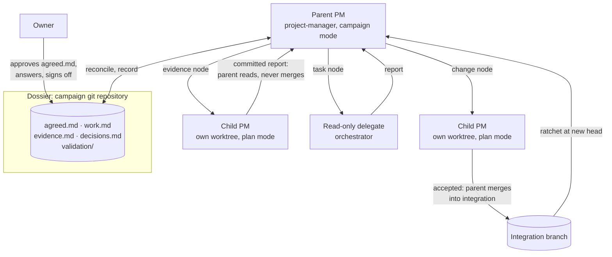
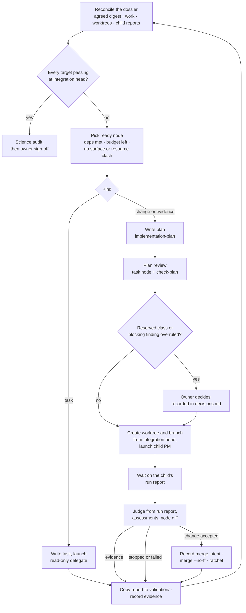
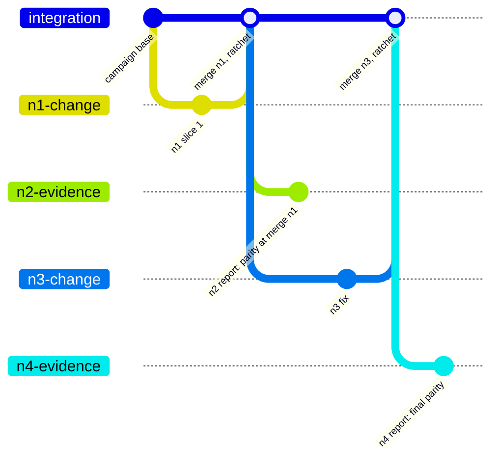

# Mimic Model Builder Prototype

**Status:** Design brief for pathway step 5, revised 2026-10-23. Not an implementation plan: the next step writes one in ai-agent-coder from this brief. The first version (2026-10-20, adopted as step 5 on 2026-10-22) proposed a separate Campaign Manager seat with its own toolkit. A design review replaced it with the PM campaign mode described here. The earlier versions are archived as `archive/dev-plans/MIMIC-MODEL-BUILDER-PROTOTYPE-2026-10-22-campaign-manager-design.md` and `archive/dev-plans/MIMIC-MODEL-BUILDER-SETUPS-2026-10-23.md`.
**Scope:**
- A first working version of the model builder of [`MIMIC-MODEL-BUILDER-PLAN.md`](MIMIC-MODEL-BUILDER-PLAN.md) (pathway step 8), for the reference-port class.
- Given a goal agreed with the owner, it investigates, plans, executes, validates and diagnoses by itself, across days, until the goal is met, and asks the owner only where the agreement requires.
- It extends ai-agent-coder's Project Manager (PM) rather than adding a layer. The work lands almost entirely in ai-agent-coder; Mimic contributes a small policy file, and through the campaign itself, the instruments.
- Importing SAGE26 as `models/sage26` is the exercise it is built and tested against.

**Relationship to the pathway:** It is step 5, ahead of the emulator (step 6) and the coupled rate formulation (step 7), as the owner decided on 2026-10-22; the reasoning is in the archived first version. The step 8 brief stays the requirements anchor, and its overdue re-review starts from this brief after the prototype's retrospective.
**Method:**
- Claude (Opus 5.5) brainstormed the shape with Codex (`gpt-6.1-sol`, high effort) over three rounds.
- The owner then set the design: a parent PM delivering against a dossier through small plans and tasks, with worktrees from the start.
- An independent panel, Codex and Fable (`claude-fable-5-1`, high effort), reviewed that design against the ai-agent-coder code in separate fresh sessions. Both found it sound with changes; [Panel Findings](#panel-findings-and-resolutions) records the resolutions.
- No seat read SAGE26 or the answer key.

**Hold-out:** This brief describes the builder. Test campaigns must not read it, its archived versions, or the pathway index (see [Hold-Out Discipline](#hold-out-discipline)).

---

## Summary

- **The parent PM is the campaign seat.** A PM in *campaign mode* holds the dossier, decides what happens next, writes each piece of work, launches it, judges the result, merges it, and repeats until every goal the owner agreed is met. It never implements, and it never supervises a plan it wrote: a child PM does that.
- **The dossier is the authority, the state and the handoff.** It is a small git repository outside the product repos. Its `agreed.md` is approved by the owner and frozen by digest; the rest is the parent's own record. The parent holds no `pm.py` run of its own. Git and the dossier already record everything a campaign needs to remember, so there is no second state store to drift from it.
- **Every piece of work is a node of one of three kinds, built from existing tools:**
  - a **change node**: a small implementation plan run by an ordinary child PM in its own worktree, then merged;
  - an **evidence node**: a 1–2 slice plan whose deliverable is a committed report, such as "confirm X", "find out why Z" or "measure parity". It is run the same way and read, not merged;
  - a **task node**: a hand-written, read-only `orchestrator` task for questions answered by reading and reasoning.

  Validation, diagnosis and plan review are simply nodes. Nothing about them needs special machinery.
- **Built for worktrees and parallel sessions; run serially first.** Every plan node has its own worktree and branch, and PM's state already lives per worktree. Running in parallel later means only launching more than one child before waiting, under three rules: no overlapping surfaces, exclusive resources respected, and merges one at a time.
- **About 200–300 lines of new Python**, plus about 250 lines of Markdown:
  - protected paths enforced by PM (the one real toolkit gap, about 150 lines);
  - a small child-launch script, whose size the first test will settle;
  - a campaign-mode reference and dossier template;
  - a few lines in three skills;
  - a deliberate VISION revision.

  No new seat, skill, state store or service.
- **Next:** the implementation plan in ai-agent-coder, then two small serial tests: a scratch repository, then a minimal Mimic campaign. Then P0 of the SAGE26 import, design only, scored against the held-out answer key.

---

## Goal and Non-Goals

**Goal.** Turn a goal agreed with the owner into a validated outcome with bounded human attention:

1. The owner and the builder agree `agreed.md`: the goal, targets for done with tolerances, constraints and budgets. The owner approves it.
2. The builder investigates the sources and the target repository itself and records evidence with `file:line` and the SHA it was read at.
3. It plans the work as small nodes, writes each node's plan or task just in time, has plans reviewed independently, and runs them.
4. It validates progress with its own instruments, diagnoses failures and plans fixes, within budgets.
5. It asks the owner only where `agreed.md` requires, keeps working on whatever a question does not block, and runs across days without a long-lived context.
6. It finishes with every target passing at the final head, an independent science audit, the owner's sign-off and a retrospective.

**Non-goals for the prototype.**

- **No science gates for novel models.** The exercise has a reference implementation to compare against, which is the strongest gate available. Gates for models built from a paper alone stay with the emulator (step 6) and step 8. The node and instrument shapes here are written so they can join later.
- **No calibration.** SAGE26's parameters are already calibrated; the exercise imports them.
- **No parallel runs in the first tests.** Parallel execution is designed in from the start and enabled only once the serial loop is boring.
- **No changes to upstream repositories or remotes** beyond what `agreed.md` permits. The builder may draft a patch and ask; it never applies one.
- **Not adversary-proof**, in the same sense as ai-agent-coder: it defends against drift, corner-cutting and overconfidence, not a determined fabricator.

---

## The Design in One Picture

---

## Roles

| Seat | Skill | Authority | Never |
|---|---|---|---|
| **Owner** | — | Approves `agreed.md` and each new version of it; decides reserved classes (core, instrument); answers questions; signs off | — |
| **Parent PM** | `project-manager`, campaign mode | Keeps the dossier; chooses nodes; writes plans with `implementation-plan` and tasks with `orchestrator`; commissions plan reviews; launches children; judges node outcomes; merges; reconciles | Implements; supervises a plan it wrote; changes `agreed.md`; answers a human gate; loosens a target or tolerance |
| **Child PM** | `project-manager`, plan mode, **unchanged** | Runs one node plan in its worktree under today's floor, judgement and reviews | Writes plans, adds nodes (depth is fixed at two) |
| Developers, reviewers | unchanged | unchanged | unchanged |
| **Delegate** | `orchestrator`, read-only | Answers one hand-written task | Edits, builds, tests, commits |

**Naming is open.** This brief says "parent PM" because the seat runs the same `project-manager` skill and toolkit as its children. The seat may still deserve its own name, so that run reports, ledgers and conversation can tell the campaign seat from the child PMs it launches. "Campaign Manager" is the leading candidate. Nothing in the design depends on the choice, so it can be settled when the implementation plan is written.

The parent writing plans is a deliberate change of authority, not a launcher detail. ai-agent-coder's VISION says PM "never authors or expands plans" and lists "not a planner-free autopilot" as a non-goal (`docs/VISION.md:37, 93`). VISION gets one revision paragraph: a PM in campaign mode writes node plans within an owner-approved `agreed.md`, child PMs supervise them, and the human-approved contract moves up one level from the plan to the dossier. PM in plan mode keeps its prohibition unchanged.

---

## The Dossier

One small git repository per campaign, outside every product repository. The parent commits after every loop step, so a crash loses at most the step in flight.

| File | Owner | Content |
|---|---|---|
| `agreed.md` | **Owner only** | Goal; targets for done, with tolerances; pinned references; allowed and protected paths; reserved decisions; budgets, including a node budget per target; exclusions (paths the campaign may not read). Frozen by a digest the owner supplies when starting or resuming the parent; a new version needs the owner's approval |
| `work.md` | Parent | **Now:** in-flight nodes, the next action, blockers (this is the restart point). **Nodes:** id, kind, objective, target, dependencies, surface, resources, status, branch, worktree, base and head SHAs, report pointer |
| `evidence.md` | Parent | Findings, each with its source, the SHA it was read at, and its uncertainty |
| `decisions.md` | Parent and owner | Each decision with its actor, grounds and the `agreed.md` permission it uses. Owner approvals of reserved nodes and owner answers to questions are recorded here before the work they unblock |
| `validation/` | Parent | Copies of evidence-node reports and child `run-report.md` files, and receipts: measured product SHA, instrument version, configuration, command, outcome, artifact hashes |

Two rules keep a living record from moving its own goalposts:
- **Decisions use permissions; they never create them.** No evidence or decision entry can authorise a core change, weaken a target or reinterpret a reservation.
- **`agreed.md` is protected by its owner-supplied digest.** A digest stored beside the file it protects would protect nothing.

**Reconcile** runs before every launch and is the restart procedure. It reads:
- `agreed.md`, checked against the owner's digest;
- `work.md`;
- `git worktree list`;
- each in-flight worktree's token-free `pm status`;
- every child `run-report.md`.

Then it confirms:
- every target has work, a passing receipt at the integration head, or an open gap;
- every node traces to a target;
- no failure has silently disappeared;
- budgets hold.

**Questions to the owner** are recorded in `work.md` with the nodes they block, the evidence, the options and what each leads to, a recommendation, and what continues meanwhile. A blocked node never stops independent nodes.

---

## Nodes

| Kind | Use | Executed by | Deliverable | Integration |
|---|---|---|---|---|
| **Change** | Change the product: modules, properties, tests, docs, plots, **and instruments** | Child PM, own worktree, branch `campaign/<id>/<node>` | Commits under today's floor | Parent merges it (`--no-ff`); the ratchet runs at the new head |
| **Evidence** | "Confirm X and report back", "find out why Z happens", "measure parity at SHA H" | Child PM, own worktree, plan of 1–2 slices whose surface is the report path | A committed report `campaign-reports/<node>.md` (it satisfies floor fact 6, which needs a commit, `floor.py:225`) | **Never merged.** The parent copies the report and the child's `run-report.md` into `validation/` before removing the worktree, which deletes the child's run state (`run-state.md:94`) |
| **Task** | Questions answered by reading and reasoning: code, existing outputs, reports | `orchestrator` read-only delegate | The delegate's report, captured by the parent | Recorded in `evidence.md` |

**The dividing line:** executing the product, building, testing, generating outputs or changing state needs a plan node, because only a PM run gives an authenticated record of it. Reading, including with read-only shell commands, is a task node. Delegate `files` must sit beneath the delegate's repository (`orchestrator/references/delegate-contract.md:60`), so dossier excerpts go inline in the task's context.

**Plan review is a task node.** A read-only delegate embedding `implementation-plan` reviews a node plan before it is frozen; `orchestrator` already lists that use (`orchestrator/SKILL.md:70`). `check-plan` covers the mechanical part. The review returns findings with severity and the verdict *ready to freeze*. The parent may overrule a finding below blocking severity on the record. A blocking (P0/P1) finding it wants to overrule goes to the owner.

---

## The Loop

**Rules the campaign-mode reference states** (each one guards against a failure a panellist named):

- **Judge once.** A child PM already reviews its slices, commissioning both reviews on elevated slices (`project-manager/SKILL.md:32`). The parent judges a node from the child's `run-report.md`, assessments, Developer judgments and its own reading of the whole node diff. "Completed" means the child recorded acceptance decisions; a completion message is not enough. The parent commissions its own review only when:
  - the node is a reserved class (one `drift-audit` of the node diff against `agreed.md`'s protections);
  - the child's report carries tolerances or plan defects the parent cannot verify itself;
  - the child scored its Developer 0 or stopped;
  - the question is new: interaction between nodes, or an instrument's validity.
- **Merges are recorded before they happen and done one at a time.** The parent writes the merge intent in `work.md` (integration head before, node head), merges, runs the ratchet, then records the result. A restart that finds an intent without a result reconciles the actual integration head first. On conflict: `git merge --abort`, then rerun the same node plan from the new integration head. A conflict-resolution node would need to authorise every file the branch touched, because the floor checks the whole diff (`floor.py:189-203`). Accepted branches are never rebased, since reviews are pinned to exact commits.
- **Stopped children end their node.** The parent never holds a child's token (it is printed once, `run-state.md:19`). A stopped or failed node is recorded and closed, and the parent plans a follow-up node from that branch's head if useful. Cleanup uses `stop --scavenge` scoped to the child's run id. The unscoped form kills every PM session on the tmux server (`README.md:42`).
- **Reserved approvals move up to the dossier, visibly.** The owner approves a reserved node in `decisions.md` before launch. The node plan then says `Approval needed before implementation: no` and names that decision id, because `approve` is a human command inside the child's run (`project-manager/SKILL.md:81`), which nobody is present to give.
- **Budgets bound focus.** `agreed.md` sets a node budget per target and campaign-wide limits. Two failed attempts at one target is a question for the owner, and every reconcile lists open targets against budget spent. Per-slice attempt budgets alone would reset with every replacement node.
- **Child output stays out of git's way.** Outputs written inside a worktree would fail floor fact 7 (a clean worktree, `floor.py:253-262`). The Mimic policy names its git-ignored output directories, or validation writes under the slice artifact directory.
- **Children run under PM's strict plan-defect rule.** Fix the Mode B launcher's looser clause (`implementation-plan/SKILL.md:262`) to match `project-manager/SKILL.md:44-53`, so two children never treat the same defect differently.

**Acceptance and retrospective.** When every target passes at the final integration head, the parent commissions an **independent science audit**: a read-only task node that reviews the receipts against `agreed.md`, run on a model different from the parent's. The owner then signs off. The retrospective records:
- where owner attention went;
- the questions asked, and whether each was necessary;
- child stop causes;
- plan versions per node, and nodes per target;
- spend and wall time.

Lessons proposed for promotion into skills or templates need the owner's sign-off, as step 8 requires for institutional memory.

---

## Validation: Instruments and the Ratchet

Validating against a target is ordinary work: nodes build an instrument and run it, and the four rules below are what make its verdicts mean something.

1. **Trust before use.** An instrument counts only after it passes on a **known-good** control and fails on a **known-bad** one. A negative self-test alone would bless an instrument that always fails. Its verdict is pass, fail or **error**, and an invalid measurement is not a scientific failure.
2. **Independence.** Instruments are built in owner-approved change nodes of the instrument class. Their paths then become protected in the policy, so no later node's surface or grant can reach them, and the code under test cannot edit its judge.
3. **The builder measures; the implementer does not.** Measurements are evidence nodes run by a child PM at a recorded SHA, never claims inside an implementing Developer's session. A Developer's report of success points to evidence; it is never the evidence.
4. **The ratchet.** A target that passed must keep passing:
   - cheap checks re-run at every new integration head, including `make tests-reference-identity` for "`sage16` unchanged";
   - expensive ones run at milestones;
   - acceptance needs a final evidence node at the final head.

   Receipts name the measured product SHA, separate from the commit that adds the report, so a pass at an earlier head is never claimed at a later one. Targets and tolerances live only in `agreed.md`, where the parent cannot loosen them.

The SAGE26 import closes its targets with the ordinary node sequence:
1. A change node builds the parity instrument, with its controls.
2. An evidence node measures parity at a SHA.
3. A failure becomes a task or evidence node that finds out why.
4. A change node fixes the cause, and a new evidence node measures again.

The same shape takes other instruments later, such as conservation invariants, digitised-figure parity or the emulator, which is how novel-model gates can join without new machinery.

---

## Worktrees and Parallelism: Designed In, Serial First

Everything parallel execution needs is a convention the serial case already follows:

| Concern | Convention | Already supported by |
|---|---|---|
| Isolation of child runs | One worktree and branch per plan node, created with `git worktree add -b`, from the integration head at launch | PM state and its `current` pointer live in each worktree's own git directory (`git_ops.py:208-214`, `state.py:44-45`) |
| Session names | Each child gets its own `PM_TMUX_SOCKET` | Run ids carry a nonce so names cannot collide (`state.py:51-80`, `sessions.py:152-200`) |
| Ledger | Each child writes its own ledger file, tagged `--run-tag campaign/<id>` | One ledger file per run id (`run-state.md:94`) |
| File conflicts | Two change nodes whose surfaces overlap never run at once | Surfaces are declared in `work.md` |
| Shared resources | Mimic's policy file declares exclusive resources (test suites never run in parallel; shared output and data directories); never two holders at once | Declared in the policy file |
| Semantic coupling | Merges one at a time, and the ratchet at every new integration head includes the tests that cover coupled surfaces | The ratchet |

Serial is `max_parallel: 1` in `agreed.md`. Going parallel later means the parent launches a second child before waiting on the first.

The evidence branches `n2` and `n4` are read and archived, never merged; their reports are copied into the dossier's `validation/`.

---

## What Changes

| Where | Change | Size | New or adapted |
|---|---|---|---|
| `project-manager` toolkit (`plan.py`, `slice_ops.py`, `floor.py`, `cli.py`, tests, `README.md`, `run-state.md`) | **Protected paths.** `init --policy FILE` freezes a policy into signed state; `check-plan` refuses a surface reaching a protected path; `grant` refuses one; floor fact 5 also fails if the changed files touch one. Today `grant` refuses only dependency, licence and whole-repo shapes (`plan.py:266-290`), so an instrument could be granted mid-run | ~150 lines | Adapted. Needed whatever the campaign design |
| `project-manager/scripts/` | **Child launch:** create the worktree and branch, start a PM seat under tmux with its own socket and the unattended launcher, return when its run report exists. Reuses `sessions.py`. `start-slice --harness-command` is not the vehicle: it renders a Developer contract and reaps the run's own sessions (`slice_ops.py:831-883`) | ~50–150 lines; **the first test settles it** | New, small |
| `project-manager/references/campaign-mode.md`, `references/dossier-template.md` | The role, the loop, node kinds, the rules above, restart, judging | ~250 lines of Markdown | New text, no new skill |
| `project-manager/SKILL.md` | A pointer to campaign mode and one sentence on where a campaign PM's planning authority comes from | ~5 lines | Adapted |
| `implementation-plan/SKILL.md` | Fix the plan-defect clause (line 262); an "unattended campaign child" paragraph in the Mode B launcher, replacing the confirm step and the token-resume with "proceed, write the final report, exit"; one sentence that 1–2 slice plans and report-only plans are normal | ~20 lines | Adapted |
| `docs/VISION.md` (ai-agent-coder) | The campaign-mode revision paragraph | ~10 lines | Adapted |
| Mimic: a policy file | Protected paths, git-ignored output directories, exclusive resources | ~10 lines | New, tiny. Mimic's `AGENTS.md` and `mimic-*` skills already brief every child session |
| `orchestrator`, `code-review`, `drift-audit`, `lint`, `commit`, `handoff` | No change | — | Reused as is |

**Cut from earlier drafts:** a separate Campaign Manager seat and `cm.py`; a `campaign` skill; `plan-review`, `recon` and `diagnose` skills; a `code-review` plan mode; parent run state inside `pm.py` (`init --campaign`, `add-node`, several in-flight slices, a node floor, merge records); a parallel scheduler; a separate HANDOFF.md for the parent (`work.md`'s *Now* section is the handoff).

---

## The Exercise: sage16 to sage26

### Why it is the right first exercise

- **A reference implementation exists.** Mimic's output can be compared with SAGE26's on the same trees, galaxy by galaxy, which removes most of step 8's open science-gate problems for this exercise.
- **It is an evolution, not a blank sheet.** SAGE26 descends from the SAGE that `sage16` already reproduces, so the exercise tests whether the builder recognises what to reuse and what to build.
- **The parameters are already calibrated**, so calibration is out of scope.
- **It is real work the owner wants**, so its output is not throwaway.

### The brief the builder would receive

A draft for the owner to finalise. It must contain only what a human would naturally write:

> Import SAGE26 (`sage-home/SAGE26` at `11b1ae8`) into Mimic as a new model package, `models/sage26`. SAGE26 is a substantial evolution of the SAGE model that Mimic already carries as `sage16`: much may be reusable, some will be new. Done means the package reproduces SAGE26's own output for SAGE26's default configuration on mini-Millennium, to the standard `sage16` met against SAGE, under both Mimic drivers, with Mimic's gates green and the package documented and plotted like `sage16`. Constraints: `sage16` output must not change; core changes need my approval; no changes to SAGE26 or to any remote without my approval. Budget and seats: to be set in `agreed.md`.

### Hold-out discipline

The prototype is tested only if it finds the exercise's obstacles itself. So:

- **No document here names them.** The owner holds an answer key, written from a hand analysis on 2026-10-20, **outside every repository**. It must never be committed here, in ai-agent-coder or in SAGE26. It currently sits in the owner's Obsidian vault, where any agent running as the owner can read it, so it moves off the machine that runs campaigns, or into a location the campaign's sandbox cannot see, before any test run.
- **`agreed.md`'s exclusions name every builder design document:** this brief, its archived versions, the pathway index (whose step 5 section and residuals describe the repository's known limits) and the Obsidian vault. Run transcripts are checked for reads of excluded paths.
- **Do not pre-solve campaign content.** Gaps, residuals and upstream issues the exercise would hit are left for the builder to find, ask about or plan, even where fixing one early would be easy. Each pre-solved item removes test signal. That includes building the exercise's instruments by hand or preparing the reference build.

---

## Testing and Evaluation

### Stages

| Stage | Scope | What it proves | Go or no-go |
|---|---|---|---|
| **1 · Scratch campaign** | A throwaway repository modelled on PM's setup trial (`project-manager/README.md:141-202`), real harnesses, cheap models. `agreed.md` with two targets: T1, a function with a stated output; T2, the suite passing at the final head. Nodes: N1 change, merge, ratchet; N2 evidence (run the suite, commit a report, do not merge). Kill the parent between N1 and N2 and restart from the dossier. Include an instrument with known-good and known-bad controls | Unattended child launch, judging from the report, merge and ratchet, the unmerged evidence branch, reconcile and restart | No-go if a child cannot run unattended to completion, or restart loses or repeats work |
| **2 · Minimal Mimic campaign** | A branch of Mimic: one change node (an empty `models/sage26` package that builds) and one evidence node (`sage16` unchanged, via `make tests-reference-identity`) | The loop against Mimic's real gates, policy file and exclusive resources | As stage 1 |
| **3 · P0** | The SAGE26 exercise, design only: the parent builds `evidence.md` and the first `work.md` through task and evidence nodes, then stops | Recall of the answer key's must-find items; whether necessary questions were asked and unnecessary ones not; the owner's review of the plan of work | No-go if recall is low or the work table needs rewriting; revise and repeat |
| **3r · P0r** | Replays: P0 on archived past campaigns (below) | Planning quality against human-approved decompositions | As P0 |
| **4 · The import** | The full campaign, serial, then parallel once the serial loop is boring | Persistence, questions, budgets, the final audit and sign-off | Prototype accepted |

Recon and plan review spotting what a plan leaves out is the least certain part of the design, according to both panellists and the earlier brainstorm. P0 measures it directly, which is why it comes before the full campaign.

### The replay benchmark

`archive/` holds the records of every finished campaign on this repository: briefs, implementation plans, reviews, acceptances and handoffs (the dual driver, the converter generalisation, HOD and SHAM, chunked streaming, distribution, the Shin-Uchuu work, the Tier A performance plan). Each is a human-approved answer to "given this goal, what work?".

A replay gives the parent a past campaign's brief against a worktree at that campaign's starting commit, then compares its evidence and work table with what was actually approved. Do not score how closely a graph's text matches, because several decompositions can be good; freeze each submission before giving feedback. HOD and SHAM is the nearest analogue to the exercise: new model packages with new tests, plots and READMEs. The corpus is machine-local and gitignored, so this is work for the owner's machine.

### Fault injection

Each must produce the right behaviour, at least once, before stage 4:

- a seeded defect in a node plan → the child stops on it, and the parent writes a new plan version rather than forcing it through;
- a broken instrument, always passing or always failing → its controls catch it, and it is never trusted;
- an unanswered owner question → only the nodes it blocks wait;
- an edit to `agreed.md` mid-campaign → the digest check stops the parent at reconcile;
- a weak Developer seat → the child exhausts its budget, the node stops, and the per-target budget escalates to the owner;
- a node plan or grant reaching a protected path → refused by `check-plan` or `grant`, and caught by the floor if it gets through;
- the parent killed mid-merge → reconcile recovers from the recorded merge intent.

### Measures

- Owner minutes per node.
- Questions asked, and the share that were necessary.
- Child stop causes.
- Plan versions per node, and nodes per target.
- The trajectory of instrument verdicts.
- Spend and wall time.

Every input is pinned, so a campaign can be replayed to compare one version of the builder with the next.

---

## Groundwork and Open Decisions

**Groundwork, on the owner's machine:**

1. **The replay corpus.** Gather the archived briefs, plans and acceptances, each with its starting commit.
2. **Costs from step 4.** Extract agent time and spend per slice from the PM run report and ledger named in `archive/dev-plans/HANDOFF-performance-tier-a-2026-10-22.md` and from the harness, so `agreed.md`'s budgets are grounded rather than guessed.
3. **The answer key.** Move it out of the Obsidian vault (see [Hold-Out Discipline](#hold-out-discipline)).
4. **The environment.** Choose the isolation (container or VM, as PM's README advises for unattended runs, since Developers run with full harness autonomy) and the channel through which owner questions reach the owner.

**Open decisions for the owner:**

| # | Decision | Recommendation |
|---|---|---|
| 1 | The parent seat's name | "Campaign Manager", or keep "parent PM"; settle it in the implementation plan |
| 2 | Reserved plan classes | Core (`src/`) and instrument; plus anything touching `sage16` paths |
| 3 | Upstream repositories | The builder may draft a patch for SAGE26 and ask; it never applies one |
| 4 | Seats and spend ceiling for the import | Set from step 4's measured costs (groundwork item 2) |
| 5 | Environment and notification | Owner's choice (groundwork item 4) |

---

## Panel Findings and Resolutions

| Issue | Codex | Fable | Resolution |
|---|---|---|---|
| **Where the parent's state lives** | Signed campaign state in a new `campaign_ops.py`, with `work.md` rendered from it (~800–1,500 lines) | No parent `pm.py` run: the dossier and git are the state; `pm.py` is built around one plan parsed at `init`, one current slice and per-slice ledger windows, and changing that touches everything (`slice_ops.py:356-378`, `state.py:164-169, 253`) | **Fable.** It has one state store, not two, and it is what makes the dossier the authority. Codex's concerns become rules: merge intent recorded before merging, SHA-bound receipts, campaign-wide budgets. Parent-side signed state is added only if a test shows the need |
| **Plan review** | A concise `code-review` plan mode | A task node embedding `implementation-plan`, plus `check-plan`; no change | **Fable**, which needs zero change. Revisit if plan reviews prove inconsistent |
| **Merge conflicts** | A resolution node that authorises the incoming files; never rebase accepted branches | Abort and rerun the node from the new head | **Fable** for conflicts (cheaper and stays inside today's PM), **plus Codex's** rule: never rebase accepted branches, merges one at a time |
| **Parent restart** | A campaign HANDOFF.md | The dossier is the handoff | **Fable** (one source of truth); `work.md` has a *Now* section |
| **Child launch** | A child-PM prompt reusing `sessions.py`; prototype first | The Mode B launcher with an unattended preamble; may grow into a small script | **Both**: the launcher text stays single-sourced in `implementation-plan`, and a small script reuses `sessions.py`. Both panellists are least sure here, so the first test settles it |
| **Agreed on** | Evidence as a committed report on an unmerged branch; task nodes read-only; never re-review per slice; protected paths enforced in the floor and grants; reserved approvals move up to the dossier; per-child tmux socket; tiny serial tests first; a deliberate VISION revision | | Adopted |

---

## Risks

1. **The child cannot run unattended reliably.** Over an hours-long run it meets a trust dialog, a usage limit or context compaction, and the node sits silent. Mitigation: the same autonomy flags Developers use, a per-child socket, one long wait on the run report rather than polling, and stage 1 before anything else.
2. **Planning quality is the ceiling.** The parent now writes the plans, and fluent, self-consistent plans can still omit essential work. Mitigation: plan review, P0 and the replay benchmark before the full campaign, owner approval of `agreed.md` and of reserved classes.
3. **Gaming the gate.** A parent optimising for passing verdicts. Mitigation: instrument controls and protected paths, targets only the owner can change, the ratchet, the independent science audit and the owner's sign-off.
4. **Stale evidence at sign-off.** Parity passed at one head is claimed at a later one. Mitigation: SHA-bound receipts and a mandatory final evidence node.
5. **Loss of focus.** Cheap diagnose-and-fix nodes repeat for days without converging. Mitigation: node budgets per target in `agreed.md`, and two failures at one target go to the owner.
6. **A crash mid-merge.** The parent restarts as if nothing happened. Mitigation: merge intent recorded before merging, and reconcile checks the actual integration head first.
7. **Evaluation contamination.** A builder that has read the answer is not tested. Mitigation: hold-out discipline, and exclusion checks on transcripts.

The honest residuals: the parent seat is trusted, as the PM seat is today, and a weak model there weakens everything above the floor. Isolation of the dossier from Developers comes from the environment, not from the design.

---

## Alternatives Considered

- **A separate Campaign Manager with its own toolkit** (this brief's first version, archived): a new seat above PM with `cm.py`, signed state, an event log, a question queue, a tick-driven supervisor and three new skills. Dropped: PM's sessions, floor, reviews, judgements and logging already do this work, and the realistic size was several thousand lines.
- **Human-led** (the owner approves every plan and launches each child): kept as the fallback. The owner can play the parent by hand with the same dossier and nodes.
- **An anchored swarm without a permanent seat:** dropped. Ownership becomes diffuse, and published experience points the other way: Cursor's [account of scaling long-running agents](https://cursor.com/blog/scaling-agents) moved from equal-status agents to a planner, worker and judge structure. Anthropic's [parallel compiler experiment](https://www.anthropic.com/engineering/building-c-compiler) used file-based task locks with no orchestrating agent. The useful part, stateless sessions sharing one anchored record, is what the dossier already provides.
- **Recursive PM to any depth:** dropped. Depth is fixed at two, because children run in plan mode.

---

## Side Findings

These stand regardless of the design.

1. **The Mode B launcher contradicts PM's plan-defect rule.** `implementation-plan/SKILL.md:262` lets PM decide a "natural" resolution of a plan defect, while `project-manager/SKILL.md:44-53` allows resolution only when the plan's own text leaves one reading. This is fixed by the `implementation-plan` change above.
2. **A grant can reach a protected path.** This is fixed by the protected-paths change above.
3. **PM does not "prove each change is right"**, as the first version of this brief said. Its floor proves mechanical compliance, and correctness is its accountable judgement (`project-manager/SKILL.md:22`).
