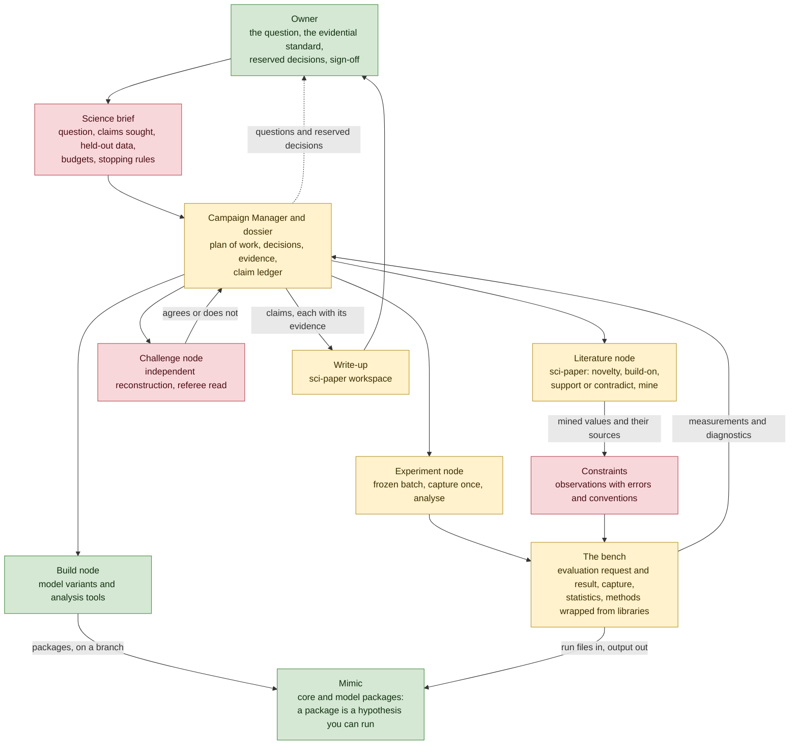

# Mimic Science Campaigns Map

**Status:** Direction brief, proposed 2026-11-10 and not adopted. It draws the goal the remaining pathway steps serve and the parts that goal needs, so each step can be judged against it. It decides nothing: the decisions under [Open Decisions and Explorations](#open-decisions-and-explorations) are the owner's, and the explorations listed there may redraw the map.

**Revised (2026-11-12):** [`AGENTIC-SCIENCE-ARCHITECTURE.md`](AGENTIC-SCIENCE-ARCHITECTURE.md) is now the working direction and wins where the two differ. Three things changed: the standard of evidence is a set of clauses in each brief; the coupled rate formulation's processing mode is built first, from an ordinary implementation plan; and the ladder of first campaigns is replaced by campaigns on the published models, which measure their numerics and then fork `sage16` onto the rate mode and recalibrate it to its published results. This map is kept for its gaps, its judging toolkit and its reasoning until that document's stage 3 consolidation.

**Date:** 2026-11-10

---

## Goal

**Write a brief containing a science question, and have a Campaign Manager answer it with Mimic in a long, mostly unattended campaign**: reading the literature, building analysis tools, constructing models and experiments, judging the results against the brief, iterating, and bringing the owner in where a decision is the owner's. The reference point is the sage26 import, which ran for five days largely alone. The difference is that an import has a reference answer and an open question does not.

---

## Summary

1. **The remaining steps are parts of one system.** The emulator ([step 6](MIMIC-EMULATOR-PLAN.md)), the model builder ([step 8](MIMIC-MODEL-BUILDER-PLAN.md)), a scientific toolkit and "science campaigns" reduce to one orchestration engine (campaign mode), one apparatus (Mimic), one set of instruments (called *the bench* here), one shared source of observational constraints, and one literature and writing tool (sci-paper). Campaign mode then takes three classes of brief: **port** (done, the sage26 import), **build** (a paper becomes a model package) and **investigate** (a question becomes supported or refuted claims).
2. **The largest gap is a definition of done.** Parity with a reference is an oracle. Campaign mode ends when every target passes, and an open question has no reference to pass against. The proposal is to make **claims** the unit of progress, each with a test declared before the runs of record, and to let a refutation close a target as surely as a confirmation. This may need no change to campaign mode's machinery, only a way of writing targets and one ledger in the dossier.
3. **A toolkit for fitting parameters is not a toolkit for judging ideas.** Experimental design, sensitivity analysis, optimisation, emulation and statistical inference answer "what matters", "what does the data exclude" and "where is the best fit". They leave out the questions that judge an idea: is the effect numerical, does the model predict data it was not tuned on, and is structure A better supported than B and why. The last is where Mimic's runtime modularity is an advantage: swapping a module in a run file is a controlled experiment.
4. **The emulator spike's lasting product is its evaluation boundary.** Its plan deliberately builds seams for future callers: a declared spec, a `design` stage and a `capture` stage with provenance. Every other method needs the same boundary; history matching is its first user.
5. **Mimic's speed changes what is worth building.** At about 2.4 s a run, eight processes complete roughly 11,000 runs an hour (the spike plan's measurement: 176 runs in 55.9 s). A Sobol analysis of the 14 continuous `sage16` parameters, about 16,000 runs, would take about an hour and a half by direct evaluation, and 10⁵ evaluations about nine hours (arithmetic from that measurement, not run). Emulation is an accelerator for when a run is too slow for the method.
6. **Numerical validity comes before any physical claim.** The spike plan records the shipped `sage16` 66% high in total z = 0 stellar mass against 1,000 fixed substeps, and the [coupled-rate brief](MIMIC-COUPLED-RATE-FORMULATION-PLAN.md) records that permuting the module list changes the answer.
7. **Little needs building, and each piece should be built by the first campaign that needs it.**

---

## The Map

Green exists, amber exists in part, red is missing.

| Part | Its job | Who owns its state | Status | What it still needs |
|---|---|---|---|---|
| **Science brief** | State the question, the claims sought, what counts as support, the held-out data, budgets and stopping rules | The owner; pinned in the dossier | Missing as a class of brief | A template beside the existing one, whose targets read "this claim is adjudicated to this standard" |
| **Campaign Manager and dossier** | Choose the next piece of work, commission it, judge the evidence | ai-agent-coder owns the machinery; the dossier owns the campaign's state | Built, and proven on the import | A claim ledger, and spend that is recorded |
| **Mimic** | Run specified physics deterministically, with provenance | This repository | Built | Nothing in the core. Its model packages are the hypotheses |
| **The bench** | Turn "this structure, these parameters, this fidelity" into observables with provenance; host the methods that consume them | Mimic, as `bench/mimic-bench/` beside `plot/` and `convert/` (decision 6, taken 2026-11-12) | Built: the evaluation boundary (spec, design or an external design, run files, capture with provenance, request hash and manifests, one statistic, one constraint) and history matching with emulators as its first method, moved from the spike's repository with the review's cleanup (2026-11-12) | A second method and a second statistic, each when a campaign asks |
| **Constraints** | One source for each observation: values, errors, conventions, selection | Mimic's plotting and model packages, since the figures must consume the same source | Missing: observation tables sit inline in figure code, and one is copied in three packages | Lifting to one source. The discrepancy budget and the calibrate or held-out role belong to each campaign's brief |
| **Literature and write-up** | Find what is known, mine comparison values, draft from evidence | sci-paper (`/Users/dcroton/Local/git-repos/sci-paper`) owns the technique; its workspace owns the manuscript | In development: the start, draft, literature and voice skills exist; critique, framing and finishing do not | Finishing, which the owner intends to do by writing the Mimic paper with it; then a written policy for a Campaign Manager acting in the author's role |
| **Compute** | Run thousands of evaluations and keep them findable | The bench (capture); the dossier (receipts) | Local only | A run registry, and later a queue for the HPC machine |
| **Owner** | Own the question, the standard of evidence and the final claims | The owner | Present | Stops placed where the science needs them (the import took 29 owner decisions, 12 on its first day) |

The model builder is not a box because its orchestration is campaign mode: it is the **build** class of brief, and an investigation will usually contain one (a new module, a variant package). Its requirements do not dissolve with it. A human-approved model specification, preserved ambiguities and tolerances validated against injected errors remain what a build brief must demand, and the bench supplies instruments for that science gate without discharging it.

The bench is a Mimic tool and not a general one. Its package is independent of the model (`sage16`, `sage26`) but not of the simulator: its `runfile`, `statistics` and `capture` modules write Mimic run files, launch the executable, verify each run from `RunProperties` and read output through `mimic-plot`'s own readers, while its design and analysis modules read only a spec and captured files. Another simulator would need its own capture stage, and none is a named consumer. The spike's separate repository was a decision for the spike (a fail would have left nothing to unpick in Mimic); at promotion the package moved into Mimic, where a change to the run-file format or the output schema breaks it in the same commit.

sci-paper is on its own track. Its design makes the author the verifier and forbids the tool from running analysis, which suits a campaign (experiment nodes run things; sci-paper reads what they wrote down), but its skills ask the author questions at about ten points and three of its seven planned skills are unbuilt. The first campaigns should depend on its literature skill only.

---

## What Is Missing, Ranked

Ranked by how badly an autonomous science campaign fails without each. The statements about campaign mode were read from ai-agent-coder's `skills/project-manager/references/campaign-mode.md` and its dossier template, and those about the import from the sage26 dossier's retrospective and post-campaign review.

1. **A definition of done for an open question.** Campaign mode merges nodes "until every target in the brief passes", and every node traces to a target. Three things are needed, and the first should be tried before any contract changes. **A target convention**: write each target as "claim X is adjudicated to standard S", so that supported, refuted and unresolved-with-reasons all pass it, and exploration hangs on a target as the import's two investigation nodes did. **A claim ledger** in the dossier: proposition, scope, rival explanations, the test declared in advance, evidence, and a status. **Stopping rules** in the brief other than success or exhausted budget. A ledger would also have helped the import, where tying 357 documented statements back to node records took most of the Campaign Manager's last day.
2. **Trustworthy comparison with data.** Observations live inline in figure code in three forms, only one of which carries an error. Without one declared source, with conventions and a held-out partition, an autonomous loop can adjust assumptions until anything agrees. The emulator brief names this as its crux (the discrepancy budget) and its gate item 2.
3. **Numerical validity before physical interpretation.** The spike plan records the time-step problem and chooses, reasonably for a test of a method, to run at the shipped setting. A science campaign cannot make that choice silently. Nothing yet asks, as a routine first step, whether an effect survives refinement in time step, mass resolution, volume or module order.
4. **The shared evaluation boundary.** Every method needs the same four records and none should invent its own: an evaluation request (structure, parameters, input, fidelity, seed policy, executable identity), an evaluation result (status, observables, units, selection, numerical and sampling uncertainty, cost, artefact hashes), a constraint, and an assessment (method, assumptions, diagnostics, a narrowly worded conclusion). The spike builds the first two for one statistic.
5. **An economical path for experiments.** The import spent about 103 plan-review rounds across 30 nodes, and in the first shakedown one 2 m 35 s measurement drew four plan-review rounds and ten child reviews. The contract is not the obstacle: a pinned runner may run an adaptive sampler, and a template may be reviewed once and instantiated with a substitution diff. Science needs that template path to be the normal way to run an experiment batch, because most experiments will be unproductive and each must be cheap.
6. **Compute and cost.** Spend was not recorded during the import. There is no registry across thousands of runs and no queue for the HPC machine. One trap is already known: inside the sandbox, Python's `ProcessPoolExecutor` fails on a semaphore-limit check while `multiprocessing.Pool` works. Local runs on mini-Millennium need nothing more than that.
7. **Independent challenge.** A second agent, on a different model, that reconstructs a consequential result from the captured data and not from the first agent's summary. Campaign mode has the closing audit; sci-paper's critique skill is planned and unbuilt.
8. **sci-paper as something a campaign can call.** A campaign's evidence reports can serve as its notes provided results are written down as tables, which its trace format already accepts. What is missing is a policy for who answers the author's questions.
9. **Memory across campaigns.** What one campaign learns about a model should reach the next, and the model builder brief already requires that promotion into shared knowledge be gated by the owner. Not needed for a first campaign.

---

## The Judging Toolkit

A list of methods (design, sensitivity, optimisation, emulation, inference) is better organised by the question being asked, because the question decides which methods apply and what would count as an answer.

| Rung | The question | Methods | Covered today by |
|---|---|---|---|
| **0. Verify** | Is this number physics or numerics? | Convergence in time step, resolution and volume; module-order permutation; conservation checks | One substep scan, recorded in the spike plan; the coupled-rate brief's measurement spike |
| **1. Screen** | Which parameters and processes matter for this observable? | Space-filling design, Morris screening, Sobol indices | Nothing |
| **2. Rule out** | What can the data exclude? Is the model well-posed? | History matching with a declared discrepancy; identifiability | The emulator brief |
| **3. Locate** | Where is the acceptable region, and how uncertain is it? | Optimisation (SAGEswarm), MCMC or nested sampling | SAGEswarm, outside this repository |
| **4. Predict** | Does it hold on data it was not tuned on? | Held-out observables and redshifts, predictive checks | Nothing |
| **5. Compare and attribute** | Is structure A better supported than B, and which change produced the difference? | Controlled ablation through run-file module swaps under one protocol; leave-one-out | The emulator brief's gate item 4, for surviving volume only; the import's first investigation node did an ablation by hand |

Two capabilities cut across the rungs. **Experimental design** is a service every rung calls. **Emulation** is an accelerator, worth its validation cost only when a run is too slow for the method in hand: large boxes, converged time steps at 16 to 37 s a run, clustering statistics, many parameters.

**What the field's record suggests** (from a literature survey made for this map, read from abstracts and not re-checked: verify each before citing it). The lasting results of semi-analytic calibration were verdicts on adequacy, and a best fit was a by-product. Henriques et al. (2009) ran MCMC on the Munich model and found no region of parameter space that reproduced the luminosity function's shape; Henriques et al. (2013) used the same machinery to show the reincorporation timescale had to change form. Lu et al. (2014) calibrated on one set of data, checked predictions on another, and concluded the model family failed. Mutch, Poole & Croton (2013) found that fitting two redshifts at once drove supernova feedback to its limits. Rodrigues, Vernon & Bower (2017) found that the local stellar mass function alone does not select models that match its evolution. Each is a rung 2, 4 or 5 result reached with rung 3 tools: they needed held-out data, an honest error budget and a willingness to report failure, not a new method.

**Where the emulator plan sits.** The brief is rung 2, with a reach into rung 5 through its structure-against-structure gate; the spike is narrower by design (one model, one statistic, one iteration). Three cautions follow. A surviving region measures compatibility under declared assumptions: it is not a posterior, not proof of identifiability (the brief notes that an unconstrained parameter barely moves it), and not an explanation. The spike leaves out outputs its emulator cannot validate, so a conclusion must say which constraints remained. And "an empty region is a result" holds only for the ranges explored at the fidelity run.

**Build, wrap, or leave to a node.** Permanent code is earned by a second real consumer, or by an operation where a silent mistake would change a conclusion. Either way it ships with a known-good and a known-bad control.

| Capability | Decision |
|---|---|
| Evaluation request and result, capture with hashes, run verification | **Build** (the spike does) |
| Statistics from output (mass functions, relations, clustering) | **Build** as named functions, one at a time as a campaign needs each; share with `mimic-plot` |
| Constraints | **Build** one source consumed by the figures and the bench |
| Convergence and conservation harness | **Build** small; model-specific invariants stay with the campaign |
| Sampling designs, sensitivity indices, optimisers, samplers, regressors, posterior diagnostics | **Wrap** a maintained library for each (candidates, with maintenance checked on 2026-11-10: `scipy.stats.qmc`, SALib, `scipy.optimize`, emcee, dynesty, UltraNest, scikit-learn, ArviZ); own only the adapter that preserves scales, seeds and the design's identity. pyswarms and scikit-optimize are unmaintained |
| History matching and its validation diagnostics | **Build** (a few hundred lines, as the emulator brief decided) on a wrapped regressor |
| Likelihoods and objectives | **Leave to the campaign** until one is defended and reused. No default likelihood |
| Ablation and attribution | **Leave to a node** under a plan: reruns and differencing |
| One-off plots and response curves | **Leave to a node** |

Every method returns the diagnostics proper to it with its result (a sampler its convergence and effective sample size, an emulator its held-out calibration, a sweep its fraction of failed runs), and a result without them is not evidence.

---

## What Replaces Parity

A reference port is gated by agreement with the reference. An open question is gated by these, most of which campaign mode or the spike plan already practise in another setting:

- **Claims, not fits, are the unit of progress**, and each carries its rivals and its scope. The import shows why scope matters: a cause was accepted on 27 of 106 population readings, and a further 352 of 882 bin readings outside that scope were examined only after the campaign closed.
- **Explore freely, confirm under a freeze.** A confirmatory batch fixes its selections, ranges, discrepancy, comparison and stopping rule before the runs of record, and exploratory runs are never reused as evidence. The spike plan already works this way: its 176-run probe is not evidence.
- **Instruments earn trust on controls**: pass a known-good case, fail a known-bad one, and for the important gates catch a planted defect (a unit error, a wrong selection, a non-converged run). This is campaign mode's rule and the model builder's.
- **Held-out data is excluded mechanically**, not by instruction. The import's instruction-only exclusion leaked once.
- **Independent reconstruction** of any result a claim rests on, from captured data, by a different model. The object audited is the artefacts (run files, logs, raw output), never the write-up.
- **One protocol for A and B.** A comparison of two structures gives each the same constraints and fidelity, and each search must show by its own diagnostics that it was adequate.
- **A negative or unresolved answer closes the target.** An agent under pressure to complete is the one most likely to invent a result.
- **The owner decides** the question, the evidential standard, the constraint set and its discrepancy budgets, anything that narrows what a claim reports, and what is promoted into shared knowledge. Routine experiments inside the brief run unattended.

---

## The Seven Principles, Extended

The principles of [`docs/VISION.md`](../VISION.md), carried to the whole system. This table is a proposal: `docs/VISION.md` owns Mimic's principles and changes only when implemented behaviour justifies it.

| Mimic principle | Extended to the whole system | The rule it implies |
|---|---|---|
| **1. Physics-agnostic core** | **Question-agnostic machinery.** The Campaign Manager, the evaluation boundary and Mimic's core know no particular science question or model | Everything specific to a question lives in the brief or a spec file. Code may name a kind of statistic; it never names a model, a parameter or a hypothesis |
| **2. Runtime modularity** | **Composable methods.** A campaign selects the instruments its question needs; there is no fixed calibration pipeline | A new combination of methods is a spec, as a new combination of modules is a run file. A new kind of method is tested code, as a cross-family model is a new package |
| **3. Metadata as structural truth** | **One declared source per scientific fact.** Constraints, conventions, priors and claims are declared once and consumed by figures, gates and reports alike | No number is retyped; a figure and an analysis cannot disagree about what an observation says |
| **4. One coherent processing model** | **One campaign loop.** Port, build and investigate share one lifecycle: claim, declared test, capture, assessment. One specification gives one result | No second orchestrator; every stochastic method is seeded and the seed recorded |
| **5. Bounded memory and explicit ownership** | **Bounded resources and named owners.** Every artefact has one owner and a retention rule; compute, spend and owner attention have budgets that are measured | Campaign state never enters a product repository; a budget that nothing measures is not a budget |
| **6. Format-agnostic I/O and reproducible output** | **Portable evidence.** Every number in a claim resolves to a run, a commit, a spec and a data hash, readable without the conversation that produced it | A claim that cannot be traced is withdrawn, not softened |
| **7. Validation and fast failure** | **Validate before inferring.** Controls before trust, pilots before production, numerics before physics | An invalid run stops the batch; a scientifically unwelcome result is kept |
| **8. (new) Evidence is not belief** | No fit, gate, emulator or reviewer verdict may by itself strengthen a claim, and whoever produces evidence does not judge it | Claims change status only through the ledger, on a test declared in advance |

Principles 4 and 5 extend by analogy and not literally. The eighth has no counterpart in Mimic because a simulator holds no beliefs; sci-paper states it as "the author is the gate" and campaign mode as "evidence, never narration".

---

## What It Would Change on the Road

Proposals, each waiting on a decision below. The [development pathway](MIMIC-DEVELOPMENT-PATHWAY.md) owns the order.

- **Step 6 is read as the bench's first slice** (decided 2026-11-12). The calibrated-variance spike ran exactly as planned and passed (2026-11-11), and the evaluation boundary (spec, capture, provenance) was promoted into Mimic as `bench/mimic-bench/` with the emulator as its first method. Further methods join one at a time as campaigns need them. The next work is the verify rung (the science shakedown, by direct evaluation on the bench) and the constraints source, before any refocusing wave. This is a shared boundary and not a platform: nothing more is hosted until a second method arrives.
- **Step 8's orchestration folds into campaign mode as the build class of brief**, with its requirements (traceability, human approval of the specification, honest calibration, injected-error validation of gates, protected memory) carried over as that brief's clauses. Its re-review is the place to decide this.
- **Campaign mode gains a science brief template and a claim ledger** in ai-agent-coder, tried first as a convention on existing targets and changed in contract only if a shakedown shows the convention is not enough.
- **The constraints source is a Mimic change outside the core** (plotting and model packages). The emulator brief's gate asks both that constraints be shared with the figures and that Mimic be unchanged, defining the latter as no core edit, processing mode or module ABI surface, so the two are compatible; it still needs its own plan.
- **Step 7's measurement spike is a candidate early science campaign.** It asks a question (how much of `sage16`'s answer is operator splitting and time step), it constructs its own reference (a coupled solution for the rate-shaped subset), and it needs no discrepancy budget.

**A ladder of first campaigns**, mirroring shakedown then import:

1. **A science shakedown with a held-out answer.** For example: does the stellar mass function's response to one feedback efficiency survive time-step refinement? One model, one box, direct evaluation, no emulator. It exercises literature, experiment, claim ledger, challenge and draft end to end, and it deliberately avoids the hard parts: no discrepancy budget to defend, no model to build, no open choice of direction.
2. **A bounded real question** with a published comparison. This is the first real test: it needs the constraints source, a defended discrepancy, held-out data and rungs 1 to 4.
3. **An open question** with a build inside it, needing rung 5 and the owner's judgement at the claim stage.

---

## Where It Is Most Likely to Fail

| Failure | Early signal |
|---|---|
| **The campaign optimises the gate and not the question** | Discrepancy budgets grow, awkward observables drop out, and the claims do not change |
| **Numerics are reported as physics** | A change in time step or volume moves the result by more than the claimed effect |
| **Process overwhelms experiment** | Plan-review time exceeds run time; small exploratory questions need owner exchanges |
| **A well-traced narrative is wrong** | Every claim has a source, but the source says something adjacent or opposite |
| **The question was too open** | The ledger grows in breadth and no claim reaches a declared test |
| **Early commitment** | The first hypothesis is still the only one after a refuting result; fixes are local and nothing is backtracked |
| **Missing data is quietly replaced** | A statistic appears for which no constraint was mined, or a sample is smaller than its source |

The import avoided the last two because parity left no room for them. An investigation has room.

---

## Next Steps

The work that would settle the open decisions soonest, in order. Each is small, and each is chosen for what it tells us and not for what it builds. The first, second and fourth are already on the road or planned; the map adds the third and gives the others a second purpose.

| # | Step | What it settles | What it needs first |
|---|---|---|---|
| **1** | **Run the step 6 spike as planned** (done: it ran and passed, 2026-11-11) | Whether history matching transfers to `sage16`, and what the evaluation boundary looks like once it exists as code (decision 2) | Nothing: its implementation plan was frozen (now archived as `archive/dev-plans/MIMIC-EMULATOR-IMPLEMENTATION-PLAN.md`) |
| **2** | **Hold step 8's re-review, with this map as an input** | Whether the model builder becomes the build class of brief, and what its science gate still owes (decision 1) | The import's retrospective and the post-campaign review's axis 1, both written |
| **3** | **Run a science shakedown** | Whether existing targets plus a claim ledger can express scientific completion (decision 3); what an experiment costs in review rounds against run time; whether a challenge node catches anything | The owner chooses a question with a held-out answer and writes the answer key; a science brief drafted on the existing template; `docs/dev/` excluded mechanically, since the spike plan records the time-step result |
| **4** | **Write the Mimic paper with sci-paper** | What the write-up leg can take from recorded evidence, and what its unbuilt skills must do | The owner's time; it is independent of the other steps |
| **5** | **Decide the constraints source and the second campaign** (the instruments' home was decided on 2026-11-12) | Decision 4, and the bounded real question that first tests the hard parts (a defended discrepancy, held-out data, a build) | The results of steps 1 to 3 |

Steps 1, 3 and 4 share nothing and can run alongside each other. Step 3 is the one that tests the map: if a shakedown with a known answer cannot be run to a clean, adjudicated claim, the rest of the map is premature.

---

## Open Decisions and Explorations

**Decisions, the owner's:**

1. Is "one engine, three classes of brief" the framing, with the model builder's orchestration folded in and its requirements kept?
2. Is step 6 read as the bench's first slice: the spike unchanged, the evaluation boundary promoted, the emulator its first method? **Decided yes (2026-11-12).**
3. Is scientific completion tried first through existing targets ("this claim is adjudicated") plus a claim ledger, before any change to campaign mode's contract?
4. Do observational constraints become one source in Mimic that its figures consume, with discrepancy budgets and held-out roles set in each campaign's brief?
5. Which question is the science shakedown, who writes its answer key, and what must the second campaign prove that the shakedown does not?
6. Where do the instruments live once the spike is promoted? **Decided (2026-11-12): inside Mimic, as `bench/mimic-bench/`.** The default was inside Mimic, beside `plot/` and `convert/`, as the other tools tied to Mimic are: the capture stage already imports `mimic-plot`'s readers, a change to the run-file format or the output schema would then break it in the same commit and not silently later, and the constraints it shares with the figures can only have one source if both are in one repository. A separate repository is right only if a second simulator becomes a named consumer, which would make it a different product with its own scope.

**Explorations whose results may redraw the map:**

- **The step 6 spike's verdict.** It ran and passed (2026-11-11). A pass supports history matching on `sage16`. A fail would have closed the emulator, and the evaluation boundary would then have needed another first consumer to justify itself.
- **Step 8's re-review**, from the import's retrospective. It may find that the build class needs more than a brief template.
- **A science shakedown.** It tests whether existing targets can express scientific completion; if they cannot, campaign mode's contract changes.
- **sci-paper on the Mimic paper.** Real use will show what the write-up leg can take from a campaign's evidence, and what a Campaign Manager can do in the author's place.
- **Step 7's measurement spike.** It sizes how much of a `sage16` result is numerical, which bounds what any science campaign on `sage16` can claim before the coupled-rate work lands.

---

## How This Was Produced

Written on 2026-11-10 from `docs/VISION.md`, the pathway, the emulator brief and its implementation plan, and the model builder brief, with surveys of ai-agent-coder's campaign mode and the sage26 dossier, of the sci-paper repository, and of the external literature and library landscape. An independent design read on a second model reached the same main conclusions before seeing this text and then checked a draft against the source documents; its corrections are taken, and its two standing challenges are recorded above as limits (the bench stays a boundary until a second method needs it, and the shakedown does not test the hard parts). Nothing here was tested by running Mimic.
